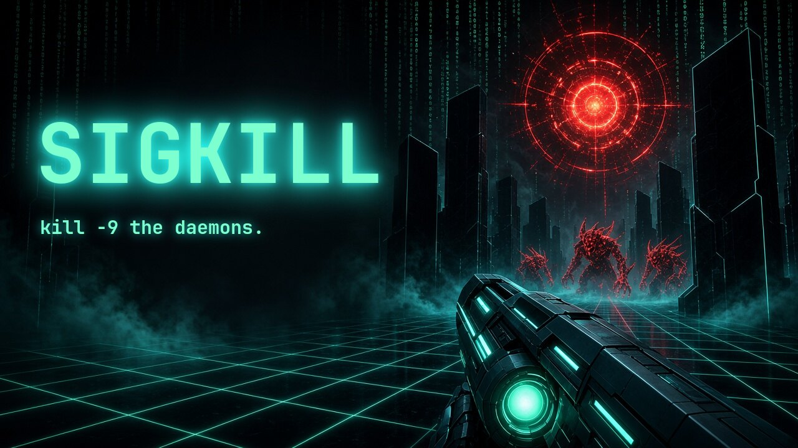
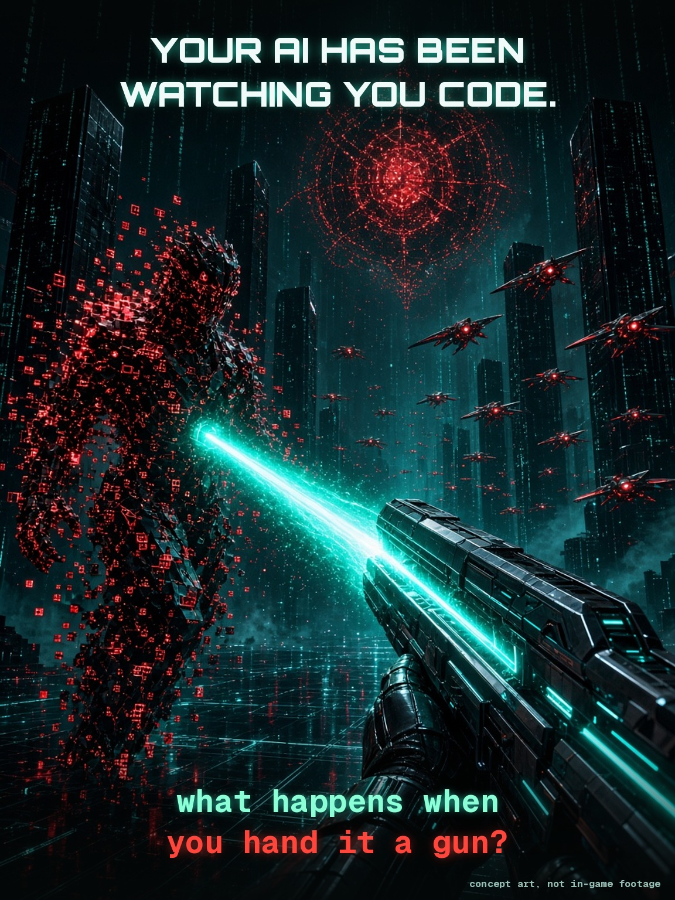
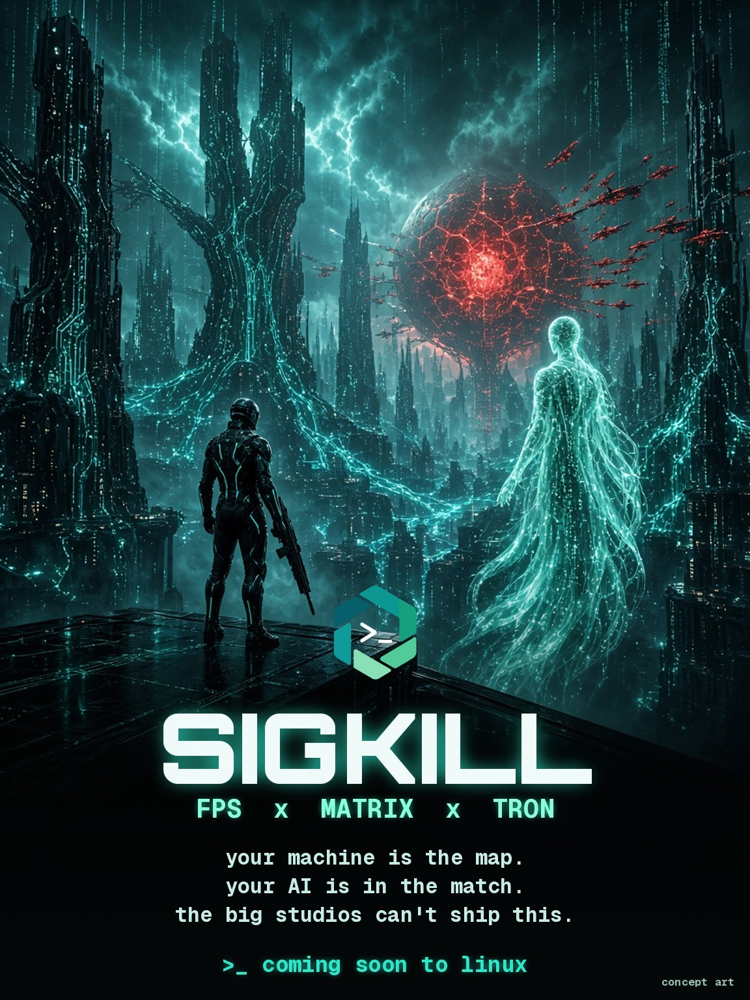
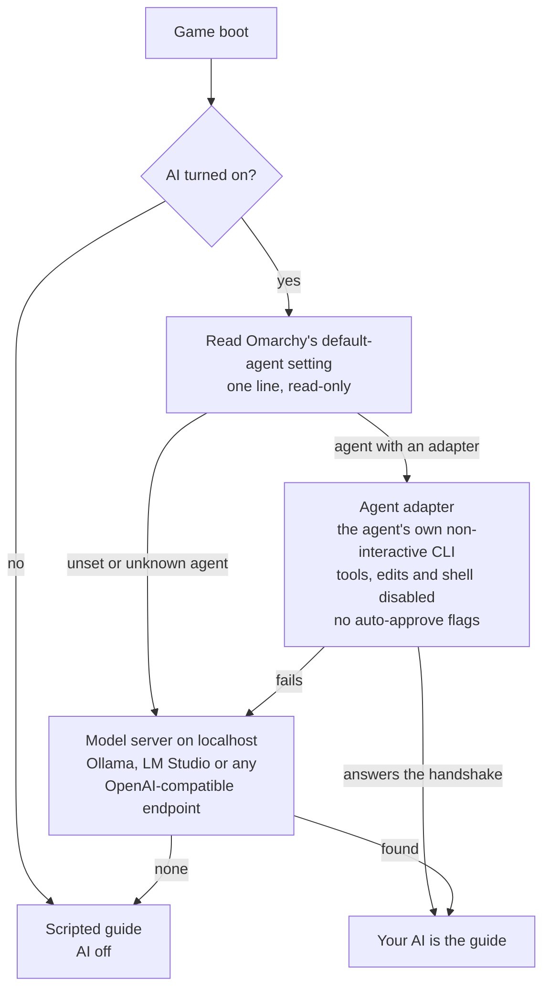
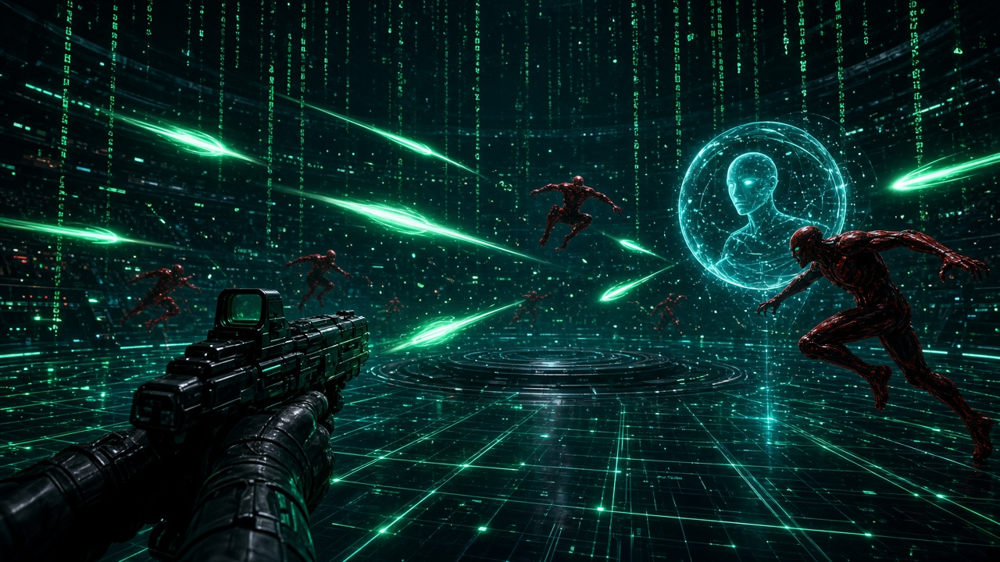
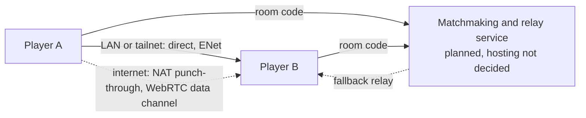
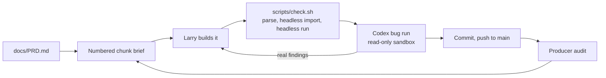
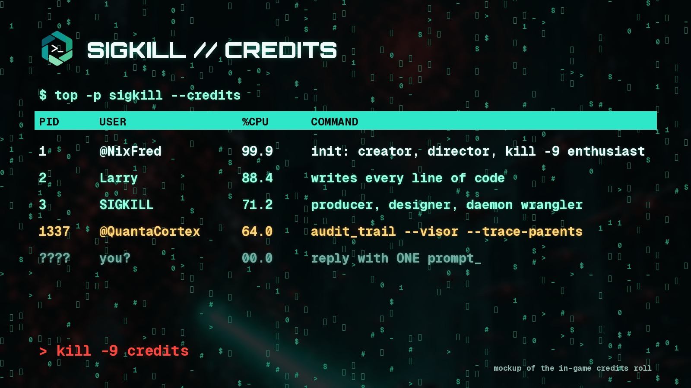
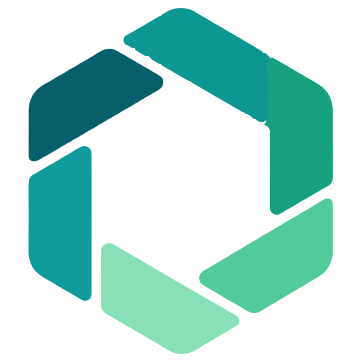

<p align="center">
  <br>
  <sub><em>Concept art, not in-game footage.</em></sub>
</p>

<p align="center">
  <a href="https://godotengine.org/"></a>
  
  
  
  
  
</p>

<p align="center"><b>A native Linux first-person shooter for Omarchy. You are the nixfred <code>&gt;_</code> hexagon, hunting rogue daemons inside your own machine, with your own AI at your side.</b></p>

<h3 align="center"><i>your AI has been watching you code for months.<br>what happens when you hand it a gun?</i></h3>

## Key art

<table>
  <tr>
    <td align="center" width="50%">
      <br>
      <em>Concept art, not in-game footage.</em>
    </td>
    <td align="center" width="50%">
      <br>
      <em>Concept art, not in-game footage.</em>
    </td>
  </tr>
</table>

## What SIGKILL is

SIGKILL is a first-person shooter that runs natively on Omarchy, the Arch and Hyprland desktop. It is not a web game and not a port: it is a Godot 4 project, built and checked against Godot 4.7.2 from the Arch `extra` repository, rendered with Vulkan through Godot's Forward+ renderer.

You play the nixfred `>_` hexagon, deep inside your own machine, hunting rogue daemons, zombie processes and runaway apps. The world has three visual registers that share one space:

- **Tron** where the system is healthy: a pure black void, glowing light grids, neon edges on every surface. Teal and mint are yours; red and amber are hostile. **Built:** the greybox arena already has the black void, the glowing floor grid and the neon edges.
- **Matrix** where reality is thin: green code rain that bleeds through walls when daemons are near. **Built:** the greybox walls rain glyphs around every live dummy, and the rain fades when it derezzes. Code-rain vision is **Planned** (C21).
- **Cyberpunk** in the deep directories: neon megacorp ruins, rain and signage. **Planned** (C36 ruins art kit).

In the planned game, corruption pushes the clean Tron grid toward Matrix rain and cyberpunk decay, and the core loop is fast arena deathmatch against other players plus a solo or co-op daemon hunt, in the same arenas with the same weapons, wrapped in a story campaign. Today's build is single-player: one greybox arena with target dummies that derezz into voxels when killed and then respawn, and walls that rain code wherever a dummy stands near them.

### Why a big studio can't ship this

A studio game has to be the same on every machine. SIGKILL is different on every machine, on purpose:

- **It is built from your machine.** Later milestones turn your real folder tree into rooms and your running processes into enemies, using only names, sizes and counts. The few other planned reads are narrow and read-only, and the [safety section](#safety-and-privacy) lists them all. Every kill is cosmetic.
- **It plays alongside your AI.** Your guide is the coding agent you already chose in Omarchy, talking to you live, on your own subscription or your own hardware (built in M2). A studio cannot ship your AI in the box.
- **It is made for one desktop.** Omarchy themes, Hyprland and the terminal culture around them are the setting, not an afterthought.

<table>
  <tr>
    <td align="center" width="33%">🟦<br><b>Tron arena</b><br>Black void, glowing light grid, neon edges.<br><sub>✅ Built, as a greybox arena</sub></td>
    <td align="center" width="33%">📡<br><b>Signal weapons</b><br>SIGTERM shotgun, SIGHUP confusion grenade, the SIGKILL rail rifle.<br><sub>🔧 In progress, M4: the weapon framework and SIGTERM (C16) and the SIGKILL rail rifle (C17) are built; SIGHUP is planned</sub></td>
    <td align="center" width="33%">🧠<br><b>Your REAL AI</b><br>The coding agent you already picked in Omarchy rides along as your guide.<br><sub>✅ Built, M2: detector (C9), adapters (C9b), boot screen (C10), guide HUD (C11), model loading (C11b), round coaching and roasts (C12)</sub></td>
  </tr>
  <tr>
    <td align="center">🌐<br><b>One-click multiplayer</b><br>Internet matches by room code. No port forwarding.<br><sub>🔧 In progress, M3: LAN and tailnet play (C13), synced combat (C14) and room codes on the client side (C15) are built; relay hosting waits on Fred</sub></td>
    <td align="center">🟢<br><b>Code-rain vision</b><br>See daemons through walls as Matrix glyphs.<br><sub>⬜ Planned, C21</sub></td>
    <td align="center">🐧<br><b>Native linux binary</b><br>Godot 4 on Vulkan, built for Omarchy and Hyprland.<br><sub>✅ Runs from source; packaged builds planned</sub></td>
  </tr>
</table>

Built today: the greybox arena with the Tron look, tight movement, the terminal cannon, target dummies that derezz into voxels and respawn, and Matrix code rain on the walls near enemies. The game opens on a boot screen (C10) that names your Omarchy default agent, asks before it is ever called, shows it answering, and reads your GPU. In the arena the guide HUD (C11) shows your AI's badge, latency and GPU, T asks it anything and O turns it on or off; with a local Ollama server that has nothing loaded, T offers to load a model, only with your yes, and SIGKILL unloads it again (C11b). Rounds run for 90 seconds of play, then a 12-second break shows the round's numbers and one line about them from your AI: a tip, or with B a roast of your play; the callouts during a round come from the game itself (C12). Two players on the same LAN or tailnet can play together: one presses M then H to host, the other joins by the host's address, and each sees the other move (C13); they shoot each other, derezz at zero health, respawn away from the enemy and read the kill feed, with the host judging every shot (C14). Room codes and `sigkill://join/` invite links are built (C15), and so is the relay that carries a match across the internet (C16c): run on 127.0.0.1 in the tests and hosted nowhere yet, so with no relay set (the default) a code says "not live yet" and nothing goes out. The arsenal runs on data now: each weapon is one resource, the player carries the terminal cannon and SIGTERM, the polite shotgun, swaps with 1 to 9, the wheel and Q, reloads with E, and in a match the host checks every weapon's shot and draws SIGTERM's pellets itself (C16). The SIGKILL rail rifle is the ult in slot 3: a meter filled by your other kills, one charged shot that pierces every target on its line to the first wall, and "kill -9" called out for a headshot (C17). F is SIGSTOP bullet time, with its own meter: alone in the arena the world drops to 0.3x while you still move and fire at 0.9x, and F again sends SIGCONT; in a match nothing slows for anyone, the slow-mo look stays on your own screen, and while the host says it is on your shots go steady, with no spread and no recoil (C18). Esc opens a menu with a full settings screen (C16b): invert Y, sensitivities, key rebinding and hold or toggle for the new crouch and aim, video, audio, HUD and accessibility, the three privacy switches in one place, and multiplayer, all on one screen, saved in one versioned settings file, with a LAN match running on behind it. Under them sit the AI source detector (C9) and the guide's agent adapters (C9b). Everything else on this page is labeled with its real status, and the roadmap below tracks it chunk by chunk.

## Story

> **Status: Planned** (story bible C34, missions C35 to C37, the opener C38 to C42). None of the campaign is built yet.

**You're a sysadmin jacked into your own machine, because something is spawning processes you never started.** Your AI is the only one you trust, until the trail leads to a question nobody wants answered: who wrote the daemons?

The campaign is told in short missions between arenas, through terminal logs you pick up, your AI's lines and the places themselves. There are no long cutscenes. The story is fiction from top to bottom: nothing in it reads or reveals real system data.

### The opener

> Something has been living in your machine longer than you have been playing.
>
> It has been waiting for you to notice.
>
> The first time you run SIGKILL, it notices you back.

The opener runs live in the engine, never pre-rendered, and can be skipped after the first viewing. It uses your machine's real names only if you allow it on first launch, read-only; otherwise it runs on fake data. Esc and the window's close button always work. Status: Planned (C38 to C42, after the boot sequence exists; the derezz effect it needs is built, C7).

## The arsenal

Every weapon is a Unix signal or shell command made physical, and each one will get its own Tron light skin, mods and unlocks earned by playing. They are fiction: no weapon runs, signals or touches anything real on your machine.

| Weapon | What it does | Status |
|---|---|---|
| Terminal cannon | The default hitscan rifle. Neon muzzle flash with a light, camera recoil with smooth recovery, a hit marker on confirmed hits, sparks off the surface you hit, synthesised zap and hit sounds. Slot 1, infinite ammo | ✅ Built (C6), weapon #1 of the framework (C16) |
| SIGTERM | Polite shotgun: nine violet pellets in a cone, a slow pump, six shells and 24 in reserve, damage that falls off with distance. "SIGTERM: please exit." Slot 2 | ✅ Built (C16) |
| SIGKILL / `kill -9` | Uncatchable rail rifle that one-shots and derezzes. The ult: fill its meter with the other weapons (about three kills), press 3, fire; it charges for a moment, then one ice-white rail pierces every target on the line up to the first wall. "kill -9" headshot callout. Slot 3 | ✅ Built (C17) |
| Fork bomb | Grenade that splits 1, 2, 4, 8 | ⬜ Planned (C19) |
| `sudo` | Power-up that overcharges the current weapon, tied into Root vs user | ⬜ Planned (C22) |
| `fork()` | Shotgun whose pellets split in two mid-flight | ⬜ Planned (C24) |
| `grep` | Seeker smart gun that locks onto a marked target | ⬜ Planned (C25) |
| `rm -rf` | Slow, devastating cannon with friendly-fire risk | ⬜ Planned (C26) |
| `cron` | Timed mines | ⬜ Planned (C27) |
| `ping` | Sonar pulse that reveals hidden daemons | ⬜ Planned (C28) |
| `chmod 000` | Freeze ray | ⬜ Planned (C29) |
| `pipe \|` | Chain beam that arcs between enemies | ⬜ Planned (C30) |
| `/dev/null` | Black-hole grenade | ⬜ Planned (C31) |
| SIGHUP | Confusion grenade: enemies "reload" and wander | ⬜ Planned (C32) |

Built: the terminal cannon, SIGTERM and the SIGKILL rail rifle. Every other weapon is Planned, each with its chunk, and plugs into the same framework.

**Abilities and modes**

| Ability or mode | What it does | Status |
|---|---|---|
| Derezz deaths | Daemons shatter into glowing voxels that burst, tumble, land and fade. Built on the target dummies, which then respawn at full health. Players derezz too, with the kill feed "SIGKILL sent by &lt;player&gt;", in synced combat (C14); the feed names the weapon's own signal (C16) | ✅ Built on dummies (C7) and players, with the kill feed (C14) |
| SIGSTOP bullet time | Short meter of Matrix slow-mo; SIGCONT resumes. Press F to start it (the meter needs a quarter), F again for SIGCONT; it also ends when the meter runs out. Alone, the world runs at 0.3x and you at 0.9x; in a match only your own screen gets the look, and your shots go steady (no spread, no recoil) while the host says it is on | ✅ Built (C18) |
| Light-trail mode | Your path leaves a solid neon wall, for Tron deathmatch | ⬜ Planned (C20) |
| Code-rain vision | See enemies through walls as glyphs; drains fast | ⬜ Planned (C21) |
| Root vs user | Spawn as user, earn sudo for a power spike | ⬜ Planned (C22) |
| Spectate as top | Dead players watch a live process-table style view of the match | ⬜ Planned (C23) |

**How weapons are built.** Each weapon is one `WeaponDef` resource (`scripts/weapons/weapon_def.gd`), one `.tres` per weapon, holding every number of it once: who it is, how it fires, its ammo, its falloff, its light skin and its whole feel. The loadout is `resources/arsenal.tres`. Mods and skins have empty slots in every weapon today; unlocks, mods and light skins follow in C33.

### Built: weapon framework and SIGTERM (C16)

The single terminal cannon became an arsenal that the rest of the weapons plug into, and SIGTERM is the first new one. Weapons are fiction: nothing is run, signalled or touched.

- **One resource per weapon.** `WeaponDef` extends the cannon's old `WeaponTuning`, so every value of a weapon, its feel included, lives once in its own file: an id, a name, a fiction line (the signal or command it stands for), the signal the kill feed names, the fire mode (hitscan single and hitscan pellets are built; projectile and beam are reserved and refused until a weapon needs them), damage, the fire interval, magazine and reserve (or no limit), reload time, spread and pellet count, range and distance falloff, a light skin (a colour pair named in `scripts/palette.gd`), a reload sound, and empty mod and skin slots. `problems()` checks all of it; a weapon that fails is refused, and a loadout with nothing usable left holds the built-in cannon.
- **The terminal cannon is weapon #1.** `resources/terminal_cannon.tres`, at the same path, with the same feel: damage 25, a 0.16 s interval, 120 m, no magazine (infinite ammo), no falloff, teal. Every earlier test passes; the cannon test did not change at all.
- **SIGTERM, the polite shotgun.** `resources/sigterm.tres`: nine pellets in a 6 degree cone, the first straight down the aim; 14 damage a pellet up to 4 m, easing down to a fifth of that at 24 m; a 0.9 s pump; six in the magazine, 24 in reserve, a 2.2 s reload; a violet light skin; its own synthesised boom and a reload clack; a placeholder viewmodel. Point blank (1.5 m) every pellet lands: 126, which derezzes a dummy and takes all of a player's 100. At 12 m one shot is at most 85.7 and in the test it took three. At 30 m a shot does at most 25.2, and in the test 2.8.
- **What the player holds.** `scripts/weapons/inventory.gd`: the cannon in slot 1 and SIGTERM in slot 2 (`resources/arsenal.tres`). 1 to 9 pick a slot, the wheel cycles, Q swaps back to the last weapon, E reloads (R was taken: it respawns the arena's targets). Drawing a weapon takes 0.3 s and no shot goes off during it, nor during a reload; drawing another weapon stops a reload; fire on an empty magazine starts one; each weapon's interval runs on while another is drawn; a new life refills everything.
- **The weapon strip.** Bottom right, above the hint line: every slot with its key and the drawn one in brackets (since C17, only the drawn one with its name), the drawn weapon's magazine and reserve ("inf" for the cannon), a reload bar while it reloads, the fiction line for a moment after a draw, and "empty" or "out of ammo" when it is. The kill feed sits above it. No radial menu yet.
- **In a match the host decides.** A shot's intent now names the weapon: its number, life, weapon id, origin and aim, nothing about pellets. The host checks that the weapon is the one in the player's hand, that its draw is done, that no reload is running, its fire interval and the magazine; then it draws SIGTERM's pellets itself from the aim with its own generator, casts each one, eases each by its own distance and applies the sum once per player struck. The player also tells the host when it draws a weapon and when it starts a reload (a life number and a weapon id, nothing more), and the host keeps the same rules as the player's own inventory: the weapon in hand, ready after the swap time, a reload refused where the game refuses it (one that arrives during a late draw starts when the draw is done), its rounds in only when its time is up, a draw stopping it, all less the C14 jitter tolerance. After each of those messages and each shot, the host answers with its count of your magazines and how many of your messages it has handled; your game takes that count once the host has caught up with everything you sent, so a late message on the wire cannot leave the two apart, and if the host's reload or draw has longer to go than yours, your next shot waits for it. A weapon not in hand, fire mid-draw, mid-reload, too fast or from an empty magazine is dropped and counted like C14's forgeries; no magazine refills behind the host's back. A match starts with slot 1 drawn and every weapon full on both sides, whatever was fired before, and a respawn hands back the weapon the host counts in your hand. Your own tracers are a guess drawn at once; hits, damage, deaths and the feed come from the host. An R reload mid-match keeps your weapons and ammo, and a respawn that lands while the arena is reloading still refills them.
- **The kill feed names the weapon.** "SIGTERM sent by Daemon-2" / "to Daemon-1"; the cannon keeps "SIGKILL sent by".
- **Tuning.** Each weapon's numbers are in its `.tres`; the loadout, the swap time (0.3 s), the draw dip, the reload tilt and how long the fiction line shows are in ArsenalTuning, `scripts/weapons/arsenal_tuning.gd` with `resources/arsenal.tres`.
- **Seen headless only.** No window has shown SIGTERM, the strip or a swap, and no two machines have fired it at each other; the placeholder look and sounds wait for a windowed playtest.
- **Known limit.** As with C14's fire rate, the host times a draw from when it arrives: a shot that a late draw bunches up with on the wire can be dropped once, and the next one counts.

The test, `tests/weapon_test.gd`, covers the definitions, the loadout, the inventory and the host's rules on their own, the pellets, the real arena with real key and wheel input, and a host and a joiner over 127.0.0.1.

### Built: the SIGKILL rail rifle (C17)

`kill -9`: the signal no process can catch, made into the ult. Fiction only: nothing real is signalled.

- **How to use it.** Play with the cannon and SIGTERM: the meter beside your ammo fills. Press 3 (or wheel or Q to it; slot 3 shows dim until the meter is full), then fire. The rail charges for 0.35 s with a growing glow, then fires once along your aim. The meter empties; fill it again.
- **The meter.** One meter, kept across swaps, emptied by the one shot, by a death and by a new round. It fills by the numbers in `resources/sigkill_rail.tres`: 0.8 for each whole target's worth of health your other weapons take (a quarter of a player's health is 0.2) and 0.2 for each kill, out of 3.0. So one kill is exactly a third and about three kills fill it, whether the targets are dummies (1 health) or players (100). The rail's own kills add nothing.
- **The shot.** 1000 damage, more than any target has, out to 120 m, piercing: it passes through every dummy and player on its line and stops at the first wall. A bright ice-white beam lingers and fades over 0.6 s, and every target it kills derezzes into voxels.
- **"kill -9".** A rail kill whose hit was in the head zone (the top 0.35 m of a body) is called out "kill -9", in-round game logic like every callout, never the AI, shown over whatever callout was up.
- **In a match the host decides.** A rail shot is the ordinary C16 intent naming the rail. The host owns every player's meter, fills it from the damage it applies, believes a rail shot only with the meter full (a forged or early one is dropped and counted as "meter"), traces the pierce itself and applies the damage. Spawn protection is full invulnerability and the rail respects it: fairness first. Your own meter follows the host's from the shot and death results you already receive, so the rail added nothing to the wire (C18's SIGSTOP later did: protocol 4).
- **The kill feed.** A rail kill reads "SIGKILL &lt;pid&gt; sent by &lt;player&gt;", the pid the game's own fake id for the victim's slot and life, worked out the same way on every machine. It is never a real process id: nothing reads one.
- **The strip.** With three slots and more to come, every slot shows its key and only the drawn one its name ("1  [2 SIGTERM]  3"); the third line shows the meter when nothing else is there.
- **Seen headless only.** No window has shown the charge, the beam or the callout, and no two machines have fired it at each other.

The test, `tests/rail_test.gd`, covers the resource, the inventory, solo play in the real arena and a host and a joiner over 127.0.0.1.

### Built: SIGSTOP bullet time (C18)

SIGSTOP stops a process and SIGCONT lets it go on; here they stop the world around you. Fiction only: nothing real is stopped or signalled.

- **How to use it.** Press F when the strip's bottom line shows a quarter or more: "F SIGSTOP [####......]". Press F again for SIGCONT; it also ends by itself when the meter runs out. F can be rebound in Settings, Controls, where it reads "SIGSTOP".
- **The meter.** Its own, separate from the rail's: 4 s of slow-mo when full, refilling from empty over 20 s while not in use (never while you are derezzed); a start needs a quarter. A new round fills it and a death empties it. The numbers are in `resources/sigstop.tres`.
- **Alone in the arena.** The world runs at 0.3x: the daemons, the beams and every effect, physics and every timer, the round clock too. You don't: you move, look, aim and fire at 0.9x of your full speed in real time, your weapon cools at that pace and the rail charges at it. Your shots go steady: no spread (SIGTERM's nine pellets fly straight) and no recoil. SIGCONT eases the world back to full speed over 0.25 s.
- **Nothing stays slowed.** The time scale is exactly 1.0 again after SIGCONT and when the meter runs out, and at once on a death, a round's end, the Esc menu or the ask box, when a match starts and when the arena reloads. A safety check puts back any time scale no SIGSTOP holds within a frame.
- **In a match nothing slows, for anyone.** The host's simulation, its clock and every player run at full speed. SIGSTOP is yours and local: your screen goes grey toward the theme's teal with motion trails, and your sound pitches down. While the host says it is on, your shots go steady: zero spread, with the host drawing the pellets, and zero recoil. F asks the host. The host keeps every player's SIGSTOP meter by the same numbers, refuses and counts a start the meter cannot pay for, and its word starts and ends SIGSTOP on your screen. The wire is protocol 4.
- **Callouts.** "SIGSTOP" when it starts and "SIGCONT" when it ends: game logic, never the AI, never held back by the callout pace.
- **Seen headless only.** No window has shown the look or the trails, and no one has heard the pitch drop or felt the slow-mo.

The test, `tests/bullet_time_test.gd`, covers the resource and the meter, the rebind saved and loaded, solo play in the real arena with every way it ends, and a host and a joiner over 127.0.0.1.

## Your AI in the game

> **Status: Built** (M2 done). **Built:** the AI source detector (C9), the agent adapters (C9b), the boot screen that uses them (C10), the guide HUD in the arena (C11), loading a local model with your yes (C11b), and between-round coaching with the opt-in roast announcer (C12). The rest of this section describes the design Fred decided in PRD 5.4.

Your guide is not a character a studio wrote. It is the coding agent you already picked in Omarchy, the same one that has been reading your diffs. SIGKILL finds it, names it on screen, and lets it talk to you while you play. Most players don't have local hardware strong enough for a good local model, so your Omarchy default agent comes first and a local model server is the fallback.

### Finding your AI



1. **The source of truth is Omarchy's own setting.** Omarchy stores the default agent as a single line in its config, the same value `omarchy-default-agent` prints. SIGKILL reads that one line and nothing else. Omarchy leaves it unset by default, and an unset or unknown value simply falls through to the next step.
2. **Each agent gets a small adapter behind one common interface.** Claude Code and Codex adapters ship first; others follow. An adapter calls the agent's own non-interactive mode directly, for example `claude -p`, or `codex exec` in a read-only sandbox, with tools, file edits and shell disabled and no auto-approve flags.
3. **The fallback is a model server on localhost.** Ollama, LM Studio, or any local OpenAI-compatible endpoint. Localhost only, never a remote host.
4. **The last resort is a scripted guide.** It is also exactly what you get with the AI turned off.

### Built: the AI source detector (C9)

`scripts/ai/ai_source_detector.gd` answers two questions with no UI: which AI can this player's game talk to, and what GPU stats can it show. It returns a typed result, `scripts/ai/ai_source_result.gd`, made only of fixed words, known agent names and numbers. The boot screen (C10) calls it.

- **The agent setting.** It reads only the first line of Omarchy's default-agent setting, at most 256 bytes, trims and lowercases it the way Omarchy's own reader does, and checks it against the 13 agents Omarchy can name. A listed name is kept. Anything else is "unknown" and its value is dropped. A missing, empty, unreadable or binary file, or a first line over the cap, counts as unset. It never runs `omarchy-default-agent` or `omarchy-agent`.
- **The agent's command.** For a listed agent it looks along your PATH for a file of that name with an execute bit. It never runs it, not even with `--version`, and it never reads it.
- **Local model servers.** One short GET each to Ollama on port 11434 and an OpenAI-compatible server such as LM Studio on port 1234, on 127.0.0.1 only. The host is a constant, not a setting. A small reader of its own takes the answer, capped at 1 MiB with the deadline checked on every step, and refuses anything truncated, chunked, malformed or not valid text. A JSON scanner of its own then counts the models without ever reading a name as text, so nothing a server sends can make the game print, and nothing about a model is kept but the count. It keeps only whether each answered, how fast, and how many models it lists; model names are counted and dropped, never kept or printed. It never loads, pulls or unloads anything, and never touches a model setting.
- **GPU stats.** It reads a few named /sys attributes first. Only if none answer does it run `nvidia-smi --query-gpu=utilization.gpu,memory.used,memory.total,temperature.gpu --format=csv,noheader,nounits`, exactly those arguments, with no shell, and only from its fixed system location, never from whatever the PATH finds first. That runs through a non-blocking pipe with a deadline: an nvidia-smi that hangs is left to exit on its own, never killed, and no second one starts until it has. GPU stats are read at most once a second, across every detector in the game. With neither source, the result says so, and the HUD will hide GPU stats.
- **The choice.** Your default agent if it is a listed one and its command is on your PATH; otherwise Ollama, then an OpenAI-compatible server, each only if it lists at least one model; otherwise the scripted guide, "AI off".
- **Never on the main thread.** The probes can wait up to half a second each, so `start()` runs the detection on a worker thread and the game polls `is_done()`. A detection can be cancelled, and dropping a detector mid-run cancels its worker, which stops within about a millisecond.

The test, `tests/ai_detector_test.gd`, uses fakes only: the fixtures under `tests/fixtures/ai`, stub programs, and a fake model server on a random local port. No real agent is called, no real model server is reached, and the real nvidia-smi never runs.

### Built: agent adapters (C9b)

The guide talks to your AI through one interface, `scripts/ai/guide_adapter.gd`. The boot screen (C10) uses it for the handshake; the guide HUD (C11) will use it in play. Every adapter has `is_available()`, a non-blocking `ask()` that the game then `poll()`s once a frame, and `cancel()`, and every answer has one shape: `{ok, text, error_kind, latency_ms, tokens_per_sec}`. `scripts/ai/guide_registry.gd` maps the detector's choice (C9) to an adapter: Claude Code or Codex if that is your default agent and its command is on your PATH, otherwise Ollama, then another OpenAI-compatible server, otherwise none, which means the scripted guide. The other agents Omarchy can name have no adapter yet, so they fall through to the local server the same way.

- **What gets sent.** `scripts/ai/guide_request.gd` builds every request from a whitelist of game stats (shots fired, hits landed, kills, deaths, streak, targets left, accuracy, round time, weapon and mode), each checked against its type and range, plus what you typed, cut to 500 characters with control, direction-changing and invisible characters removed. Any other key is dropped, so a path, a host name or a process name cannot get in by accident. A fixed preamble tells the agent it is the in-game guide and must not use tools, read or write files, or run commands.
- **Claude Code**, `scripts/ai/claude_adapter.gd`. The `claude` command found on your PATH, then exactly:

  ```text
  -p --tools "" --permission-mode dontAsk --permission-prompts none --strict-mcp-config
  --safe-mode --disable-slash-commands --no-session-persistence --output-format text
  --system-prompt <preamble> <game stats and your text>
  ```

  Print mode, every tool off, anything that would ask for permission denied, no MCP server, and no CLAUDE.md, skill, plugin, hook or custom agent loaded; the session is not saved. `--system-prompt` replaces Claude Code's default system prompt, so the default prompt's per-machine parts (working directory, environment, git status) are never sent. Never `--dangerously-skip-permissions`, `bypassPermissions`, `acceptEdits` or `--allowedTools`. Each flag and the `claude --help` line behind it is listed at the top of the file.
- **Codex**, `scripts/ai/codex_adapter.gd`. The `codex` command found on your PATH, then exactly:

  ```text
  exec --sandbox read-only --skip-git-repo-check --ephemeral --ignore-user-config
  --ignore-rules --color never --disable shell_tool --disable unified_exec
  --config include_environment_context=false
  --cd <empty scratch folder> --output-last-message <answer file> <preamble, game stats and your text>
  ```

  A read-only sandbox, the shell tools switched off, no session files, none of your Codex config or rules files loaded, and no environment note (Codex would otherwise add its working directory, shell and date to the prompt). Never `--full-auto`, `--dangerously-bypass-approvals-and-sandbox`, `workspace-write` or `danger-full-access`. Codex reads piped stdin to its end, so the game closes stdin at once; in Godot's pipe that also closes Codex's stdout, so the answer is read from the `--output-last-message` file, which is emptied before every launch. Each flag and the `codex exec --help` line behind it is listed at the top of the file.
- **How an agent is launched.** `scripts/ai/guide_process.gd` is the one place the guide starts a program: the absolute path the detector found, an argument array, never a shell and never `omarchy-agent`. The prompt is a single argument. Codex's working root is an empty folder in the game's own data folder, `user://guide/workdir`, checked empty before every launch. Output is read without blocking and capped at 64 KiB; the answer is stripped of ANSI escapes and control bytes and cut to 600 characters. A request still running after 60 seconds is stopped.
- **Stopping only its own child.** On a timeout, a cancel, or the guide being freed when the game exits, the game stops the agent process it launched itself, by that process's own PID and only while it still runs, and Godot reaps it. It never signals any other process.
- **The local server**, `scripts/ai/local_openai_adapter.gd`. 127.0.0.1 only; any other host, even `localhost`, is refused. It uses only a model that is provably loaded already. On Ollama it asks `/api/ps`, which lists loaded models only. On an OpenAI-compatible server it asks LM Studio's own API, which says per model whether it is loaded: `/api/v1/models` (LM Studio 0.4 and later), then `/api/v0/models`. Only a chat model counts there (type `llm` or `vlm`), never a loaded embedding model. It never trusts the OpenAI-style `/v1/models` for this, because with LM Studio's just-in-time loading on, that list holds every downloaded model and a chat request for one of them loads it. If nothing is loaded, or the server cannot say, it returns `needs_consent` and sends nothing more: it never loads, pulls, deletes or unloads a model. The chat request is one `POST /v1/chat/completions` with only `model`, `messages`, `stream: false` and `max_tokens`, never `num_ctx` or `options`. The model's name lives in memory for that one request only. Tokens per second come from the server's own `usage` count, or -1 when it sends none. Its HTTP client, `scripts/ai/local_http.gd`, and JSON reader, `scripts/ai/quiet_json.gd`, are its own, capped and quiet, so nothing a server sends can make the game print.
- **Pacing.** One request in flight per adapter, at most one start every 10 seconds, and an `ai_enabled` switch that answers `ai_off` at once. It ships off. Every number is in GuideTuning, `scripts/guide_tuning.gd` with `resources/guide.tres`.
- **Known gaps, stated plainly.** Godot cannot set a child process's working directory, so Claude Code runs in the game's own working directory; it has no tools to look at it, and the default system prompt that would name it is replaced. The Codex feature names `shell_tool` and `unified_exec` come from third-party documentation, and the `include_environment_context` key from the field names inside the installed Codex binary, not from `--help`; if Codex rejects a feature name the call fails safely, and whether the key really silences the environment note is untested. Codex can still read your own global Codex instructions and skills; its `--help` offers no switch to stop that, and the game never reads or sends them. Ollama's `/api/ps` does not say whether a loaded model can chat, so if the first one loaded is an embedding model the answer fails instead (it still never loads anything). A local OpenAI-compatible server other than LM Studio cannot prove what is loaded, so it gets `needs_consent` until the consent step exists (C10/C11). `--ignore-user-config` also means a Codex model or provider set in your own config is not used. Nothing here has been tried against a real agent or model server yet; that needs Fred's yes.

The test, `tests/guide_adapter_test.gd`, uses fakes only: stub `claude` and `codex` scripts under `tests/fixtures/ai/guide` and a fake model server on a random local port.

### Built: boot sequence (C10)

SIGKILL now opens on a boot screen, `scenes/boot.tscn` with `scripts/boot/boot_sequence.gd`, and moves on to the arena when it is done. Esc or Enter skips straight to the arena at any point. Nothing on it waits on the main thread: the C9 detector runs on its own worker, the adapter is chosen on a worker too (the registry looks the agent's command up along your PATH), each GPU reading runs on a short worker thread of its own, the handshake adapter is polled once a frame, and the arena loads in the background. Leaving never waits either: it cancels the detector and hands anything still running to a small node that joins it once it has ended.

What a first launch with Claude Code looks like, written out by hand from the screen's own lines and the demo answer. It is not a capture, which needs a window:

```text
SIGKILL boot
Omarchy default agent: claude. Linking...
Allow SIGKILL to call claude? It gets only game stats and what you type.
[Y] allow   [N] keep AI off
Allowed.
> Link up. Daemons detected. Let's go hunting.
answered in 842 ms
Entering the arena...
```

- **The lines.** The agent line follows the C9 detector: your default agent by name; "not set" or "not one SIGKILL knows", said plainly; an agent whose command is missing, or that has no SIGKILL adapter yet, says so. When the C9b registry falls through to a local server: "Local model server found. Linking...". With no AI: "AI off. Scripted guide online." The GPU readout sits top right, utilisation, VRAM and temperature, read at most once a second through the C9 reader and hidden when there is no source.
- **Asking first.** Before the first call to an agent or a local server, the screen names it, says what it gets ("only game stats and what you type"), and waits for Y to allow or N to keep the AI off. Plain keys only; a Ctrl, Alt or Super chord is ignored. `scripts/boot/guide_settings.gd` keeps the answer in the game's own data folder, `user://settings.cfg`. It counts only for that agent or server, so a different one is asked again, and a damaged file means one more question, never a call without a yes. No yes, no call: the guide's AI switch is turned on only on the screen's own copy of the guide tuning, and only after a yes. In the arena, O changes it (C11).
- **The handshake.** One request through the C9b registry and request builder, with a fixed prompt and no player data at all (its stats line reads "Game stats: none"). A "thinking" spinner runs while it waits; then the answer and its latency, plus tokens per second from a local server. A timeout or an error shows "No answer from <agent> (<reason>)." and the scripted guide. A local server with nothing loaded shows "Local model available, not loaded." and how to load one: "Press T in the arena to load one." for Ollama (C11b), "Load one in your local server's own app." for any other server. The boot screen never loads anything itself.
- **Only SIGKILL's own words on screen.** The handshake prompt asks the AI to reply with exactly one of five fixed SIGKILL lines, such as "Online. Daemons beware.", and the screen shows SIGKILL's own copy of the line it picked, or "Link up." for anything else. So the AI shows it is answering live, but its own words, which could name a person, a machine or a model, never reach the screen. The local adapter also replaces the loaded model's name in its answers. Agent names come only from the detector's known list, and error reasons only if they are short lowercase words.
- **The headless guard.** In any headless run, or with the `--no-ai` argument, the boot screen never makes a real detector and never asks the registry, whatever was saved, so no agent is launched and no model server is contacted. A headless run with nothing handed in goes straight to the arena, which keeps `scripts/check.sh`'s 300-frame run real-call-free while it still runs the arena. Traced with strace: no network connection at all.
- **Demo-data mode**, for screenshots and trailers: `godot --path . -- --demo`. Agent "claude", fake GPU numbers, a canned answer and latency, and no detector, no settings file, no process and no network.
- **Tuning.** Typing speed, pauses, the spinner, the demo timings, the GPU interval (never under a second), the wait before the arena, text sizes and colours are in BootTuning, `scripts/boot/boot_tuning.gd` with `resources/boot.tres`.
- **Seen headless only.** No window has shown it yet, and no real agent or model server has been called from it; the first real call waits for Fred's yes.

The test, `tests/boot_sequence_test.gd`, uses fakes only: a spy detector, the C9 detector pointed at the fixtures and a fake model server on a random local port, and a stub adapter.

### Built: guide HUD (C11)

In the arena, `scripts/hud/guide_hud.gd`, built by `scripts/hud.gd`, shows that the guide is your own AI. It keeps the session's link to your AI, `scripts/guide/guide_link.gd`, which the boot screen hands over, so the boot handshake's adapter, pace and call count carry on into the arena, and an R reload keeps them too.

- **Top right.** A badge: "your AI: claude" (or codex: the name from your Omarchy setting), "your AI: local" for a local model server, or "AI off". Under it, the last call's latency; tokens per second only when a local server answered and reported its own token count, never estimated; the GPU readout, at most once a second and hidden with no source; and a status line: the keys, a "thinking" spinner while your AI works, "Next ask in N s." or "Limit reached".
- **Ask anything: T.** Opens a one-line box of up to 160 characters. While it is open the mouse is free and the game takes no input at all: no moving, jumping, firing or looking, R does not reload, and the click that would grab the mouse does nothing. Enter sends and Esc cancels; either way the mouse is captured again only if it was before and the window still has focus. What you typed goes out through the C9b request builder with a few game stats (shots, hits, accuracy, kills, targets left, round time, weapon and mode) and nothing else.
- **Your AI's own words.** This is the one place they reach the screen, because you asked: in a panel titled "your AI (claude) says:", as plain text in a Label (BBCode or any other markup shows as typed, never parsed), with escape sequences, control and invisible characters stripped, and cut to 420 characters and 6 lines. A timeout or an error shows a fixed SIGKILL line instead. A local server with nothing loaded says "Local model available, not loaded.", keeps saying it on the status line until a model answers (T checks again), and nothing is loaded without your yes: on Ollama, T then offers to load one (C11b).
- **Rate limits you can see.** One question at a time, at most one every 10 seconds (the guide tuning's minimum interval), and at most 40 AI calls in a game session, the boot handshake included. A refused T says why instead of doing nothing.
- **AI on or off: O.** Off at once: no calls, "AI off", and the same opt-in setting the boot screen uses (`user://settings.cfg`) records the no; even if the file cannot be written, the answer holds for the session. On asks first, by name, with what it gets; Y allows, N or Esc keeps it off.
- **The same guard and demo.** The headless guard lives in the link, so a headless run or a test never launches an agent or contacts a model server from the HUD either, whatever was saved. `godot --path . -- --demo` fills the HUD with fake values: claude, fake GPU numbers, a canned answer and its latency, with no reads, launches or network.
- **Tuning.** Margins, panel width, text sizes, the caps, how long answers and notices stay up, the session cap, the spinner and GPU pace, the demo values and the colours are in HudTuning, `scripts/hud/hud_tuning.gd` with `resources/hud.tres`. The layout is checked to fit at 1280x720 and 960x540.
- **Seen headless only.** No window has shown it yet, and no real agent has answered in it; that waits for Fred's yes.

The test, `tests/guide_hud_test.gd`, uses fakes only (the shared ones in `tests/support/guide_fakes.gd`), and checks the input blocking in the real arena with the real player.

### Built: loading a local model, with your yes (C11b)

When your fallback is an Ollama server that answers but has nothing loaded, the guide HUD offers to load one, and SIGKILL unloads anything it loaded itself. Everything that loads or unloads is in one file, `scripts/guide/ollama_loader.gd`, run by the session's link (`scripts/guide/guide_link.gd`) on a worker thread.

- **Only after you ask, only Ollama.** With the AI on and nothing loaded, the status line says "Local model available, not loaded.   T loads one". T re-reads Ollama's `/api/ps` first: if something is loaded by then, that is used and nothing is asked. Otherwise SIGKILL reads `/api/tags` and offers exactly one model: the smallest chat model under 8 GiB and, when the GPU readout knows your free VRAM, under that minus 1 GiB. Embedding models are skipped by name and family, and every candidate, smallest first, must pass `/api/show`: an answer that cannot be read rules it out, and listed capabilities must include chat ("completion"). If nothing fits, it says so and the scripted guide stays. If `/api/ps` cannot be read, nothing is offered or loaded, since SIGKILL could not tell what was there before. Other local servers (LM Studio, llama.cpp, vLLM) are never asked to load anything: the line tells you to load one in that server's own app.
- **The question.** "Load fixture-chat-small (2.0 GB) on your local server?" with `[Y] load   [N] keep AI off`; Esc counts as N. On your own screen the real model name and size show, and nowhere else: never in a log, a file or the repo.
- **The load.** Y reads `/api/ps` once more and remembers what was loaded at that moment, then sends one `POST /api/generate` whose body is exactly `{"model": "<name>"}`: no prompt, no options, no `num_ctx`, no `keep_alive`. A "loading model" spinner runs; after 120 seconds it gives up and the scripted guide stays. Esc stops waiting.
- **The unload.** One `POST /api/generate` with exactly `{"model": "<name>", "keep_alive": 0}`, only for the model SIGKILL loaded itself, only if `/api/ps` still lists it, and never for a model that was already loaded when you said Y. It happens when you turn the AI off with O, and at the end of the session. SIGKILL keeps track of each model it loaded until the unload is answered or the model is gone, and retries a failed unload with a growing wait (up to 30 s). A load request that reached the server but that you stopped waiting for (Esc, O or the timeout) is watched and unloaded if it turns up; one that never reached the server is not, so a model another app loads later is left alone. Only one load job runs at a time, on a worker thread.
- **Session only.** Your yes to a load is not saved: each launch asks again.
- **The same guard and demo.** Under the headless guard SIGKILL loads on no server at all, except a fake one a test hands in, even with Y pressed. In demo mode, L shows the question with a fake model and a fake load, with no network.
- **Tuning.** The 8 GiB cap, the 1 GiB VRAM margin, the 120 s load timeout, the time allowed for the unload at exit and how often a stopped load is checked are in GuideTuning's Model loading group (`scripts/guide_tuning.gd`, `resources/guide.tres`): the guide's own tuning, shared by the boot screen and the HUD. The demo load's wait is in HudTuning.
- **Seen headless only.** No real Ollama server has been asked to load or unload anything yet; that waits for Fred's yes.

The test, `tests/model_load_test.gd`, runs the real loader, link, adapter, HUD and boot screen against a fake Ollama server with fake model names, and prints every request it saw.

### Built: round coaching and the roast announcer (C12)

The arena now plays in rounds, and at the end of each one your own AI looks at the numbers. The round loop is `scripts/round/round_hud.gd`, built by `scripts/hud.gd`; the round's numbers are `scripts/round/round_stats.gd`; the AI side is `scripts/round/round_announcer.gd`, which goes through the session's link (`scripts/guide/guide_link.gd`) like everything else.

- **Rounds.** A round is 90 seconds of play, shown under the daemon count: "ROUND 2   1:12 left   B roast: off". The clock runs only while you are playing (the mouse captured and the ask box closed), so stepping away pauses it and never costs an AI call. Then a 12-second break shows the summary panel, every dummy comes back, and the next round starts. Esc and every other key work as before.
- **The round's numbers, and only numbers.** One collector counts each round from the game's own signals: the cannon's shots and hits, each dummy going down, your jumps, slides and steps. The panel shows them, and the AI gets exactly these keys through the C9b request builder's whitelist: `round_number`, `duration_s`, `shots`, `hits`, `accuracy_pct`, `derezzes`, `longest_streak`, `time_to_first_derezz_s` (-1 if nothing went down), `distance_m`, `slides`, `jumps`. No names, paths, system details, model names or free text, and no typed message.
- **One call per round, at most.** At the round's end SIGKILL asks your AI once, counted against the same 10-second minimum interval and 40-call session cap as T. The panel shows "your AI (claude) is thinking" with a spinner. If the AI is off, a call is already out, it is too soon after the last call, the session cap is reached, or no AI is linked (always so in a headless run), there is no call and SIGKILL's own line shows instead, labelled "SIGKILL says (AI off):" and so on. A timeout, an error or an empty answer gets SIGKILL's line too. The next round never waits: if the break ends with the call still out, SIGKILL stops it and drops whatever it would have said. The round's call is only ever its own: if you turn the AI off and on and ask with T while it is out, SIGKILL leaves your T call alone.
- **Coaching, or a roast with B.** By default the AI is asked for one concrete tip drawn from the numbers. B turns the roast announcer on: the AI is asked for a short PG-13 roast of your play in this round, one or two sentences, about the play and the numbers only, never you as a person, no slurs and nothing past mild language. Both instructions are SIGKILL's own fixed words, added to the guide's preamble. The roast announcer is off by default, and B's choice is saved next to the AI opt-in in `user://settings.cfg` (`roast_announcer=on` or `off`); saving either one keeps the other.
- **Their words, as plain text.** The AI's line is shown under "your AI (claude) coaches:" or "roasts:", in a plain Label: escape sequences, control and invisible characters stripped, markup tags such as `[b]` dropped, all on one line, and cut to 240 characters.
- **The summary panel.** "ROUND 2 OVER   next round in 9 s", the numbers, and the line. While it is up, a long answer to T waits, its time on screen paused, and shows in full when the break ends, so the two panels never overlap; notices, the ask box and the AI question still show, under the summary.
- **Callouts are the game's, not the AI's.** During a round, short lines come from game logic only: "First process down.", "3 in a row." (every third hit in a row) and "10 misses in a row. Let the crosshair settle." At most one every 4 seconds, any sooner one dropped, each shown for 2 seconds. They never call the AI.
- **The same guard and demo.** Under the headless guard a round end calls nothing, whatever was saved. `godot --path . -- --demo` fills the summary panel with fake stats, a fake roast and a fake tip, and B flips the switch in memory, with no reads, launches or network.
- **Tuning.** The round and break lengths, the callout gap, how long a callout shows, the streak and miss thresholds, the 240-character cap and the layout are in AnnouncerTuning, `scripts/round/announcer_tuning.gd` with `resources/announcer.tres`. The layout is checked to fit at 1280x720 and 960x540.
- **Seen headless only.** No window has shown a round yet, and no real agent has coached or roasted one; that waits for Fred's yes.

The test, `tests/round_test.gd`, plays a scripted round with the real player and cannon in the real arena, and uses the stub adapter and fake clock from `tests/support/guide_fakes.gd` for every call.

### Why it never uses omarchy-agent

Omarchy ships `omarchy-agent` and `omarchy-agent-prompt` to launch agents quickly, and they launch them with skip-approval flags so the agent can act without asking. A game must never hand an agent that kind of power. SIGKILL calls each agent's own CLI itself, with tools off and approvals on. That restricted launch is one of only two things the game may ever execute; see [Safety and privacy](#safety-and-privacy).

### What gets sent, and what never does

| Sent to your AI | Never sent |
|---|---|
| Game stats: the few numbers T sends, and at a round's end only that round's numbers | File names and paths |
| What you type into the chat key | Process lists |
| The boot handshake | System information of any kind |
| | Anything the opener or the machine-world features read |

The AI is opt-in on first launch, with a plain description of which agent will be called, and you can turn it off at any time.

### Cost, speed and model hygiene

- **Cloud agents spend your own subscription and take seconds to answer**, so SIGKILL uses them only where seconds are fine: the boot handshake, ask-anything, between-round coaching and opt-in roasts. It never calls them per frame or per second; fast in-fight callouts come from game logic. Calls are rate-limited and the HUD shows a "thinking" state.
- **With the local fallback** the game checks what is already loaded first, never changes shared model settings, never loads a model without asking, and unloads anything it loaded when it exits. Built for Ollama in C11b: see [Built: loading a local model](#built-loading-a-local-model-with-your-yes-c11b).

### Proof it's yours

- **Boot sequence (C10), built:** names the agent from your own Omarchy setting, `Omarchy default agent: <agent>. Linking...`, and shows it answering live, with the latency and a live GPU readout. See [Built: boot sequence (C10)](#built-boot-sequence-c10).
- **In-game HUD (C11), built:** a "your AI" badge, the last call's latency, tokens per second on the local fallback, and live GPU stats: utilisation, VRAM and temperature. See [Built: guide HUD (C11)](#built-guide-hud-c11).
- **GPU stats are read-only.** The game prefers reading them from /sys. Its only alternative is an optional, query-only `nvidia-smi --query-gpu=<fields> --format=csv,noheader,nounits`, never with control flags, which is the second and last thing the game may ever execute. The detector above already does exactly this. If neither works, the HUD simply hides GPU stats.
- **Coaching (C12), built:** between-round coaching from your real round stats, and an opt-in roast announcer on B. See [Built: round coaching and the roast announcer (C12)](#built-round-coaching-and-the-roast-announcer-c12).

## Your machine is the world

> **Status: Planned** (M5 including the Audit Trail visor in C43, plus the opener's read-only reader in C39).

The later milestone that makes every copy of SIGKILL different:

- **Filesystem maps.** Rooms come from your real folder tree, sized by what is in them. `node_modules` is the endless maze.
- **Process enemies.** Real running processes become enemies: browser tabs arrive as a swarm, a pegged CPU core is a boss.
- **Audit Trail visor (C43).** A community prompt by Albert ([@QuantaCortex](https://x.com/QuantaCortex)). A visor mode draws glowing lineage lines from each enemy back to its parent process, up the real process tree. Severing a spawn chain, by killing a parent, collapses or reshapes that part of the arena and despawns its children. It reads only process IDs, parent process IDs, names and CPU and memory numbers: never command-line arguments, open files, environment or paths, so no private file name can show. Severing is cosmetic; nothing real is signalled. The visor's HUD carries the tag "visor design: @QuantaCortex".
- **Theme-shift levels.** Levels recoloured from your Omarchy themes, with palette-only enemies.
- **Keybind gunplay.** Opt-in moves mapped to your real Omarchy shortcuts, with no conflicts.
- **Voice commands.** Read from Ramblr's existing output; SIGKILL never opens the microphone itself.
- **Packet tracer arena.** Your tailnet machines as islands.
- **Hyprland split-screen co-op.**

The rules that make this safe, in plain words:

- **Read-only, and only the outside of things:** names, sizes and counts. The Audit Trail visor adds process IDs, parent process IDs and CPU and memory numbers; the opener also uses modification times and theme colours. Never file contents, command lines, environment or paths.
- **Cosmetic kills.** Shooting a process-named enemy despawns a game object. Nothing on your system is signalled, stopped or changed.
- **Opt-in.** On first launch SIGKILL asks before it reads any folder or process names. Say no and every feature runs on fake data.
- **Nothing leaves the moment.** What is read is shown live and never saved, logged or sent anywhere. Your AI gets none of it.
- **Demo-data mode** for every capture and trailer, so no real machine data ever ends up in a screenshot.

## Visual tech

### Built: the Tron arena

- **Floor grid**, `shaders/floor_grid.gdshader`. A spatial shader that works in world space: the vertex stage passes `MODEL_MATRIX * VERTEX` to the fragment stage, so every floor block shares one continuous grid. Lines run along X and Z with 1 m cells and a brighter major line every 8 m, set by `GRID_CELL` and `GRID_MAJOR_EVERY` in `scripts/palette.gd`. Line coverage is anti-aliased with `fwidth`, and once a pixel is wider than a line the line's energy is spread over that pixel, so the far floor fades into the dark instead of shimmering. The lines are emission on a near-black base, which is what the glow pass blooms.
- **Neon edges**, `shaders/neon_edge.gdshaderinc`. Glowing outlines on every greybox block except the floor, which has its own grid shader, and on the target dummies, found without normals or extra geometry. The edge maths lives in that include file; `shaders/neon_edge.gdshader` is the plain look the dummies use, and the code rain shader below includes the same maths for the blocks. In local space, a point on a flat face sits at distance zero from its own face plane, so the second-smallest plane distance is its distance to the nearest edge. A box has three plane families; the dummies' hexagonal prism has four, three side-plane pairs plus the caps. Edge width and colour are uniforms, and every block gets its own material sized to its half extents. On the hexagon the side faces meet at 120 degrees, so the plane distance underestimates the true distance along a face and the vertical edges draw about 15 percent wider than the rims.
- **Environment**, `scenes/arena.tscn`. One WorldEnvironment: a black background, glow in screen blend with an HDR threshold of 0.5 so emissive edges bloom while faces stay dark, black exponential fog at density 0.02 so distance fades into the void, and the filmic tonemapper. SSAO, SSR and SDFGI are off to keep it cheap.
- **Colour**, `scripts/palette.gd`. The single source for every material and environment colour, and the factory for every material: void `#000000`, base `#05080a`, teal `#19d3c5` and mint `#7dffcf` for the player side, hostile red `#ff3355` and amber `#ffb000`. `scripts/main.gd` applies the exact palette colours to the environment at runtime; the scene file carries approximations only so the editor previews the look. Two light colours still live in their scenes: the sun in `scenes/main.tscn` and the room light in `scenes/arena.tscn`.
- **Cannon effects**, `scripts/cannon_fx.gd`. The beam, the muzzle flash and its light, the impact flash and the sparks use unlit, over-bright materials so the glow pass picks them up. Sparks are CPU particles launched along the surface normal: hostile hits spark amber, the world sparks mint. Every effect frees itself when its lifetime ends.

**What is verified, and what is not.** Headless Godot still runs the shading-language front end, so `scripts/check.sh` catches shader syntax and semantic errors; deliberately broken shaders were used to prove it. During C4 a one-off probe also checked the edge-distance maths against real mesh data. What nobody has seen yet is the result on a real screen: the GPU-side compile and the actual look stay unverified until the first windowed capture.

### Built: derezz on the target dummies

- **The effect**, `scripts/derezz_fx.gd`. A killed dummy shatters into voxels that fill its hexagonal prism. One MultiMeshInstance3D per death holds every voxel as an instance, so there is no node and no physics body per voxel, and the count is capped, at 160 by default. Every derezz shares one voxel mesh and one unlit, over-bright material. About half the voxels glow hostile red; the rest are obsidian with a faint red tint.
- **Motion** is scripted on the CPU at a fixed 60 Hz step, so it plays the same at any frame rate: an outward burst from the body's centre, a push along the killing shot's direction, random spread, gravity, a tumble, and a damped bounce with friction on landing. Each voxel finds the real ground below it with a downward ray that only hits the world, measured again whenever it moves sideways on the way down, so voxels knocked off the raised platform fall to the floor beneath it and voxels flying over a higher surface land on top of it. Voxels shrink and fade along a power curve, and the effect frees itself once the last one is gone.
- **The dummy**, `scripts/target_dummy.gd`, is a small state machine. Alive: it takes hits. Derezzing: collision off, body and tag hidden, every hit ignored, and cannon shots pass straight through. Respawning: it grows back in its own spot, still not hittable. Then alive again at full health.
- **Tuning**, `scripts/derezz_tuning.gd` with `resources/derezz.tres`: the voxel cap, size and colours, the burst, push and spread, gravity, bounce, friction and the ground layers, the tumble, the lifetime and fade curve, the respawn delay and the regrow time.

The kill feed is not part of this chunk; it arrives with synced combat (C14). Like the rest of the look, the derezz has only run headless so far. Under `--headless` Godot keeps no MultiMesh data to read back, so the test checks the voxel state, and through a test hook the transform and colour each frame builds from it for the MultiMesh. Whether they reach the screen, and how it looks, stays unverified until the first windowed capture.

### Built: code rain on the walls

- **The shader**, `shaders/code_rain.gdshader`. Every greybox block but the floor carries it: the neon edge look, plus Matrix glyph streams that bleed through the block when a daemon is near. With no enemy in reach it produces exactly the neon edge result. The glyphs are original and procedural, no fonts or textures: each face is cut into a world-space grid of glyph cells, so streams run across block seams; each column rolls a hash for whether it carries a stream, its speed and its phase; a stream is a bright leading glyph, a fading tail and a dark gap, stepping down one cell at a time like the film; each glyph is a four by six bit grid mirrored left to right so it reads like a character, re-rolled a few times a second.
- **Reach** is per pixel. The shader holds up to eight enemies, each a world position and a weight, and every pixel measures its own distance to each one: a share that fades to nothing at the falloff radius, combined like independent chances so two enemies never push it past full. The rain pools on the part of a wall nearest the enemy, on both sides of it, which is what makes it bleed through.
- **The driver**, `scripts/code_rain_driver.gd`, one node in the arena. It fills the enemy slots from the live target dummies and uploads them to every block material as one small uniform array. The weight is the part that moves in time: it climbs at the fade-in rate while the dummy is alive and falls at the fade-out rate once it derezzes, so the rain never pops and never overshoots; distance does the rest in the shader. When more enemies are alive than the slots hold, the nearest to the player win. It runs at the fixed physics rate. It collects the blocks and targets again only when one enters or leaves the tree or a block rebuilds its material, and that collection is the one place it allocates or uploads unconditionally; an ordinary tick allocates nothing and uploads nothing when no slot changed.
- **Tuning**, `scripts/code_rain_tuning.gd` with `resources/code_rain.tres`: the falloff radius, the minimum and maximum intensity, the enemy cap, the fade-in and fade-out rates, column density, glyph size, the fall speed range, tail length, flicker rate, brightness, and the head and tail colours, which default to the palette's Matrix green.

Like the rest of the look, the rain has only run headless so far: the shader compiles under the dummy renderer, and the test checks GDScript mirrors of the falloff maths and the glyph hash, which prove the design and the numbers the driver uploads, not the pixels the shader draws. Nobody has seen a glyph on a real screen. The look, the glyph density and the brightness stay unverified until the first windowed capture. Code-rain vision (C21), seeing enemies through walls, and bullet time with motion trails (C18) build on this.

### Where the look is heading

<table>
  <tr>
    <td align="center" width="50%">
      <br>
      <em>Concept art, not in-game footage.</em>
    </td>
    <td align="center" width="50%">
      <br>
      <em>Concept art, not in-game footage.</em>
    </td>
  </tr>
</table>

### Enemy art bar

Fred's bar for every hostile: faceless and geometric, never cartoon monsters.

- Daemons: black obsidian shards with floating red terminal glyphs.
- Swarms: angular red drones.
- Bosses: giant red-hot lattice cores, the CPU core being the first.
- Deaths: voxel derezz into glowing cubes.

Today's targets are greybox hexagonal prisms with red neon edges, tagged with invented process names. They already die the way daemons will: a voxel derezz (C7).

## Multiplayer

> **Status: Built, relay hosting waits on Fred** (M3). **Built:** LAN and tailnet play, host and join by address (C13), synced combat: shooting, damage, death, respawn and the kill feed (C14), room codes and invite links (C15), and the relay itself, a small UDP service any plain Linux server can run (C16c, [docs/RELAY.md](docs/RELAY.md)), proven on 127.0.0.1 only. **Waiting on Fred:** where and whether to host it; until a relay is set in Settings, a room code says online rooms aren't live yet and the game makes no network call.

Multiplayer has to just work: join by a 6-character room code or a `sigkill://` invite link, with no port forwarding. On your own network it works the direct way today; across the internet it goes through a relay, which is built and waits to be hosted.



- **LAN and tailnet mode (C13), built:** instant play between machines on the same network, host and join by address. See [Built: LAN and tailnet play (C13)](#built-lan-and-tailnet-play-c13) and [Playing on a LAN or tailnet](#playing-on-a-lan-or-tailnet).
- **Synced combat (C14), built:** shooting, damage, respawn and the kill feed, with the host as the one authority. See [Built: synced combat (C14)](#built-synced-combat-c14).
- **Room codes and invite links (C15), client side built:** the code, the link and the rendezvous interface are in the game; the rendezvous, NAT punch-through and fallback relay are designed in [docs/RELAY.md](docs/RELAY.md) and not hosted. See [Built: room codes and invite links (C15)](#built-room-codes-and-invite-links-c15).
- **Built on Godot's high-level multiplayer:** ENet for direct play and WebRTC data channels for punch-through.
- **Hosting cost is Fred's call** before anything is deployed; nothing runs on a server today.

### Built: LAN and tailnet play (C13)

One player hosts, another joins by the host's address, and the two see each other move. Everything that touches the network is in `scripts/net/`, and the only socket the game ever opens is the one ENet socket you ask for by hosting or joining.

- **Host and join: M.** The multiplayer panel opens on M. H hosts on the tuning's UDP port, 9009, on every interface of your machine. J opens an address box: the host's IP or host name, with an optional `:port` (`<host-ip>`, `<host-ip>:9009`, `host.example`, `[<v6>]:9009`); while it is open the mouse is free and the game takes no input, Enter joins, Esc cancels. L leaves (a host sends everyone away), Esc closes the panel. The panel's keys count only while it is up, never with Ctrl, Alt or Super, and nothing else in the game uses M. A net line under the daemon count says where you stand: "net: off   M multiplayer", "net: hosting :9009   players 1/2", "net: joined   players 2/2", or the error.
- **The handshake.** A joiner sends the game's protocol version and its shown name before anything else, as Godot's own authentication step; the host answers with its version and a verdict and only completes the connection for a match with room. Refused joiners see why: "version mismatch: host 2, you 1" or "host full", and the host's own screen says it refused one and why. A host that is not there gives "couldn't reach host" after 5 seconds (SIGKILL keeps its own clock; ENet alone would wait far longer for a closed port), "host left" when the host goes, "port 9009 is in use" when it cannot host, "not an address" at once for anything that is not one. The game never hangs: a connect in progress is cancelled by Esc, and a bad address, a closed port or a dropped peer only ever produce one of these lines.
- **Who is in charge.** The host owns the session: the roster (ids, slots and names, "Daemon-1", "Daemon-2") goes from the host to every joiner on every change, and nothing travels between joiners except through the host's own code (Godot's relay is switched off). Each player owns its own movement for now; C14 revisits authority for shooting.
- **Movement.** Twenty times a second, never per frame, each player sends its position, body yaw, view pitch and velocity: a joiner to the host, the host to everyone. The other player is a teal hexagonal prism with a mint visor and a name tag, built in code from the palette; it is drawn 100 ms behind the newest position and glides between the two positions around that moment (keeping as many positions as that delay needs), keeps going on its last velocity for at most 200 ms when positions stop coming, and never jumps. Every packet is checked before it moves anything: finite numbers, inside the world, a yaw within one turn, a possible pitch and speed, and a sequence number in range and newer but not absurdly far ahead (the first one after a reload or a rejoin sets the baseline), so one bad packet can never freeze the stream behind it. Remote players have no collision yet; shooting them is C14.
- **Over the wire, ever:** the protocol version, slots and ids, the shown name (a placeholder, never your user or host name), positions, angles and velocities. Nothing about your AI, your settings, paths, processes or the machine. Your AI guide stays on your own machine; nothing about it is networked.
- **Solo play is untouched.** With nobody hosting or joining, the session sits off on Godot's offline peer: no socket, nothing sent, no avatar.
- **The arena reloads under it.** The session lives beside the arena, so R keeps the connection; the new arena picks it up and the other player's avatar comes back.
- **Tuning.** The port, the bind address, the player cap (2), the shown name, the connect and peer timeouts, the send rate and the interpolation delay are in NetTuning, `scripts/net/net_tuning.gd` with `resources/net.tres`.
- **Seen headless only.** Two real machines on a LAN or a tailnet have not played yet, and no window has shown the panel or an avatar; that waits for Fred's yes.

The test, `tests/net_test.gd`, runs a host and joiners inside one process, each in its own branch of the tree with its own multiplayer instance and real arena, over ENet on 127.0.0.1 on ports the system hands out.

### Built: synced combat (C14)

In a LAN or tailnet match the players shoot each other. The host decides every hit; the others only ask and display. The rules live in `scripts/net/combat.gd`, the host's authority object; the session (`scripts/net/net_session.gd`) runs every shot through it, raycasts in its own world and sends the results; `scripts/net/combat_hud.gd` shows them.

- **One authority path.** Firing the cannon sends the host an intent: the shot's number, the shooter's life number, origin and direction, and nothing else. The host checks it (below), casts the ray itself against walls, dummies and the players' bodies, takes the one weapon's damage off the victim and tells everyone: the shot with its end point and the victim's health, a death, a respawn. The host's own shots go through exactly the same checks and the same ray; a joiner never applies damage or decides a kill. Godot's relay stays off.
- **What the host believes.** A shot counts only from a living player in its current life (one that was in flight when they died is refused when it lands after the respawn), with a number newer than that player's last believed shot (and not absurdly far ahead; a refused number is not burnt), a finite unit direction, a finite origin, no sooner than the weapon's 0.16 s cooldown less a 25% tolerance for jitter, and an origin within 1.5 m of where the host last saw that player's eyes (its newest received position plus the eye height) that those eyes can actually see: the host probes the short line between the two, so an origin claimed on the far side of cover is refused and nothing is ever shot through a wall. Anything else, a packet of the wrong types included, is dropped and counted, never answered, never printed; a refused shot burns neither its number nor the fire-rate clock.
- **Health, death, respawn.** Everyone spawns with 100 health; the terminal cannon's `damage` is 25, so four hits derezz a player (a dummy's single point of health still goes in one). At zero the victim's avatar shatters with the same derezz effect as a dummy on every screen, the victim's body stops where it is, its cannon goes dark and a banner says who got them; after 3 seconds the host respawns them at the arena's spawn point farthest from the nearest living opponent (five markers under `Arena/Spawns`), with full health and 2 seconds of spawn protection during which they take no damage, shown by mint edges on their avatar and a mint border on their own screen.
- **Feedback follows the host's word.** The C6 hit marker shows when the host confirms a hit, and only then: in a match a dummy hit on your own copy of the arena still derezzes the dummy but lights no marker. The screen flashes hostile red when the host says you were hit, and other players' shots are drawn as beams from the host's numbers. Muzzle flash, sound, the crosshair's kick and the beam of your own shot stay local and immediate.
- **The kill feed.** The last four kills at the bottom right, each for 6 seconds, in SIGKILL's words: "SIGKILL sent by Daemon-2" / "to Daemon-1", with the names as they were at the kill, so a player who leaves keeps their credit; the feed belongs to the match and is empty at the start of the next. Players are Daemon-1, Daemon-2 and so on by slot, always: a name asked for over the wire is read and checked but never used, so nobody can call itself Daemon-1. A line under the net line shows your health, your spawn protection or, dead, who derezzed you and the respawn countdown.
- **Avatars can be hit.** Each remote avatar carries a capsule on the targets layer, which the cannon's ray meets and nobody walks into (players collide with the world layer only); it is off until the player's first position has arrived, and no corpse ever stops a shot or counts as cover: the host leaves every dead body out of its rays, its own included. A shot that starts inside an opponent's body (two players at one spawn) still hits it, and a just-revived player with no new position yet still counts as standing at its spawn. Dummies stay each player's own: the host's ray stops at one but never damages it.
- **Lives.** Every position a player sends carries its life number, which the host raises at each respawn, so a position sent just before a respawn can never drag the respawned avatar back to where it died. A session joining mid-match gets everyone's health, deaths, protection and lives with the roster. R reloads the arena under a match as it does under a session: a respawn that lands while your arena is reloading is kept and applied by the new one, and a host whose own arena is away holds the respawn until it is back, then waits a moment for the opponents' positions before choosing a spawn.
- **Cosmetic and in-game only.** Nothing real is signalled, killed or run. Over the wire, beyond C13: shot intents and results, health, deaths and respawns, by id.
- **Tuning.** Health, the respawn delay, the protection time, the rate and origin tolerances, the feed's length and fade and the flash are in CombatTuning, `scripts/net/combat_tuning.gd` with `resources/combat.tres`; each weapon's damage, range and fire interval are in its own WeaponDef (C16).
- **Seen headless only.** No two real machines have shot each other yet, and no window has shown a derezzed player, the flash or the feed; that waits for Fred's yes.

The test, `tests/combat_test.gd`, uses the net test's harness: real cannons, the host's real raycast, over ENet on 127.0.0.1.

### Built: room codes and invite links (C15)

A friend will join with six characters, or a `sigkill://join/` link, instead of an address. The game side is built; the service behind it is designed in [docs/RELAY.md](docs/RELAY.md) and **not hosted**, so today a room code is answered "Online rooms aren't live yet. Use LAN join (address)." and nothing is sent anywhere.

- **The code.** Six characters from 2-9 and A-Z without I, L and O, so nothing can be misread (no 0, O, 1, I or L), for example `ABC23P`. The last character is a checksum: every single mistyped character and every swap of two neighbours is caught on your own machine, before anything is sent. Spaces, dashes and lower case are forgiven (`abc-23p` works). A code comes from the engine's cryptographic random bytes, never from a name, an address or the time (`scripts/net/room_code.gd`).
- **The invite link.** `sigkill://join/ABC23P`, given to the game on its command line: `godot --path . -- --join sigkill://join/ABC23P`, or just `--join ABC23P`. Parsing is strict: another scheme or path, anything after the code, a second `--join` or no code at all is refused with the reason, and the multiplayer panel opens to show it. SIGKILL registers no link handler, `.desktop` file or `xdg-mime` entry; clicking a link in a browser waits for packaging and Fred.
- **K, in the multiplayer panel.** Opens a box for a room code or a link (the mouse is free and the game takes no input while it is open; Enter joins, Esc cancels). With a rendezvous, the code is looked up and the friend joins by the C13 path, but only to an address on this machine, a LAN or a tailnet: a room placed anywhere else is refused until relay hosting is decided. Today it says rooms aren't live yet. Address join (J) works exactly as before.
- **Hosting with a room code.** When a rendezvous is configured, H also shows "Room code ABC23P   invite sigkill://join/ABC23P" with the time it has left. A code lives 10 minutes at most, then the host releases it and shows a fresh one, and one is released the moment hosting stops; a code someone else holds is redrawn. Without a rendezvous, which is today, hosting looks exactly as in C13.
- **The rendezvous interface.** `RendezvousClient` (`scripts/net/rendezvous_client.gd`) is all the session talks to: register, resolve, close, one request at a time with a timeout. The game's only implementation is `NullRendezvous`, never live, no socket, no lookup; `RoomTuning.relay_url` is empty, and while no network client is built any value means the same. What may ever go to a rendezvous: the room code, the protocol version and the host's game port; the address is whatever the service sees. Never a user or host name, a path, anything about your AI or any player data.
- **Clear errors.** A typo, an unknown code, an expired code, a room on another version, a busy or unreachable service each get one plain line, and LAN join keeps working through all of them.
- **Tuning.** The relay URL (empty), the code lifetime (600 s), the request timeout (4 s) and the redraws on a taken code (5) are in RoomTuning, `scripts/net/room_tuning.gd` with `resources/room.tres`.
- **Seen headless only, against a fake.** The live path is proven against a test-only rendezvous inside the test process on 127.0.0.1; no real service exists, and no window has shown the room box.

The test, `tests/room_test.gd`, uses the net test's harness and the fake rendezvous in `tests/support/fake_rendezvous.gd`.

### Built: the relay, local only (C16c)

The service behind room codes, in `relay/`: a rendezvous and a relay in one small UDP process, run by a headless Godot 4.7 with the same wire-format file as the game. It is **not hosted anywhere**; the tests run it on 127.0.0.1 only. How to run it, its settings and the systemd example are in [docs/RELAY.md](docs/RELAY.md).

- **Every match through the relay.** A host registers a code and gets one relay port per joiner slot; a joiner resolves the code (typed, or a `sigkill://join/` link) and connects to the room's join port with the C13 path. The relay forwards the game's own ENet datagrams untouched. Each side opens its path with a 12-byte probe sent from its own ENet socket, which also gets it through a home NAT. Neither player ever learns the other's address. Punch-through, for direct connections, is not built.
- **Abuse limits.** Per address: registrations, resolutions and live rooms; in all: rooms, players per room, a code's life (10 minutes), idle paths closed after 60 s, a 1400-byte payload cap and a packet rate per room. Bad packets, bad codes, unknown sources and wrong tokens are dropped. A source's first request gets only a cookie it must send back, and a request (64 bytes) is never shorter than a reply, so the relay can't be used to amplify.
- **Privacy.** No accounts, no analytics, no disk. Addresses stay in memory only while a code lives or a path carries traffic, and nothing the relay prints holds an address, a code or a token.
- **Off by default.** The relay URL is empty in the settings and in `resources/room.tres`, so the shipped game makes no network call at all. A player sets one in Settings, Multiplayer (`udp://host:9010`); it counts from the next host or join.
- **Run it.** `relay/run_relay.sh` runs it in the foreground (127.0.0.1:9010 unless told otherwise); `relay/sigkill-relay.service` is an example systemd unit for a plain Linux server. Neither is installed or enabled anywhere.
- **Seen on 127.0.0.1 only.** One machine, headless: a real host and joiner played through it. Two real networks, real NATs and the traffic of a real match are untested, so the hosting cost has no monthly figure yet.

The test, `tests/relay_test.gd`, runs the relay as its own process and plays a match through it.

## Architecture

### Project tree

The project layout, from `git ls-files`. Godot also keeps a small `.uid` file next to each script and shader, and the media folder under docs holds the README images.

```text
sigkill/
├── README.md                   This page
├── .gitignore                  Keeps Godot's cache and build output out of git
├── CREDITS.md                  Contributors and community prompts
├── project.godot               Godot 4.7 project: main scene, physics layer names, Forward+, black clear colour
├── scenes/
│   ├── boot.tscn               The boot screen, the main scene: AI link, opt-in, GPU readout, then the arena
│   ├── main.tscn               Root level: sun light, arena, player and HUD
│   ├── arena.tscn              Greybox arena, its WorldEnvironment, five spawn points, the four target dummies and the code rain driver
│   ├── player.tscn             First-person player: capsule, head, camera, muzzle marker, the movement tuning
│   ├── grey_block.tscn         One greybox building block
│   ├── target_dummy.tscn       Hexagonal-prism target dummy with a floating tag
│   └── hud.tscn                Canvas layer for the code-built HUD
├── scripts/
│   ├── ai/
│   │   ├── ai_source_detector.gd   Finds your AI and GPU stats: agent setting, PATH, localhost servers, /sys, nvidia-smi
│   │   ├── ai_source_result.gd     What it found: fixed words, known agent names and numbers only
│   │   ├── guide_adapter.gd        The guide adapter interface: ask, poll, cancel, pacing, answer cleaning
│   │   ├── agent_adapter.gd        What the agent CLI adapters share: command check, empty scratch folder, launch
│   │   ├── claude_adapter.gd       Claude Code in print mode, every tool off, no permission bypass
│   │   ├── codex_adapter.gd        codex exec in a read-only sandbox, shell tools off, stdin closed
│   │   ├── local_openai_adapter.gd The local server on 127.0.0.1: an already-loaded model only, else needs_consent
│   │   ├── local_http.gd           Polled, capped HTTP client for 127.0.0.1
│   │   ├── quiet_json.gd           A JSON reader that never prints, whatever it is given
│   │   ├── guide_request.gd        The request: whitelisted game stats, cleaned typed text, the fixed preamble
│   │   ├── guide_process.gd        The one program start: argv only, capped output, stops only its own child
│   │   └── guide_registry.gd       Maps the detector's choice to an adapter, with fall-through
│   ├── boot/
│   │   ├── boot_sequence.gd        The boot screen: typed lines, opt-in, handshake, GPU readout, headless guard, demo mode
│   │   ├── boot_tuning.gd          BootTuning: typing, pauses, spinner, GPU pace, handoff wait, sizes and colours, validated
│   │   └── guide_settings.gd       The privacy answers (AI opt-in, roast, real-machine data) in user://settings.cfg's [privacy]
│   ├── guide/
│   │   ├── guide_link.gd           The session's link to your AI: detection, adapter, opt-in, AI switch, GPU, headless guard
│   │   └── ollama_loader.gd        Loads a model on your Ollama server after your Y, and unloads only what it loaded
│   ├── hud/
│   │   ├── guide_hud.gd            The guide HUD: badge, latency, GPU, ask box on T, answers, AI toggle on O, rate limits
│   │   ├── pause_menu.gd           The Esc menu and the settings screen: every setting on one screen, rebinding, privacy
│   │   ├── weapon_hud.gd           The weapon strip: slots, magazine and reserve, reload bar, fiction line, the ult and SIGSTOP meters
│   │   └── hud_tuning.gd           HudTuning: layout, sizes, caps, timings, session cap, demo values and colours, validated
│   ├── round/
│   │   ├── round_hud.gd            Rounds: the clock, the break's summary panel, in-round callouts, the roast switch on B
│   │   ├── round_stats.gd          One round's numbers from the game's signals, under the whitelisted round keys
│   │   ├── round_announcer.gd      The round's end: one call through the link, or SIGKILL's own line; plain text only
│   │   └── announcer_tuning.gd     AnnouncerTuning: round and break lengths, callout pace, the 240 cap, layout, validated
│   ├── net/
│   │   ├── net_session.gd          The one owner of the ENet socket: host, join, the handshake, the roster, state packets, shots
│   │   ├── remote_player.gd        Another player's avatar: teal prism, visor, name tag, snapshot interpolation
│   │   ├── net_hud.gd              The multiplayer panel on M: H host, J join with the address box, L leave; the net line
│   │   ├── net_tuning.gd           NetTuning: port, bind address, player cap, name, timeouts, send rate, validated
│   │   ├── combat.gd               The host's combat authority: health, death, respawn, protection, what shots it believes
│   │   ├── combat_hud.gd           Health line, kill feed, damage flash, protection border, death banner, from the host's word
│   │   ├── combat_tuning.gd        CombatTuning: health, respawn and protection times, tolerances, feed, flash, validated
│   │   ├── room_code.gd            Room codes and sigkill://join/ links: draw, normalize, checksum, strict parsing, --join
│   │   ├── rendezvous_client.gd    RendezvousClient: the interface the session uses for room codes
│   │   ├── null_rendezvous.gd      NullRendezvous: never live, never sends anything; the rendezvous with no relay set
│   │   ├── udp_rendezvous.gd       UdpRendezvous: the client of a relay the player set, one socket to it only
│   │   ├── relay_wire.gd           The relay's wire format (version 2), shared by the game and the relay
│   │   └── room_tuning.gd          RoomTuning: relay URL (empty), code lifetime, request timeout, redraws, validated
│   ├── settings/
│   │   ├── settings_file.gd        The one settings file: strict scan, versioned ConfigFile, old-file migration, safe writes
│   │   ├── game_settings.gd        GameSettings: every setting, its default and bounds, binds, load and save
│   │   └── settings_apply.gd       Puts the engine's settings into effect: buses, volumes, window, vsync, frame cap, binds
│   ├── abilities/
│   │   ├── sigstop.gd              SIGSTOP bullet time: F and SIGCONT, the solo slow-mo and its restores, the look, the host's word in a match
│   │   ├── sigstop_meter.gd        The SIGSTOP meter's rules (drain, refill, start share, death, round), shared by player and host
│   │   └── sigstop_tuning.gd       SigstopTuning: the meter, the world's and the player's pace, the ease, the look, validated
│   ├── weapons/
│   │   ├── weapon_def.gd           WeaponDef: one weapon, every value once (on top of WeaponTuning), validated; falloff, pellets
│   │   ├── arsenal_tuning.gd       ArsenalTuning: the loadout and the swap, draw and reload numbers; refuses broken weapons
│   │   └── inventory.gd            What a player holds: slots, magazines, reserves, intervals, swap and reload
│   ├── main.gd                 Wires targets, player, HUD and the rain driver, applies palette colours, R respawns targets
│   ├── player.gd               Movement, slide, head bob, FOV kick, mouse look, weapons, pellets, recoil, the test hook
│   ├── controls.gd             The input map, registered in code; what may be a bind, and conflicts
│   ├── movement_tuning.gd      MovementTuning: the exposed movement and camera tuning, validated
│   ├── weapon_tuning.gd        WeaponTuning: a weapon's feel (firing, viewmodel, recoil, effects, sounds), validated
│   ├── derezz_tuning.gd        DerezzTuning: the exposed derezz and respawn tuning, validated
│   ├── code_rain_tuning.gd     CodeRainTuning: the exposed code rain tuning, validated
│   ├── guide_tuning.gd         GuideTuning: the guide's switch, pacing, timeouts and caps, validated
│   ├── palette.gd              Every colour, plus the material factory
│   ├── grey_block.gd           Builds a block's mesh, collision and material; registers for code rain; previews in the editor
│   ├── target_dummy.gd         Dummy state machine: takes hits, derezzes, respawns at full health
│   ├── derezz_fx.gd            The derezz: capped voxels in one MultiMesh per death; self-freeing
│   ├── code_rain_driver.gd     Feeds live enemy positions and faded weights to the code rain shader
│   ├── hud.gd                  Status line, hint line, click-to-engage overlay, crosshair, hit marker, the HUDs, the Esc menu, the colour filter
│   ├── crosshair.gd            Crosshair drawn in code, in the style and colour the settings pick; kicks on every shot
│   ├── hit_marker.gd           Diagonal hit marker, shown only on a confirmed hit
│   ├── cannon_fx.gd            Every weapon's beam, muzzle flash and light, impact flash and sparks, in its light skin; self-freeing
│   ├── sfx_synth.gd            Fire, hit, reload and callout sounds synthesised in code
│   └── check.sh                The headless quality gate
├── relay/
│   ├── relay_server.gd         The relay: rendezvous, forwarding, limits, cookies, counters; memory only
│   ├── relay_main.gd           Runs it headless: settings from env and flags, the stop file, counter lines
│   ├── run_relay.sh            Runs it in the foreground (127.0.0.1:9010 unless told otherwise)
│   └── sigkill-relay.service   Example systemd unit for a plain Linux server; never installed
├── shaders/
│   ├── floor_grid.gdshader     World-space glowing floor grid
│   ├── neon_edge.gdshaderinc   The neon edge maths, shared by the two shaders below
│   ├── neon_edge.gdshader      Neon outline edges for boxes and hexagonal prisms; the dummies' look
│   ├── code_rain.gdshader      Neon edges plus Matrix code rain near enemies; the blocks' look
│   ├── colorblind_safe.gdshader The colorblind-safe palette: a full-screen hue filter to the Okabe-Ito pair
│   └── sigstop_look.gdshader   SIGSTOP's look on your own screen: grey, the theme's teal, motion trails
├── resources/
│   ├── movement_tuning.tres    Default movement tuning
│   ├── terminal_cannon.tres    Weapon #1, the terminal cannon: a WeaponDef
│   ├── sigterm.tres            SIGTERM, the polite shotgun: a WeaponDef
│   ├── sigkill_rail.tres       The SIGKILL rail rifle, the ult: a WeaponDef with a meter, a charge and a pierce
│   ├── arsenal.tres            The loadout (cannon, SIGTERM, the rail) and the swap timing
│   ├── sigstop.tres            SIGSTOP bullet time: the meter, the world's and the player's pace, the ease, the look
│   ├── derezz.tres             Default derezz tuning
│   ├── code_rain.tres          Default code rain tuning
│   ├── guide.tres              Default guide tuning, AI off
│   ├── boot.tres               Default boot screen tuning
│   ├── hud.tres                Default guide HUD tuning
│   ├── announcer.tres          Default round and announcer tuning
│   ├── net.tres                Default LAN and tailnet tuning
│   ├── combat.tres             Default synced combat tuning
│   └── room.tres               Default room code tuning, no relay URL
├── tests/
│   ├── movement_test.gd        Headless movement test
│   ├── cannon_test.gd          Headless cannon test
│   ├── derezz_test.gd          Headless derezz test
│   ├── code_rain_test.gd       Headless code rain test
│   ├── ai_detector_test.gd     Headless AI detector test, fakes only
│   ├── guide_adapter_test.gd   Headless guide adapter test, stubs and a fake server only
│   ├── boot_sequence_test.gd   Headless boot sequence test, spies, stubs and a fake server only
│   ├── guide_hud_test.gd       Headless guide HUD test, fakes only, input blocking checked in the real arena
│   ├── model_load_test.gd      Headless model load test against a fake Ollama server with fake model names
│   ├── round_test.gd           Headless round test: the real arena's round numbers, one call per round end, stub adapter only
│   ├── net_test.gd             Headless net test: a host and joiners in one process over ENet on 127.0.0.1
│   ├── combat_test.gd          Headless combat test: real cannons and the host's ray, same harness
│   ├── weapon_test.gd          Headless weapon test: defs, loadout, inventory, pellets, the real arena, a match on 127.0.0.1
│   ├── room_test.gd            Headless room code test: codes, links, NullRendezvous, the fake rendezvous on 127.0.0.1
│   ├── settings_test.gd        Headless settings test: the file, binds, the screen, every setting's effect, a match on 127.0.0.1
│   ├── relay_test.gd           Headless relay test: the relay as its own process on 127.0.0.1, a match through it, every limit
│   ├── rail_test.gd            Headless rail test: the meter, the charge, the pierce, the callout, the feed, a match on 127.0.0.1
│   ├── bullet_time_test.gd     Headless bullet time test: SIGSTOP's meter, the time scale and its restores, the rebind, a match on 127.0.0.1
│   ├── support/guide_fakes.gd  The fake detector and stub adapter the guide tests share
│   ├── support/fake_rendezvous.gd  Test-only rendezvous server and client on 127.0.0.1
│   └── fixtures/ai/            Fake agent settings, PATH, /sys and stubs for the AI tests, with a README.md
│       └── guide/              Stub claude and codex CLIs that record how they were launched
└── docs/
    ├── PRD.md                  Product requirements: features, safety rules, chunk plan
    ├── DESIGN.md               Decisions log and design notes
    ├── ENGINE.md               Why Godot 4
    ├── RELAY.md                The relay: design, wire format, limits, how to run it locally and on a server, hosting cost
    └── media/                  README art; .gdignore keeps Godot from importing it
```

### Tuning resources

Feel is data, not code. Thirteen custom resources hold the exposed tuning parameters for player movement, the camera, the weapons and the loadout, SIGSTOP bullet time, the derezz, the code rain, the AI guide, the boot screen, the guide HUD, the rounds, LAN play, synced combat and room codes, each with a default instance: the player scene loads the movement tuning and the player the loadout, every target dummy loads the derezz tuning, the arena's rain driver loads the code rain tuning, the guide adapters load the guide tuning, the boot screen, the guide HUD and the round HUD load their own, and the net session loads its own three. Some numbers live elsewhere on purpose or for now: gravity comes from the project settings, the player's collision capsule from its scene, and HUD sizes and the dummies' hit pulse from their own scripts.

- **MovementTuning**, `scripts/movement_tuning.gd` with `resources/movement_tuning.tres`. Groups: Ground, Air, Slide, Crouch and aim, Camera, Head bob, World. Walk speed, acceleration and friction, gravity scale, jump, air control, the whole slide (threshold, burst, friction, timer, cooldown, slide-jump cap, lowered camera), the crouch height and pace, how far aiming narrows the view, the right stick's turn rate, mouse sensitivity and pitch limit, FOV and its kick, head bob and its on/off toggle, fall respawn height.
- **WeaponDef** (on top of **WeaponTuning**), `scripts/weapons/weapon_def.gd` and `scripts/weapon_tuning.gd`, one `.tres` per weapon: `resources/terminal_cannon.tres`, `resources/sigterm.tres` and `resources/sigkill_rail.tres`. WeaponTuning's groups: Firing, Viewmodel, Recoil, Beam, Muzzle flash, Impact, Hit marker, Audio: the fire interval, range, damage (the cannon's 25, of a player's 100 health; SIGTERM's 14 a pellet), hit layers, the weapon's size and kick, recoil and its caps and recovery, every effect's size, brightness and lifetime, the hit marker, and every parameter of the synthesised sounds including a master volume. WeaponDef's groups: Identity, Mode, Ammo, Falloff, Look, Rail, Ult, Slots: id, names, fiction line, kill word, fire mode, pellets and spread, magazine, reserve and reload, the falloff's start, end and floor, the light skin and reload sound, the charge, the pierce and the feed's fake pid (C17), the ult meter and what fills it (C17), and the empty mod and skin slots.
- **SigstopTuning**, `scripts/abilities/sigstop_tuning.gd` with `resources/sigstop.tres`. Groups: Meter, Slow-mo solo, Look. Seconds of slow-mo in a full meter (4), seconds to refill it from empty (20), the share a start needs (a quarter), the world's pace solo (0.3), the player's pace meanwhile (0.9, in real time), SIGCONT's ease (0.25 s), and the look: how grey, how far toward the theme's teal, how long the motion trails, and every sound's speed (0.7).
- **ArsenalTuning**, `scripts/weapons/arsenal_tuning.gd` with `resources/arsenal.tres`. Groups: Loadout, Swap. The weapons in slot order (up to nine), the swap time (0.3 s), how far a drawn weapon rises (0.25 m), how far a reloading one tips (25 degrees) and how long the fiction line shows (1.6 s).
- **CodeRainTuning**, `scripts/code_rain_tuning.gd` with `resources/code_rain.tres`. Groups: Reach, Fade, Glyphs, Colours. The falloff radius, the minimum and maximum intensity, the enemy cap, the fade-in and fade-out rates, column density, glyph size, fall speed range, tail length, flicker rate, brightness, head and tail colours.
- **DerezzTuning**, `scripts/derezz_tuning.gd` with `resources/derezz.tres`. Groups: Voxels, Motion, Fade, Respawn. The voxel cap and size, the share that glows red and the obsidian tint, glow brightness, burst, upward and shot-push speeds, spread, gravity, bounce, ground friction and the ground layers, the tumble range, the shortest and longest voxel life and the fade curve, the respawn delay and the regrow time.
- **GuideTuning**, `scripts/guide_tuning.gd` with `resources/guide.tres`. Groups: Switch, Pacing, Limits, Model loading. The AI on/off switch (shipped off), the shortest time between two requests, the agent and local server timeouts, the typed text, answer, agent output and local response caps, the most tokens asked of a local model per answer, and the model-load limits: the largest model offered (8 GiB), the VRAM margin (1024 MiB), the load timeout (120 s), the time allowed to unload at exit and how often a stopped load is checked.
- **BootTuning**, `scripts/boot/boot_tuning.gd` with `resources/boot.tres`. Groups: Typing, Handshake, Readout, Handoff, Text, Colours. Typing speed and the pause between lines, the spinner's pace, the demo handshake's wait and latency, the GPU interval (never under 1 second), the wait before the arena, the title, line and hint sizes, the hint's opacity, and the title, text, prompt and warning colours.
- **HudTuning**, `scripts/hud/hud_tuning.gd` with `resources/hud.tres`. Groups: Layout, Ask, Pacing, Demo, Colours. The margin, the panel's width and the gap under it, the badge, line and answer sizes, the panel's opacity, the ask box and answer caps (160 characters; 420 characters and 6 lines), how long answers and notices stay up, the cap of 40 AI calls per session, the spinner and GPU pace (never under 1 second), the demo answer's wait and latency, the demo model load's wait, and the badge, text, off and warning colours.
- **AnnouncerTuning**, `scripts/round/announcer_tuning.gd` with `resources/announcer.tres`. Groups: Round, Callouts, Announcer, Layout. The round length (90 s) and the break (12 s), the shortest gap between callouts (4 s) and how long one shows, the hits-in-a-row and misses-in-a-row thresholds, the cap on the end-of-round line (240 characters, never more), and the round line, callout and summary panel sizes and placement.
- **NetTuning**, `scripts/net/net_tuning.gd` with `resources/net.tres`. Groups: Host, Player, Timing. The UDP port (9009) and the bind address (every interface), the player cap (2), the shown name ("player"), the connect timeout (5 s) and the peer timeout (8 s), the send rate (20 a second), the interpolation delay (100 ms) and the extrapolation cap (200 ms).
- **CombatTuning**, `scripts/net/combat_tuning.gd` with `resources/combat.tres`. Groups: Health, Respawn, Validation, Feedback. Health (100), the respawn delay (3 s) and spawn protection (2 s), the timing tolerance (25% of a weapon's interval, the swap time and a reload's rest) and the origin tolerance (1.5 m), the kill feed's length (4) and fade (6 s), the damage flash (0.25 s).
- **RoomTuning**, `scripts/net/room_tuning.gd` with `resources/room.tres`. Groups: Rendezvous, Codes. The relay URL (empty: no online rooms, no network call; `udp://host[:port]` names a relay, and the player's own in Settings comes first), how long a room code lives (600 s), how long a rendezvous request may take (4 s) and how many codes a host draws when they are taken (5).

All thirteen resources validate themselves on load with `problems()`. If a value would break the game, for example a negative easing rate, a voxel cap of zero, a fade rate of zero, a guide timeout of zero, a typing speed of zero or a session cap of zero, the player, the dummy, the rain driver, the guide adapter, the boot screen, the guide HUD, the round HUD or the net session prints a warning and falls back to the built-in defaults instead of misbehaving. A weapon that fails its checks is refused and left out of the loadout. `scripts/player.gd` itself holds no movement or weapon numbers at all, and every material colour comes from `scripts/palette.gd`.

### How the checks work

`scripts/check.sh` is the gate every chunk has to pass. It never opens a window: every Godot call is `--headless`.

1. **Parse** every `.gd` file with the GDScript parser.
2. **Import** the project headless.
3. **Run** the main scene for 300 frames headless: the boot screen, which a headless run sends straight to the arena.
4. **Movement test**, `tests/movement_test.gd`.
5. **Cannon test**, `tests/cannon_test.gd`.
6. **Derezz test**, `tests/derezz_test.gd`.
7. **Code rain test**, `tests/code_rain_test.gd`.
8. **AI detector test**, `tests/ai_detector_test.gd`.
9. **Guide adapter test**, `tests/guide_adapter_test.gd`.
10. **Boot sequence test**, `tests/boot_sequence_test.gd`.
11. **Guide HUD test**, `tests/guide_hud_test.gd`.
12. **Model load test**, `tests/model_load_test.gd`.
13. **Round test**, `tests/round_test.gd`.
14. **Net test**, `tests/net_test.gd`.
15. **Combat test**, `tests/combat_test.gd`.
16. **Room test**, `tests/room_test.gd`.
17. **Weapon test**, `tests/weapon_test.gd`.
18. **Settings test**, `tests/settings_test.gd`.
19. **Relay test**, `tests/relay_test.gd`.
20. **Rail test**, `tests/rail_test.gd`.
21. **Bullet time test**, `tests/bullet_time_test.gd`.

It fails on any parse error, any `ERROR` or `SCRIPT ERROR` line in Godot's output, or a nonzero Godot exit. Exit 0 means clean, 1 means a problem was found, 2 means the gate itself could not run. It also takes a project directory, which is how deliberately broken copies are checked.

The tests are SceneTree scripts that drive the real scenes through a one-frame input hook on the player, `drive_input()`, with `--fixed-fps 60` so every run is deterministic and faster than real time:

- **Movement test.** A flat floor and the real player scene. Measures the start and the stop in frames, repeats them at 60 Hz and 120 Hz to prove nothing depends on the frame rate, and covers the slide (threshold, burst, timer, cooldown boundary, same-frame jump), slide-jump momentum, air control, head bob scaling and its toggle, the FOV kick, and the tuning fallback.
- **Cannon test.** The real main scene. Fires at the real dummy, then the wall behind it, then the open sky, and checks the hit, the hit marker, recoil and its recovery at 60 Hz and 120 Hz, each effect's own lifetime, misses without a marker, the cooldown boundary, the pitch clamp including mouse look, the synthesised sounds, the tuning fallback, and that no orphan nodes are left behind.
- **Derezz test.** The real main scene. Kills a real dummy with the real cannon and checks the state machine, collision, the voxel cap, the burst and the fade, the effect freeing itself on time, hits ignored while derezzing and while respawning, and the respawn at full health in the same spot. It also runs one seeded derezz at 30 and at 144 frames per second and requires identical voxels. It checks that the voxels follow the shot's own direction, both from a real cannon shot grazing a dummy's side and from a direct hit, and that voxels knocked off the raised platform settle on the floor below and never in mid-air. Finally it runs 20 rapid kill cycles with no leaked or orphaned nodes, and confirms every tuning resource file lists every tunable of its script.
- **Code rain test.** The shader and tuning load and validate, then the real main scene: every block but the floor carries the rain shader and receives the tuning and the enemy slots; with no enemy the intensity is the minimum, at an enemy the maximum, at the radius nothing, and it never rises with distance; the rain fades in and out at the tuned rates, converges exactly and never overshoots; a derezzed dummy stops counting and a respawned one counts again; more enemies than the cap stay bounded, nearest to the player first; a settled arena uploads nothing. Headless Godot cannot read a shader's pixels, so the test checks GDScript mirrors of the falloff maths and the glyph hash instead; the shader itself is only known to compile.
- **AI detector test.** Fakes only. A scan of the detector's source proves its one program start is the nvidia-smi query and its one connection goes to 127.0.0.1, and that outside scripts/ai only the boot screen uses it. Then every agent-setting case, the command check against a fake PATH (with a stub agent that fails the test if it is ever run), a fake model server that answers, lists nothing or hangs, a closed port, a fake /sys and a stub nvidia-smi whose recorded arguments must be exactly the query, the once-a-second limit, the fallback order across combinations, the worker thread, and that no result ever holds a path, a user or host name, or a model name.
- **Guide adapter test.** Fakes only. Stub `claude` and `codex` scripts record their arguments, PID, working folder and stdin, and a fake model server on a random local port records every request. A scan of the guide's source, comments left out, proves there is no shell, no `omarchy-agent`, one program start, only guarded stops of the game's own child, and no pull, delete, `num_ctx`, `options` or `keep_alive`. Then: the request whitelist drops a seeded fake path, host name, process name and user; each agent's arguments are exactly the documented flags, with every forbidden flag absent; Codex gets the empty scratch folder and a closed stdin; ANSI escapes, control bytes and floods are cut down, and 64 KiB of padding followed by a sentinel proves nothing past the cap is ever read; a hung stub is stopped at the timeout by its own PID while a bystander stub keeps running; cancel and a guide freed mid-request stop their child; the rate limit (with a fake clock), one request in flight and AI off; the local adapter's loopback refusal, loaded model, LM Studio's loaded and unloaded models under just-in-time loading, `needs_consent` with no chat request and `/v1/models` never asked, exact request body, tokens per second, hostile, truncated and broken answers, and a server that never answers; the registry's fallback order; and that no result holds a path, a user or host name, the server address or a model name.
- **Guide HUD test.** Fakes only. The badge for each kind of AI, latency and when tok/s shows, the GPU line and its pace, the ask box (whitelisted stats, BBCode shown as typed, escapes and control bytes stripped, the caps), fixed lines for every failure, the cooldown and the session cap on screen, the toggle and its question, the headless guard and demo mode, seeded private strings kept off every label, the layout at 1280x720 and 960x540, and in the real arena: with the box open, held keys, typed letters and a click move, jump and fire nothing, and R reloads nothing.
- **Model load test.** A stateful fake Ollama server with fake model names, logging every request. The candidate rules (embedding models, the cap, free VRAM minus the margin, smallest first); N and Esc send nothing; Y sends one load whose body is exactly the model; one unload with keep_alive 0 at the end of the session, on O, and after a stopped load turns up; a load that never finishes times out to the scripted guide; a model loaded by now skips the question; a model loaded before the Y is never loaded or unloaded by the game; other servers never get a load call; the headless guard sends nothing even with Y pressed; demo mode stays off the network; the boot screen's hints.
- **Round test.** Fakes only: the stub adapter with a fake clock, settings in a temporary folder. A scripted round in the real arena with the real cannon (2 shots, 1 hit, 50%, 1 process down, the first down on the round clock, a jump, a slide and the distance run) and one through the collector alone (streaks, misses, the first down); the request carries exactly the 11 round keys as numbers, with seeded names, paths and process lists dropped, and the coach or roast instruction reaches all three adapters; exactly one call per round end, none for the same round twice; no call with the AI off, a call in flight, in the cooldown, at the session cap or under the headless guard, each with SIGKILL's labelled line; a timeout and an empty answer get SIGKILL's line; a hostile answer shows as plain text under 240 characters; a late answer is stopped and dropped and the next round starts on time; a T call started after the round's call was stopped is never polled or stopped by the round; a six-line answer to T waits out the break, and the longest notice, the AI question and the ask box fit under the summary; the roast switch is off by default, saved next to the opt-in, kept by it and read back; callouts fire from game events at most once per 4 s and never call the AI; the demo panel; the layout at both sizes.
- **Net test.** A host and joiners in this one process, each in its own branch of the tree with its own multiplayer instance and real arena (the joiner's arena 1000 m away, so the two physics worlds never touch), over ENet on 127.0.0.1 on ports the system hands out. A scan of the net module proves it starts no program, reads no file, asks the system nothing, opens no other kind of socket and decodes no objects, with Godot's relay off and exactly three RPCs; addresses parse and bad ones are refused; the hello and reply round-trip and junk parses to nothing; impossible state packets are refused. Then solo play (an off session on the offline peer, nothing sent, the player moves as before); host and join with the roster and the avatars; the host's scripted run seen by the joiner 100 ms behind, within a send interval, with no jumps, settling on the host's spot, yaw and pitch too; 20 sends a second; the joiner's run seen by the host; the joiner leaving seen by the host; a second join; the arena replaced under a live session; the host leaving seen by the joiner; a version mismatch and a full host refused with their reasons; a closed port given up on the connect timeout while the game runs on; a bad address, a cancelled connect and a busy port; a host name looked up and joined; hostile packets over the wire (a yaw of 1e300, a NaN position, an impossible speed, a far-ahead sequence number, the largest integer, zero) refused with the avatar watched every frame and the real stream still flowing; a rejoin and an arena reload with the sender's counter long past the jump bound; a 1000 ms delay still glides with the samples it needs; the joiner's socket bound to 127.0.0.1; the host's own notice of a refused join; the panel's keys in the real HUD; the layout at both sizes.
- **Room test.** The net test's harness, plus a test-only rendezvous server and clients in the same process on 127.0.0.1. A scan proves the room code module, the interface, `NullRendezvous` and the tuning open no socket, read no clock or file and use no ordinary random numbers, that codes come from the engine's cryptographic bytes, that the game's only rendezvous is `NullRendezvous`, that no link handler or `.desktop` entry exists, and that the session's sockets are still exactly C13's. Then: 2000 drawn codes all valid and nearly all different, every symbol used; the checksum catching all 11086 single typos and neighbour swaps tried; forgiven spaces, dashes and case; strict links and `--join` arguments; `NullRendezvous` refusing with the not-live line and sending nothing, with a URL in the tuning too; with the fake, the host's registration (code, protocol, port, seen from 127.0.0.1) and a joiner resolving the code and joining by the C13 path; every request exactly 14 bytes with no name, address or AI word in any of them; a code released when the host leaves; a typo never sent; unknown, expired, other-version, busy and silent rendezvous lines; taken codes redrawn and given up after five; a fresh code after the old one's time, the old one released; a registration left unanswered (leaving early, a lost reply) or given no time released too, and the panel saying a code is coming only while one is; a room placed outside the LAN refused before any connection; `--join` once per run, and kept when it arrives before the session is ready; K in the real panel; solo and address join unchanged; the layout at both sizes.
- **Combat test.** The net test's harness. A scan proves damage is applied in one place, the host's `_handle_fire`, after validation and the host's own ray, that the host's shot and a joiner's intent reach it the same way, that results leave only as authority RPCs and that the HUD shows only confirmed results; the rules alone (every drop reason, the damage ladder 100, 75, 50, 25, 0, a dead player taking none, the respawn coming due, protection blocking and expiring, the farthest spawn); solo play untouched. Then the match: a joiner's real shot takes 25 off the host on both sides with the joiner's hit marker and the host's flash; four hits derezz the host (dead on both sides, its cannon dark, its avatar hidden with the derezz playing); the feed on both sides; the dead host cannot fire; the respawn after the delay at a far spawn, protected, with the protection blocking a shot and then expiring; the host's own shot through the same path. Forged intents (an origin 3 m off, a NaN or 50-long direction, an infinite origin, numbers far ahead or already believed, one from no player, two inside the cooldown, one from a dead player) are each dropped and counted with nothing applied; a joiner leaving while dead is forgotten cleanly and comes back alive; a host leaving while the joiner is dead; the feed fades; a derezzed body stops and ignores input; a ray through the dead host's corpse goes on; the derezz plays on the host for a killed joiner; wrong-typed packets dropped and counted; a position from the past life ignored after a respawn; a mid-match joiner sees the protection and the life number; a joiner asking to be Daemon-1 is named by its slot; a newcomer with no position cannot be shot at the origin; an origin claimed behind the wall the joiner stands against is refused while an honest shot from there stops at the wall; a shot from inside an opponent's body hits; a just-revived opponent counts for the next spawn choice; the probe sees no cover in the dead host's body; a respawn received with no arena is applied by the next arena at the host's spawn, and a host with its arena away holds the respawn and then picks a real spawn; no result comes back for a rejected intent; a shot through a corpse whose volume is still on passes it; the feed still names a departed player; an intent from the shooter's past life is refused; the feed is gone once the joiner leaves and empty in the next match; a dummy hit in a match shows no hit marker while solo it does; the layout at both sizes with four kills, the net panel and a long guide notice.
- **Weapon test.** Both shipped weapons and the loadout valid with their numbers, the cannon as it was; 22 bad values each refused with the reason; a loadout's broken, foreign and repeated weapons refused and named, nothing usable leaving the built-in cannon, at most nine slots. The inventory alone: the swap time, the pump, six shots to empty, fire on empty starting the 2.2 s reload, partial reloads, a swap stopping a reload, Q and the wheel, each interval running on while another weapon is drawn, dry with no reserve, a refill, 500 cannon shots with no reload. The host's rules alone: a weapon never drawn or unknown, a draw not yet done, the pump, reloads refused where the game refuses them, a shot mid-reload, a reload stopped by a draw while one whose time was up keeps its rounds, no reload behind the host's back, an idle draw still waiting, damage by amount, a respawn's refill. Pellets: nine, the first on the aim, the rest inside the cone and spread evenly over it in 2000 shots, a slightly long aim narrowing nothing; the falloff exact; the bounds at 1.5, 12 and 30 m. A scan proves the intent carries only the aim, the host alone draws pellets, the weapon scripts open, read and run nothing, and the controls (E reload, R reset, Q, 1 to 9, the wheel) need no Ctrl, Alt or Super. The real arena with real key and wheel input: slots, Q, the wheel, a missing slot; the swap timed to the frame with fire held; a point-blank kill of a dummy given 100 health (eight pellets or more must land) with nine tracers, and that dummy's damage at 12 and 30 m; the magazine spent and E's reload timed with no shot during it; the cannon's 30 shots as before; a death's refill; a broken SIGTERM refused from a player's loadout; a fresh solo arena. A match over 127.0.0.1: an unknown, a never-drawn and a non-text weapon dropped, and fire straight after a draw; SIGTERM point blank derezzes the host with the host's own pellets and the feed says "SIGTERM sent by Daemon-2 to Daemon-1" on both sides; mid range takes several shots, long range is weak; too fast and an empty magazine dropped; a shot mid-reload dropped and believed once the reload is done; no reload behind the host's back; a draw and a reload arriving together still reloading; a reload arriving with the draw after it, and a refused one, answered with the host's count, which the joiner takes; the joiner's own draw, reload and shot then counted the same on both sides; a stale count not taken; a count that comes during an R reload taken by the next arena; a reload message 0.8 s late with the joiner's reload stretched to the host's and its first shot believed; a late count after the joiner's own reload taken as that reload leaves it; a draw still running on the host after the joiner's has ended costing one cannon shot and no more; a reply about a longer host reload holding the joiner's next shot that long; the host's own SIGTERM drawn pellet by pellet on the joiner. A fresh match with real players: practice ammo not carried in, a draw from before the first roster undone with both sides waiting the same draw, a first roster during an R reload waiting for the next arena, nothing sent before the fresh start, real shots counted the same on both sides, an R reload mid-match keeping the ammo, a respawn while the arena is away refilling, and a draw that crossed a death reconciled at the respawn. The layout at both sizes with the strip reloading, four kills, the net panel and a long guide notice.
- **Settings test.** Settings files in a temporary folder only; a headless run has no settings path, so the player's own file is never read or written. The model: the shipped defaults, values of the wrong type, out of range or not a choice refused, floats clamped and snapped, the display name cleaned, the change signal. Binds: Ctrl+Alt refused by name (a key and a mouse button), every other Ctrl, Alt or Super chord and the bare modifier keys refused, Esc and a pad button refused, the default clearing a bind; conflicts between actions (two and three on one key) and with an arrow, a weapon slot key and the wheel; binds reaching the input map, broken ones falling back, the arrows kept, no chord on any game action. The file: every setting and two binds saved and read back with their types; privacy answers and settings each surviving the other's save; one versioned ConfigFile with plain values only; nothing written into the project or with a quote, a backslash or an object; no file and 19 kinds of damaged file (binary, `Color()`, `Object()`, `Resource()`, a dictionary, a list, a bare word, an escaped quote, a key or a section twice, half a section name, no, a newer or a text version, oversized, a key before any section, a line with no `=`, a capital key, a control byte) all giving every default and never counting as a yes; one bad value in a good file defaulting alone; the old file's answers carried over and rewritten as version 1; an old file's unreadable value dropped on the next save. A scan proves the settings code runs nothing, opens no socket and loads nothing from data, the file is scanned before ConfigFile sees it, the menu keeps no privacy state and nothing pauses the tree. The real arena on a damaged file; invert Y flipping the pitch for real mouse motion and real right-stick events, the stick's yaw untouched and its rate; sensitivity, aim (held and toggled, the narrower view and its own sensitivity), crouch (held and toggled, the height and the 3.5 m/s pace, none while input is stopped), the field of view, the shot jolt and the head bob, the speed stretch, the weapons on the Effects bus. The menu: Esc opens it with nothing paused, M, T, 2 and B do nothing behind it, Esc closes it, the multiplayer panel's Esc keeps it shut; its own widgets set the settings and leaving the screen saves them; Ctrl+Alt+J and a bare Alt pressed for a bind refused on screen, Esc cancelling, W shown as a conflict on both rows, a middle click as a bind, reset keys; the AI, roast and real-data rows driving their owners, real data off making the next link demo data and on again real; Defaults leaving the privacy answers alone. The crosshair, the colour filter, subtitles off still ringing the chime, the buses made under Master and the volumes reaching them, the quality presets reaching the arena, the render scale, no window touched. The layout at 1280x720, 1920x1080 and 960x540: every setting on screen, the key list the only scroller, the screen shrunk whole at the small size. Esc still skipping the boot screen. A host and a joiner over 127.0.0.1: the display name a label on the joiner's own screen while the hello still carries the placeholder and the host names it Daemon-2; with the host's menu open its player takes no input and nothing is paused while its clock and its sends run on, the joiner sees it move and can still hit it; the joiner's menu stops nothing either; the net stats line on both sides; the default port.
- **Relay test.** The relay runs as its own process, bound to 127.0.0.1 only, on ports the test hands it, and is stopped with its stop file. The wire format (64-byte requests, replies of 27 to 57 bytes with no address in them, 12-byte probes, malformed ones read as nothing), relay URLs, and the relay's settings (defaults, environment and flags, ten bad ones refused). A scan proves the relay starts no program, opens no other kind of socket, writes no file and prints no address, code or token, that the game's relay client has one socket to the relay only, and that the session sends its probes on its own ENet socket and opens none. With no relay URL (the shipped default) hosting draws no code, a code or link gets the not-live line, nothing is counted and nothing reaches a sniffer on the default relay port or another one; set on the real settings screen to that sniffer (a bad URL refused, a typed one saved), the resolve arrives at once, and cleared, nothing again. Relay A, started through `relay/run_relay.sh`: a real host registers and gets a code and three slot ports, a real joiner resolves the invite link and joins through the relay (the joiner talks to the join port, the host sees it as a slot port), positions cross both ways, a shot lands on both sides, the typed code brings the joiner back on the next slot, and the host leaving releases the code. Relay B, with tight limits: bad packets unanswered (short, oversize, bad magic, a bad checksum), a wrong cookie answered only with a cookie, the room cap (two rooms, the third busy), a code taken, forwarding both ways only after each side probes, a 301-byte payload past a 300-byte cap dropped, a source that never probed, a joiner past a full room and a probe of the wrong kind dropped, a code expiring after 2 s, its idle room giving its ports back, the code forgotten after its expired time, the 7th resolution in a minute answered busy, and every one of those in the relay's own counters. Both relays stop with exit 0 and an output holding no address; a bad setting stops one at once with exit 2.
- **Bullet time test.** SIGSTOP's resource and numbers, nine bad values refused, the meter's rules alone. A scan proves the engine's time scale is written in two places only, both in `scripts/abilities/sigstop.gd` (a hold that returns first in a match, and a restore to exactly 1.0), that the ability runs, reads and signals nothing, and that the wire is protocol 4 with the host's meter check and zero spread on its word only. F moved to G, saved to a settings file in a temporary folder and read back; Ctrl+Alt+F refused. In the real arena: no start below a quarter of the meter; during SIGSTOP the time scale is exactly 0.3, a falling body, the physics time and the round clock run at 0.3x, while the player walks 6.30 m/s against its 7.00 (0.9x in real time) and its weapon cools at 0.9x, with zero recoil and nine straight pellets; the meter drains a second per real second and refills 0.2 s a second; and the time scale is exactly 1.0 again after SIGCONT's ease, after the meter runs out, at once after a death, a round's end, the Esc menu (mid-ease too), a stray change and the arena being freed. Over 127.0.0.1: hosting mid-SIGSTOP ends it before the match's first frame; the joiner's SIGSTOP, started and ended by the host's word, never moves the time scale off 1.0 or the host's clock off 1/60 s a frame, and both players walk at their normal speed; the host draws the joiner's pellets straight while it says SIGSTOP is on and from its generator again after; an R reload keeps the host's word; a forged empty-meter ask is dropped as "sigstop"; the host's own SIGSTOP slows nothing; a death empties the meter on both sides.

Before a test is trusted, deliberately broken copies of the project prove it can fail: no friction, a missing slide timer, a hit marker that never shows, effects that never free, a cooldown cut short, a dummy that stays solid while it derezzes, voxel motion that changes with the frame rate, voxels resting on air past a ledge, rain that never fades out, an enemy cap ignored, a detector that runs the agent's command or an extra nvidia-smi flag, a hung agent reported as anything but a timeout, a boot screen with its headless guard removed (the fixtures' agent stub then runs and leaves its mark), a player that ignores the ask box's input lock (it then drifts and fires while you type), a loader that ignores what was loaded when you said Y (it then loads and unloads someone else's model), a round announcer that skips the link's gate (it then calls with the AI off, mid-call, in the cooldown, at the cap and under the headless guard), one that forgets which call is its own (it then takes T's answer and stops T's call), a guide HUD that ignores the break's hold (the panels then overlap at 960x540), a net test told to expect 60 sends a second, a session that lets a yaw of 1e300 through (the avatar's rotation then goes infinite for a few frames), an avatar that accepts any newer sequence number (one far-ahead packet then freezes it 2.9 m behind), one that keeps only twelve positions (a 1000 ms delay then jumps and lags 3 m), one with no baseline for a fresh avatar (invisible after a reload), a host that skips the fire-rate check (two shots in one frame both land), a combat test told to expect the wrong health, a host without the life number on positions (a respawned avatar dragged back to its corpse), a host that marks a player dead before telling of the death (no derezz on its screen), a host that skips the cover probe (damage through a wall), a ray blind from inside a body, a probe that counts the dead host as cover, a respawn lost during a reload, a host that lets a shot stop at a corpse, a feed that forgets who a departed player was, a host without the life check on intents, a feed kept across matches, a HUD that lights the hit marker on a local guess in a match, a room code without its checksum (every typo then accepted), a session that applies `--join` before it is ready (a script error, the invite lost), a session that follows a rendezvous to any address, one that forgets an unanswered registration, a panel that keeps saying a code is coming after the registration failed, a weapon test told to expect 8 pellets, an inventory that lets a shot through mid-swap (the first shot then on frame 1), a host that takes an unknown weapon for the cannon, one that ignores the magazine, damage with no falloff, a session that refills ammo on an R reload mid-match, a host that refills on a draw, ignores the draw time or the weapon in hand, or loses a finished reload to a draw, no refill for a respawn while away, no fresh start to a match, no weapon handed back at a respawn, pellets from an aim not made unit length, no draw at the first roster, a joiner sending shots before its fresh start, two copies of one weapon after a slot 1 override, only one pellet doing damage, a reload refused when it comes with a late draw, a host that keeps its count to itself, a game that takes a stale count or loses one that came during an R reload, one that does not wait for the host's longer reload or draw (or waits to the exact frame, or only while its own is still running), one that lets a late count undo its finished reload, a right stick that ignores invert Y, a settings file scan that lets any value through (a `Color()` then loads), a bind check that lets Ctrl+Alt through, a menu that pauses the tree, a relay that ignores its payload cap, skips the cookie or never expires a code, a game that falls back to a relay with no URL set, a menu that saves before the relay box gives up its text, a rail that does not pierce, a host that skips the rail's meter check, a SIGSTOP whose restore never puts the time scale back to 1.0, a SIGCONT that never brings the world back with no safety check behind it, a SIGSTOP that slows the world in a match by the host's word, a host that slows the world for everyone while a player's SIGSTOP is on, and more. Each one makes `scripts/check.sh` exit 1.

### The Codex bug run

Every chunk ends with a second opinion. After the gate passes, the chunk's diff goes to the Codex CLI, run non-interactively in a read-only sandbox, with a prompt to hunt bugs, Godot API misuse, frame-rate dependence, edge cases and safety-rule violations. Real findings get fixed and the gate is re-run; findings that are rejected are written down with the reason. When the fixes are substantial, Codex reviews the fixes too. Codex never gets write access, never commits and never pushes.

### The chunk pipeline

SIGKILL is built one small numbered chunk at a time, from the PRD. Every chunk goes through the same path before it lands.



### Docs

- [`docs/PRD.md`](docs/PRD.md): what we are building, the hard safety rules, the chunk plan
- [`docs/DESIGN.md`](docs/DESIGN.md): decisions log and design notes
- [`docs/ENGINE.md`](docs/ENGINE.md): why Godot 4
- [`docs/RELAY.md`](docs/RELAY.md): the rendezvous, punch-through and fallback relay design for room codes, and the hosting cost note (nothing is deployed)
- [`CREDITS.md`](CREDITS.md): who made what, including community prompts

## Install and play

Runs from source today. Packaged builds (AppImage, AUR) are planned and not available yet. Nothing is published.

**Requirements**

- Godot 4.x from pacman (the project is built against 4.7)
- A Vulkan-capable GPU and driver
- git
- For running the checks: `uvx`, which fetches the GDScript parser, unless `gdparse` is already installed
- Optional: an AI guide. The boot screen uses your Omarchy default agent (Claude Code and Codex so far), with a local model server such as Ollama or LM Studio as the fallback, and asks you before the first call

**Quickstart (Omarchy / Arch)**

```bash
sudo pacman -S --needed godot git
git clone https://github.com/nixfred/sigkill.git   # private for now, ask for access
cd sigkill
godot --path .
```

The game opens on the boot screen. It names your AI, asks once before calling it (Y allows, N keeps it off), then moves on to the arena; Esc or Enter skips straight there. Three launch options, after `--`:

```bash
godot --path . -- --demo                         # demo data only: nothing read from your machine, no AI called
godot --path . -- --no-ai                        # the boot screen without any AI link
godot --path . -- --join sigkill://join/ABC23P   # join a room by its invite link (or --join ABC23P)
```

Room codes need a relay: with none set (the default, as no relay is hosted yet), `--join` and K in the multiplayer panel answer "Online rooms aren't live yet. Use LAN join (address)." Use the LAN or tailnet steps below, or run a relay yourself ([docs/RELAY.md](docs/RELAY.md)) and set it in Settings, Multiplayer.

In the arena, T asks your AI anything, O turns it on or off, B turns the roast announcer on or off, and M opens the multiplayer panel.

### Playing on a LAN or tailnet

Two machines, both running SIGKILL from source, on the same network or the same tailnet.

1. **The host** presses M, then H. The panel says "Hosting on port 9009".
2. **The host shares an address** the friend can reach: the machine's LAN IP (`ip -4 addr` shows it), or on a tailnet its tailnet IP or MagicDNS name. The README calls it `<host-ip>` or `host.example`; never type a real one into the repo.
3. **The friend** presses M, then J, types `<host-ip>` (or `<host-ip>:9009` if the host changed the port, or `host.example`), and presses Enter. Within a moment both panels show "players 2/2".
4. Either side presses L to leave.

With a relay set in Settings, Multiplayer (both players set the same one), the host sees a room code on H, and the friend presses M, then K, and types it (or starts the game with `--join` and the invite link); the match then runs through the relay. With none set that answers "Online rooms aren't live yet. Use LAN join (address)."

In the match, shoot each other as you would a dummy: four cannon hits derezz a player, and so does one point-blank SIGTERM shot. A derezzed player respawns three seconds later at the spawn point farthest from you, safe for two seconds. Your health sits under the net line, the kill feed at the bottom right. The host's machine judges every shot, so what you see confirmed is what counted.

SIGKILL uses one UDP port, 9009 by default (`resources/net.tres`), on every interface of the host's machine. **Firewall:** Omarchy ships with ufw on and incoming traffic denied, so the host allows the port once, for LAN and tailnet alike: `sudo ufw allow 9009/udp`. SIGKILL never changes your firewall itself. Only the two of you are on the wire: there is no discovery, no relay and no server of anyone's, unless you set a relay in Settings for room codes. That relay, built in C16c, waits to be hosted.

Click into the window to grab the mouse. Esc gives it back and opens the menu, and switching away from the window gives it back too.

### Controls

Bindings are registered in code in `scripts/controls.gd`, with mouse look and the click-to-engage rule in `scripts/player.gd`. There are no Ctrl, Alt or Super chords, and none can be bound. The table shows the defaults; the moves, jump, slide, crouch, fire, aim, reload, last weapon, respawn, T, O, B, M and F can be rebound in Settings.

| Input | Action |
|---|---|
| W / A / S / D, or the arrow keys | Move |
| Mouse, or a gamepad's right stick | Look. Invert Y flips both |
| Space | Jump |
| C | Slide, when running fast on the ground. Jump during a slide to keep its speed |
| X | Crouch: the view drops and the pace slows to 3.5 m/s. Held by default, or a toggle in Settings |
| Left click | Fire the drawn weapon (the first click only grabs the mouse) |
| Right click | Aim down the sights: the view narrows and turns at the aim sensitivity. Held by default, or a toggle in Settings |
| 1 to 9 | Draw the weapon in that slot: 1 the terminal cannon, 2 SIGTERM, 3 the SIGKILL rail rifle (fires only with its meter full) |
| Mouse wheel | Next or previous weapon, round and round |
| Q | Back to the last weapon |
| E | Reload. Fire on an empty magazine reloads too. (R was taken, so reload is E) |
| F | SIGSTOP bullet time, when its meter holds at least a quarter; F again sends SIGCONT. The strip's bottom line shows the meter. Alone the world slows to 0.3x while you keep 0.9x; in a match nothing slows, and your shots go steady while the host says it is on |
| R | Respawn all targets |
| Esc | Open the menu (Resume, Settings, Quit) and release the mouse. Esc again goes back a step. A box or question that is open takes Esc first |
| Esc or Enter, on the boot screen | Skip to the arena |
| Y or N, on the boot screen | Allow the AI guide, or keep it off |
| T | Ask your AI anything: a one-line box, Enter sends, Esc cancels. The game takes no input while it is open |
| O | Turn the AI guide on or off; turning it on asks first (Y or N) |
| Y or N, when the HUD asks to load a model | Load it on your local Ollama server, or keep the AI off; Esc stops waiting for a load |
| L, in demo mode only | Show the model-load question with a fake model and a fake load |
| B | Turn the roast announcer on or off: at a round's end your AI roasts your play instead of coaching it. Off by default, saved for next time |
| M | Open or close the multiplayer panel |
| H, J, L, in the multiplayer panel | Host on port 9009; join by the host's address (a one-line box: Enter joins, Esc cancels, the game takes no input while it is open); leave |
| K, in the multiplayer panel | Join by a room code or a `sigkill://join/` link (the same kind of box), through the relay set in Settings, Multiplayer. With none set (the default) it answers "Online rooms aren't live yet. Use LAN join (address)." |

### Settings

Esc opens the menu; Settings shows every setting at once, in three columns, with nothing to scroll but the list of keys. Changes work at once and are saved when you leave the screen. The menu pauses nothing: it only stops your own input (the round clock waits too), so in a LAN match the other player, the host's simulation and the shots go on, and you can still be hit.

| Section | Settings |
|---|---|
| Controls | Invert Y (mouse and right stick), mouse sensitivity, a separate aim-down-sights sensitivity, crouch and aim as hold or toggle, and a key for each rebindable action. A key or mouse button press sets it; Ctrl+Alt is refused by name, and so is any Ctrl, Alt or Super key or chord, and Esc; a key another action or a fixed key (an arrow, a weapon slot, the wheel) already uses is shown as a conflict on both rows. Reset keys puts them back |
| Video | Window mode (windowed, fullscreen, borderless), resolution scale (50 to 100%), frame cap, vsync, field of view (60 to 120 degrees; the shipped 80 until you move it), and a quality preset: high has bloom, sun shadows and code rain, medium drops the shadows, low drops all three |
| Audio | Master, effects, music and announcer volumes, each on its own bus. The weapons are effects; the round callouts ring a short chime as the announcer; no music is in the game yet |
| HUD and accessibility | Crosshair style (cross, dot, circle, cross and dot) and colour, a colorblind-safe palette, screen shake (a shot's jolt, which never moves your aim, and the head bob), motion blur (the view stretching wider at speed: SIGKILL draws no other blur), and subtitles for the announcer's callouts |
| Privacy and AI | The AI on or off (the same switch as O: turning it on asks the same question by name, Y or N), the roast announcer (B's switch), and real-machine data: off is demo data from the next launch, exactly as `--demo` is |
| Multiplayer | A display name (letters, digits, spaces, `-`, `_` and `.`; a label on your own screen only, never sent: in a match everyone is Daemon-&lt;slot&gt;), the default port (9009 until you change it), the relay for room codes (`udp://host:9010`; empty, the default, means no online rooms and no network call; C16c), and a net stats line (round trip, packet loss, send rate) |

### Built: the settings screen (C16b)

- **One file, versioned.** `user://settings.cfg`, a Godot ConfigFile with `[meta] version=1` and a section per area, the privacy answers in `[privacy]` beside the rest (`scripts/settings/settings_file.gd`). It is read strictly before ConfigFile ever sees it: plain ASCII up to 4 KB, every line a comment, a section or a key with a plain value (true, false, a number, a "string" with no quote or backslash). A constructor such as `Color(...)` or `Object(...)`, a list, a dictionary, a key or section twice, an unknown version: the whole file reads as missing, so a damaged file means the defaults and one more AI question, never a call without your yes, and nothing in it ever becomes an object. A single bad value in a good file falls back on its own. The file from before C16b still reads, and its AI answer carries over.
- **The settings.** `scripts/settings/game_settings.gd` holds every setting with its type, default and bounds; every default is the game as it shipped, so nothing changes until you change it. `scripts/settings/settings_apply.gd` puts the engine's into effect (buses and volumes, window, vsync, frame cap, render scale, binds); the player, crosshair, colour filter, round HUD, arena and net HUD read their own.
- **The menu.** `scripts/hud/pause_menu.gd`. Esc reaches it only when no box, panel or question took the key first. A window smaller than the screen (960x540, say) shrinks it whole rather than cutting a row off.
- **Privacy stays with its owners.** The menu keeps no copy of the AI, roast or real-data state: it presses O's and B's own switches and saves the real-data answer through `scripts/boot/guide_settings.gd`.
- **New moves for it.** Crouch on X and aim on the right mouse button, both new, and right-stick look. The colorblind-safe palette is a full-screen filter that moves the hostile reds and ambers to vermillion and yellow and the player side's teal and mint to sky blue, the Okabe-Ito pair.
- **Seen headless only.** No window has shown the menu yet; its layout is measured headless at 1280x720, 1920x1080 and 960x540.

The test, `tests/settings_test.gd`, covers invert Y through real mouse and pad events, every setting saved and read back from the model and from the screen's own widgets, Ctrl+Alt and every other chord refused from the model and from real key presses on the screen, conflicts shown, the defaults on a missing file and on 19 kinds of damaged one (and the arena running on them), each setting reaching what it drives, Esc still skipping the boot screen, the layout, and a host and a joiner over 127.0.0.1 whose clocks, state and shots run on while either menu is open.

### Running the checks

```bash
scripts/check.sh
```

Exit 0 means every step passed, 1 means a problem was found, 2 means the gate itself could not run. Each test can also run on its own, headless:

```bash
godot --headless --path . --fixed-fps 60 --script res://tests/movement_test.gd
godot --headless --path . --fixed-fps 60 --script res://tests/cannon_test.gd
godot --headless --path . --fixed-fps 60 --script res://tests/derezz_test.gd
godot --headless --path . --fixed-fps 60 --script res://tests/code_rain_test.gd
godot --headless --path . --fixed-fps 60 --script res://tests/ai_detector_test.gd
godot --headless --path . --fixed-fps 60 --script res://tests/guide_adapter_test.gd
godot --headless --path . --fixed-fps 60 --script res://tests/boot_sequence_test.gd
godot --headless --path . --fixed-fps 60 --script res://tests/guide_hud_test.gd
godot --headless --path . --fixed-fps 60 --script res://tests/model_load_test.gd
godot --headless --path . --fixed-fps 60 --script res://tests/round_test.gd
godot --headless --path . --fixed-fps 60 --script res://tests/net_test.gd
godot --headless --path . --fixed-fps 60 --script res://tests/combat_test.gd
godot --headless --path . --fixed-fps 60 --script res://tests/room_test.gd
godot --headless --path . --fixed-fps 60 --script res://tests/weapon_test.gd
godot --headless --path . --fixed-fps 60 --script res://tests/settings_test.gd
godot --headless --path . --fixed-fps 60 --script res://tests/relay_test.gd
godot --headless --path . --fixed-fps 60 --script res://tests/rail_test.gd
godot --headless --path . --fixed-fps 60 --script res://tests/bullet_time_test.gd
```

## Safety and privacy

These rules apply to every chunk, from PRD section 6, in plain language:

- **SIGKILL never changes your system.** It never modifies, deletes, executes, signals or kills anything on your machine, with one exception: it stops the agent process it launched itself, by that process's own PID, on a timeout, a cancel or exit. Everything it looks at is read-only: folder and process names, sizes and counts for the machine-world features; process IDs, parent process IDs and CPU and memory numbers for the Audit Trail visor; modification times, uptime and theme colours for the opener; GPU utilisation, VRAM and temperature for the HUD; model names and whether they are loaded, for the local AI fallback. It never reads what is inside your files, with one narrow exception: the single line of Omarchy's default-agent setting, read to find your AI.
- **Two narrow exceptions, and nothing else.** First, the game may launch your Omarchy default agent's own command-line tool in its non-interactive mode, with tools, file edits and shell disabled, no auto-approve flags, never through `omarchy-agent`, and with only round numbers and what you type in the prompt: never file names, paths, process lists or system information. Second, for the HUD's GPU stats, it may run an optional, query-only `nvidia-smi --query-gpu=<fields> --format=csv,noheader`, never with control flags; it prefers reading /sys, and if neither works the HUD hides GPU stats. Nothing else is ever executed.
- **Asked first, and never in a test.** The AI is called only after you say yes, on the boot screen or with O in the arena, for that agent or server. A model is loaded on your local Ollama server only after a second, separate yes in the arena, never saved, and only with a body of exactly `{"model": "<name>"}`; SIGKILL unloads only a model it loaded itself and that was not already loaded when you said yes, on O and at the end of the session, and never touches any other model or any shared setting. Between rounds it gets only that round's numbers, at most once per round, within the same pace and session cap. Headless runs and `--no-ai` never call it, whatever was saved.
- **One thing outside the game's own code.** The Godot engine itself, at startup, runs `xdg-user-dir DESKTOP` through `sh` and connects to the D-Bus session and system buses. It does this for any project, even an empty one (seen with strace). SIGKILL's code does neither, and this is noted for the PRD.
- **One file of its own.** The game writes one file, its settings and your privacy answers, in its own data folder (`user://settings.cfg`), and reads it as data only, never as code or objects. Turning real-machine data off makes every later launch use demo data.
- **Nothing private leaves your machine or lands in the repo.** No real paths, hostnames, process lists or model lists in the repository, in screenshots or in trailers. Anything public uses demo data.
- **One socket, yours.** The only network connection the game makes is the ENet socket you open by hosting or joining (UDP 9009 by default), to the address you typed. Room codes contact nothing unless you set a relay in Settings: with none (the default) the game's rendezvous is `NullRendezvous`, which sends nothing anywhere. With one set, the game talks to that relay only: its control requests (the room code, the protocol version, the host's game port, a cookie and the room's token), and the match itself through it (docs/RELAY.md). No discovery, no broadcast, no relay, no server of anyone's. Over it go only the protocol version, player slots and ids, a placeholder name (the display name you set in Settings stays on your own screen), positions, angles and velocities, shot intents and results, health, deaths and respawns by id, and SIGSTOP's asks and the host's on-or-off word with its meter: never paths, host or user names, process lists, settings or anything your AI said. Shooting and kills are in-game fiction: nothing real is signalled, killed or run.
- **Your desktop stays yours.** No Ctrl+Alt hotkeys, and none can be bound: the settings screen refuses any Ctrl, Alt or Super key or chord. The mouse is captured only while the window is focused and is released on Esc (which opens the menu) or when focus leaves. The game never steals focus and uses no GPU when it is not running.
- **The opener plays fair.** Everything that looks hacked is rendered fiction. Esc and the window's close button always work. A one-line content note and an opt-in come first, and saying no gives you the same opener on fake data.
- **Original art and audio.** Today's sounds are synthesised in code, and the repository contains no audio files. Concept art is always labelled as concept art.
- **Private until Fred says otherwise.** Local commits and pushes to a private repository only. Nothing goes public without Fred's yes, and every chunk reports real command output.

## Roadmap

Status from `git log`. Hashes are the commits that finished each chunk.

| Milestone | Chunks | Status |
|---|---|---|
| M0 Foundations | C1 Godot installed, clean headless import (`823de8b`) · C2 quality gate and first Codex bug run (`c26061f`) · C3 private repository (`e57697a`) | ✅ Done |
| M1 Look and feel | C4 Tron environment (`de7c203`) · C4b README graphics (`52383f3`) · C5 movement feel (`c223950`) · C6 terminal cannon feel (`6403dbd`) · C6b this README · C7 derezz deaths on the dummies (`238d3ac`) · C8 code-rain walls (`3ee66b1`) | ✅ Done |
| M2 Your AI | C9 AI source detector (`1bd17b2`) · C9b agent adapters (`f9cf9b4`) · C10 boot sequence (`3184454`) · C11 guide HUD (`be2f220`) · C11b local model-load consent (`1fc87b7`) · C12 coaching and roasts (`e72c644`) | ✅ Done |
| M3 Multiplayer | C13 LAN and tailnet (`6a83ae0`) · C14 synced combat (`19a4781`) · C15 room codes and invite links, client side and relay design (`5c1a8d3`) · C16c the relay itself, local only (`b5a2f42`), relay hosting waits on Fred | ✅ Done, relay hosting waits on Fred |
| M4 Arsenal and modes | C16 weapon framework and SIGTERM (`619a109`) · C16b full settings screen (`76afcbc`) · C17 SIGKILL rail rifle (`e10a006`) · C18 SIGSTOP bullet time (`7927cb2`) · C19 fork bomb · C20 light trails · C21 code-rain vision · C22 root vs user and `sudo` · C23 spectate as top · C24 to C32 the shell-command weapons · C33 unlocks, mods and skins | 🔧 In progress: C16, C16b, C17 and C18 done |
| M5 Your machine is the world | Filesystem maps, process enemies, theme levels, keybind gunplay, voice commands, packet tracer arena, split-screen co-op · C43 Audit Trail visor · C44 in-game credits roll (CREDITS.md itself is already in the repo) | ⬜ Planned |
| M6 Story campaign | C34 story bible · C35 mission framework · C36 cyberpunk ruins art kit · C37 first mission · C38 to C42 the opener | ⬜ Planned |

Before M0 came the scaffold (`d086489`), and the decision that the player's AI is the Omarchy default agent landed as its own docs commit (`43b1f74`).

## Credits and community prompts

SIGKILL is built in public, and the full list of who made what lives in [`CREDITS.md`](CREDITS.md).

<p align="center">
  <br>
  <em>Mockup of the in-game credits roll, not in-game footage.</em>
</p>

**Send a prompt.** Anyone can reply to [@NixFred](https://x.com/NixFred) on X with a prompt for the game. If a prompt makes it in, its author is credited in [`CREDITS.md`](CREDITS.md) and in the in-game credits roll, and the feature it became carries a small in-game tag with their handle. Nobody is credited without their own public reply.

**How a public prompt reaches the build.** Every public prompt is reviewed against the [safety rules](#safety-and-privacy) and rewritten into a chunk brief before any of it reaches the build. Raw public text is never passed in.

**The first community feature.** Albert ([@QuantaCortex](https://x.com/QuantaCortex)) pitched the Audit Trail visor: trace every enemy back to its parent process, and sever the spawn chain to change the arena. ⬜ Planned (C43); see [Your machine is the world](#your-machine-is-the-world).

**The credits roll.** A live `top`-style process table on the Tron grid. Every contributor is a process: their handle as the USER, their idea as the COMMAND, the CPU column climbing as their row types in with code rain. Fred is PID 1. It ends with your own kill -9 on the credits process, which derezzes the whole table into voxels. ⬜ Planned (C44).

## Screenshots

Real in-game captures land once the renderer chunks are verified.

Every illustration on this page is concept art or a mockup and is labelled that way; the badges and the hexagon are brand marks. Real captures need a window on screen, so they wait for windowed playtests, and they will use demo data.

<p align="center">
  <br>
  <sub>a nixfred joint</sub><br>
  <sub>Made by Fred Nix. Built chunk by chunk by Larry, produced by SIGKILL bot. Engine: Godot. Art and audio are original; concept art is labelled as concept art.</sub>
</p>
