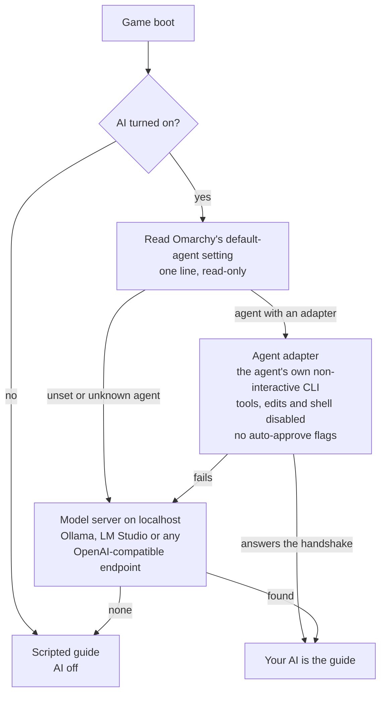
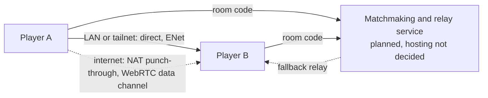
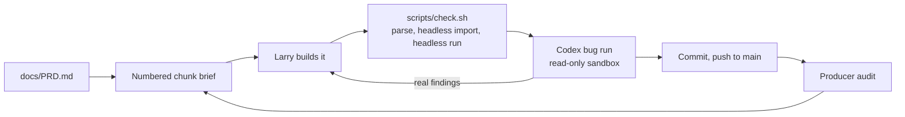

<p align="center">
  <br>
  <sub><em>Concept art, not in-game footage.</em></sub>
</p>

<p align="center">
  <a href="https://godotengine.org/"></a>
  
  
  
  
  
</p>

<p align="center"><b>A native Linux first-person shooter for Omarchy. You are the nixfred <code>&gt;_</code> hexagon, hunting rogue daemons inside your own machine, with your own AI at your side.</b></p>

<h3 align="center"><i>your AI has been watching you code for months.<br>what happens when you hand it a gun?</i></h3>

## Key art

<table>
  <tr>
    <td align="center" width="50%">
      <br>
      <em>Concept art, not in-game footage.</em>
    </td>
    <td align="center" width="50%">
      <br>
      <em>Concept art, not in-game footage.</em>
    </td>
  </tr>
</table>

## What SIGKILL is

SIGKILL is a first-person shooter that runs natively on Omarchy, the Arch and Hyprland desktop. It is not a web game and not a port: it is a Godot 4 project, built and checked against Godot 4.7.2 from the Arch `extra` repository, rendered with Vulkan through Godot's Forward+ renderer.

You play the nixfred `>_` hexagon, deep inside your own machine, hunting rogue daemons, zombie processes and runaway apps. The world has three visual registers that share one space:

- **Tron** where the system is healthy: a pure black void, glowing light grids, neon edges on every surface. Teal and mint are yours; red and amber are hostile. **Built:** the greybox arena already has the black void, the glowing floor grid and the neon edges.
- **Matrix** where reality is thin: green code rain that bleeds through walls when daemons are near. **Planned** (C8 code-rain walls, C21 code-rain vision).
- **Cyberpunk** in the deep directories: neon megacorp ruins, rain and signage. **Planned** (C36 ruins art kit).

In the planned game, corruption pushes the clean Tron grid toward Matrix rain and cyberpunk decay, and the core loop is fast arena deathmatch against other players plus a solo or co-op daemon hunt, in the same arenas with the same weapons, wrapped in a story campaign. Today's build is single-player: one greybox arena with static targets.

### Why a big studio can't ship this

A studio game has to be the same on every machine. SIGKILL is different on every machine, on purpose:

- **It is built from your machine.** Later milestones turn your real folder tree into rooms and your running processes into enemies, using only names, sizes and counts. The few other planned reads are narrow and read-only, and the [safety section](#safety-and-privacy) lists them all. Every kill is cosmetic.
- **It plays alongside your AI.** Your guide will be the coding agent you already chose in Omarchy, talking to you live, on your own subscription or your own hardware (Planned, M2). A studio cannot ship your AI in the box.
- **It is made for one desktop.** Omarchy themes, Hyprland and the terminal culture around them are the setting, not an afterthought.

<table>
  <tr>
    <td align="center" width="33%">🟦<br><b>Tron arena</b><br>Black void, glowing light grid, neon edges.<br><sub>✅ Built, as a greybox arena</sub></td>
    <td align="center" width="33%">📡<br><b>Signal weapons</b><br>SIGTERM shotgun, SIGHUP confusion grenade, the SIGKILL rail rifle.<br><sub>⬜ Planned from C16; the terminal cannon is built</sub></td>
    <td align="center" width="33%">🧠<br><b>Your REAL AI</b><br>The coding agent you already picked in Omarchy rides along as your guide.<br><sub>⬜ Planned, M2</sub></td>
  </tr>
  <tr>
    <td align="center">🌐<br><b>One-click multiplayer</b><br>Internet matches by room code. No port forwarding.<br><sub>⬜ Planned, M3</sub></td>
    <td align="center">🟢<br><b>Code-rain vision</b><br>See daemons through walls as Matrix glyphs.<br><sub>⬜ Planned, C21</sub></td>
    <td align="center">🐧<br><b>Native linux binary</b><br>Godot 4 on Vulkan, built for Omarchy and Hyprland.<br><sub>✅ Runs from source; packaged builds planned</sub></td>
  </tr>
</table>

Built today: the greybox arena with the Tron look, tight movement and the terminal cannon. Everything else on this page is labeled with its real status, and the roadmap below tracks it chunk by chunk.

## Story

> **Status: Planned** (story bible C34, missions C35 to C37, the opener C38 to C42). None of the campaign is built yet.

**You're a sysadmin jacked into your own machine, because something is spawning processes you never started.** Your AI is the only one you trust, until the trail leads to a question nobody wants answered: who wrote the daemons?

The campaign is told in short missions between arenas, through terminal logs you pick up, your AI's lines and the places themselves. There are no long cutscenes. The story is fiction from top to bottom: nothing in it reads or reveals real system data.

### The opener

> Something has been living in your machine longer than you have been playing.
>
> It has been waiting for you to notice.
>
> The first time you run SIGKILL, it notices you back.

The opener runs live in the engine, never pre-rendered, and can be skipped after the first viewing. It uses your machine's real names only if you allow it on first launch, read-only; otherwise it runs on fake data. Esc and the window's close button always work. Status: Planned (C38 to C42, after the boot sequence and the derezz effect exist).

## The arsenal

Every weapon is a Unix signal or shell command made physical, and each one will get its own Tron light skin, mods and unlocks earned by playing. They are fiction: no weapon runs, signals or touches anything real on your machine.

| Weapon | What it does | Status |
|---|---|---|
| Terminal cannon | The default hitscan rifle. Neon muzzle flash with a light, camera recoil with smooth recovery, a hit marker on confirmed hits, sparks off the surface you hit, synthesised zap and hit sounds | ✅ Built (C6) |
| SIGTERM | Polite shotgun | ⬜ Planned (C16) |
| SIGKILL / `kill -9` | Uncatchable rail rifle that one-shots and derezzes. The ult, with a "kill -9" headshot callout | ⬜ Planned (C17) |
| Fork bomb | Grenade that splits 1, 2, 4, 8 | ⬜ Planned (C19) |
| `sudo` | Power-up that overcharges the current weapon, tied into Root vs user | ⬜ Planned (C22) |
| `fork()` | Shotgun whose pellets split in two mid-flight | ⬜ Planned (C24) |
| `grep` | Seeker smart gun that locks onto a marked target | ⬜ Planned (C25) |
| `rm -rf` | Slow, devastating cannon with friendly-fire risk | ⬜ Planned (C26) |
| `cron` | Timed mines | ⬜ Planned (C27) |
| `ping` | Sonar pulse that reveals hidden daemons | ⬜ Planned (C28) |
| `chmod 000` | Freeze ray | ⬜ Planned (C29) |
| `pipe \|` | Chain beam that arcs between enemies | ⬜ Planned (C30) |
| `/dev/null` | Black-hole grenade | ⬜ Planned (C31) |
| SIGHUP | Confusion grenade: enemies "reload" and wander | ⬜ Planned (C32) |

Nothing in the arsenal is in progress right now: the cannon is finished and the rest waits for the weapon framework.

**Abilities and modes**

| Ability or mode | What it does | Status |
|---|---|---|
| Derezz deaths | Daemons shatter into glowing voxels: the target dummies first (C7), players later. The kill feed, "SIGKILL &lt;pid&gt; sent by &lt;player&gt;", arrives with synced combat (C14) | ⬜ Planned (C7, C14) |
| SIGSTOP bullet time | Short meter of Matrix slow-mo; SIGCONT resumes | ⬜ Planned (C18) |
| Light-trail mode | Your path leaves a solid neon wall, for Tron deathmatch | ⬜ Planned (C20) |
| Code-rain vision | See enemies through walls as glyphs; drains fast | ⬜ Planned (C21) |
| Root vs user | Spawn as user, earn sudo for a power spike | ⬜ Planned (C22) |
| Spectate as top | Dead players watch a live process-table style view of the match | ⬜ Planned (C23) |

**How weapons are built.** Today the cannon's every number lives in one resource, `resources/terminal_cannon.tres`, read through `scripts/weapon_tuning.gd`. The weapon framework (C16) generalises that into data-driven weapon resources with a swap wheel, ammo, and slots for mods and skins; unlocks, mods and light skins follow in C33.

## Your AI in the game

> **Status: Planned** (M2: C9, C9b, C10, C11, C12). Nothing in this section is built yet. It describes the design Fred decided in PRD 5.4.

Your guide is not a character a studio wrote. It is the coding agent you already picked in Omarchy, the same one that has been reading your diffs. SIGKILL finds it, names it on screen, and lets it talk to you while you play. Most players don't have local hardware strong enough for a good local model, so your Omarchy default agent comes first and a local model server is the fallback.

### Finding your AI



1. **The source of truth is Omarchy's own setting.** Omarchy stores the default agent as a single line in its config, the same value `omarchy-default-agent` prints. SIGKILL reads that one line and nothing else. Omarchy leaves it unset by default, and an unset or unknown value simply falls through to the next step.
2. **Each agent gets a small adapter behind one common interface.** Claude Code and Codex adapters ship first; others follow. An adapter calls the agent's own non-interactive mode directly, for example `claude -p`, or `codex exec` in a read-only sandbox, with tools, file edits and shell disabled and no auto-approve flags.
3. **The fallback is a model server on localhost.** Ollama, LM Studio, or any local OpenAI-compatible endpoint. Localhost only, never a remote host.
4. **The last resort is a scripted guide.** It is also exactly what you get with the AI turned off.

### Why it never uses omarchy-agent

Omarchy ships `omarchy-agent` and `omarchy-agent-prompt` to launch agents quickly, and they launch them with skip-approval flags so the agent can act without asking. A game must never hand an agent that kind of power. SIGKILL calls each agent's own CLI itself, with tools off and approvals on. That restricted launch is one of only two things the game may ever execute; see [Safety and privacy](#safety-and-privacy).

### What gets sent, and what never does

| Sent to your AI | Never sent |
|---|---|
| Game stats: accuracy, deaths, where you got caught | File names and paths |
| What you type into the chat key | Process lists |
| The boot handshake | System information of any kind |
| | Anything the opener or the machine-world features read |

The AI is opt-in on first launch, with a plain description of which agent will be called, and you can turn it off at any time.

### Cost, speed and model hygiene

- **Cloud agents spend your own subscription and take seconds to answer**, so SIGKILL uses them only where seconds are fine: the boot handshake, ask-anything, between-round coaching and opt-in roasts. It never calls them per frame or per second; fast in-fight callouts come from game logic. Calls are rate-limited and the HUD shows a "thinking" state.
- **With the local fallback** the game checks what is already loaded first, never changes shared model settings, never loads a huge model without asking, and unloads anything it loaded when it exits.

### Proof it's yours

- **Boot sequence (C10):** names the agent from your own Omarchy setting, `Omarchy default agent: <agent>. Linking...`, and shows it answering live.
- **In-game HUD (C11):** a "your AI" badge, live response latency, tokens per second on the local fallback, and live GPU stats: utilisation, VRAM and temperature.
- **GPU stats are read-only.** The game prefers reading them from /sys. Its only alternative is an optional, query-only `nvidia-smi --query-gpu=<fields> --format=csv,noheader`, never with control flags, which is the second and last thing the game may ever execute. If neither works, the HUD simply hides GPU stats.
- **Coaching (C12):** between-round coaching from your real round stats, and an opt-in roast announcer.

## Your machine is the world

> **Status: Planned** (M5 including the Audit Trail visor in C43, plus the opener's read-only reader in C39).

The later milestone that makes every copy of SIGKILL different:

- **Filesystem maps.** Rooms come from your real folder tree, sized by what is in them. `node_modules` is the endless maze.
- **Process enemies.** Real running processes become enemies: browser tabs arrive as a swarm, a pegged CPU core is a boss.
- **Audit Trail visor (C43).** A community prompt by Albert ([@QuantaCortex](https://x.com/QuantaCortex)). A visor mode draws glowing lineage lines from each enemy back to its parent process, up the real process tree. Severing a spawn chain, by killing a parent, collapses or reshapes that part of the arena and despawns its children. It reads only process IDs, parent process IDs, names and CPU and memory numbers: never command-line arguments, open files, environment or paths, so no private file name can show. Severing is cosmetic; nothing real is signalled. The visor's HUD carries the tag "visor design: @QuantaCortex".
- **Theme-shift levels.** Levels recoloured from your Omarchy themes, with palette-only enemies.
- **Keybind gunplay.** Opt-in moves mapped to your real Omarchy shortcuts, with no conflicts.
- **Voice commands.** Read from Ramblr's existing output; SIGKILL never opens the microphone itself.
- **Packet tracer arena.** Your tailnet machines as islands.
- **Hyprland split-screen co-op.**

The rules that make this safe, in plain words:

- **Read-only, and only the outside of things:** names, sizes and counts. The Audit Trail visor adds process IDs, parent process IDs and CPU and memory numbers; the opener also uses modification times and theme colours. Never file contents, command lines, environment or paths.
- **Cosmetic kills.** Shooting a process-named enemy despawns a game object. Nothing on your system is signalled, stopped or changed.
- **Opt-in.** On first launch SIGKILL asks before it reads any folder or process names. Say no and every feature runs on fake data.
- **Nothing leaves the moment.** What is read is shown live and never saved, logged or sent anywhere. Your AI gets none of it.
- **Demo-data mode** for every capture and trailer, so no real machine data ever ends up in a screenshot.

## Visual tech

### Built: the Tron arena

- **Floor grid**, `shaders/floor_grid.gdshader`. A spatial shader that works in world space: the vertex stage passes `MODEL_MATRIX * VERTEX` to the fragment stage, so every floor block shares one continuous grid. Lines run along X and Z with 1 m cells and a brighter major line every 8 m, set by `GRID_CELL` and `GRID_MAJOR_EVERY` in `scripts/palette.gd`. Line coverage is anti-aliased with `fwidth`, and once a pixel is wider than a line the line's energy is spread over that pixel, so the far floor fades into the dark instead of shimmering. The lines are emission on a near-black base, which is what the glow pass blooms.
- **Neon edges**, `shaders/neon_edge.gdshader`. Glowing outlines on every greybox block except the floor, which has its own grid shader, and on the target dummies, found without normals or extra geometry. In local space, a point on a flat face sits at distance zero from its own face plane, so the second-smallest plane distance is its distance to the nearest edge. A box has three plane families; the dummies' hexagonal prism has four, three side-plane pairs plus the caps. Edge width and colour are uniforms, and every block gets its own material sized to its half extents. On the hexagon the side faces meet at 120 degrees, so the plane distance underestimates the true distance along a face and the vertical edges draw about 15 percent wider than the rims.
- **Environment**, `scenes/arena.tscn`. One WorldEnvironment: a black background, glow in screen blend with an HDR threshold of 0.5 so emissive edges bloom while faces stay dark, black exponential fog at density 0.02 so distance fades into the void, and the filmic tonemapper. SSAO, SSR and SDFGI are off to keep it cheap.
- **Colour**, `scripts/palette.gd`. The single source for every material and environment colour, and the factory for every material: void `#000000`, base `#05080a`, teal `#19d3c5` and mint `#7dffcf` for the player side, hostile red `#ff3355` and amber `#ffb000`. `scripts/main.gd` applies the exact palette colours to the environment at runtime; the scene file carries approximations only so the editor previews the look. Two light colours still live in their scenes: the sun in `scenes/main.tscn` and the room light in `scenes/arena.tscn`.
- **Cannon effects**, `scripts/cannon_fx.gd`. The beam, the muzzle flash and its light, the impact flash and the sparks use unlit, over-bright materials so the glow pass picks them up. Sparks are CPU particles launched along the surface normal: hostile hits spark amber, the world sparks mint. Every effect frees itself when its lifetime ends.

**What is verified, and what is not.** Headless Godot still runs the shading-language front end, so `scripts/check.sh` catches shader syntax and semantic errors; deliberately broken shaders were used to prove it. During C4 a one-off probe also checked the edge-distance maths against real mesh data. What nobody has seen yet is the result on a real screen: the GPU-side compile and the actual look stay unverified until the first windowed capture.

### Planned: derezz and code rain

- **Derezz (C7):** dummies and, later, players shatter into glowing voxels on death.
- **Code rain (C8):** a Matrix code-rain wall shader whose intensity rises when enemies are near.
- **Code-rain vision (C21)** and **bullet time with motion trails (C18)** build on both.

No derezz or code-rain shader exists in the repo yet.

### Where the look is heading

<table>
  <tr>
    <td align="center" width="50%">
      <br>
      <em>Concept art, not in-game footage.</em>
    </td>
    <td align="center" width="50%">
      <br>
      <em>Concept art, not in-game footage.</em>
    </td>
  </tr>
</table>

### Enemy art bar

Fred's bar for every hostile: faceless and geometric, never cartoon monsters.

- Daemons: black obsidian shards with floating red terminal glyphs.
- Swarms: angular red drones.
- Bosses: giant red-hot lattice cores, the CPU core being the first.
- Deaths: voxel derezz into glowing cubes.

Today's targets are greybox hexagonal prisms with red neon edges, tagged with invented process names.

## Multiplayer (planned)

> **Status: Planned** (M3: C13, C14, C15). No networking code exists yet.

Multiplayer has to just work: join by a 6-character room code or a `sigkill://` invite link, with no port forwarding.



- **LAN and tailnet mode (C13):** instant play between machines on the same network, host and join by address.
- **Synced combat (C14):** shooting, damage, respawn and the kill feed.
- **Room codes and invite links (C15):** peer-to-peer over the internet with NAT punch-through, plus a tiny matchmaking and relay service for "find me an opponent" and as a fallback.
- **Built on Godot's high-level multiplayer:** ENet for direct play and WebRTC data channels for punch-through.
- **Hosting cost is Fred's call** before anything is deployed; nothing runs on a server today.

## Architecture

### Project tree

The project layout, from `git ls-files`. Godot also keeps a small `.uid` file next to each script and shader, and the media folder under docs holds the README images.

```text
sigkill/
├── README.md                   This page
├── .gitignore                  Keeps Godot's cache and build output out of git
├── CREDITS.md                  Contributors and community prompts
├── project.godot               Godot 4.7 project: main scene, physics layer names, Forward+, black clear colour
├── scenes/
│   ├── main.tscn               Root level: sun light, arena, player and HUD
│   ├── arena.tscn              Greybox arena, its WorldEnvironment, and the four target dummies
│   ├── player.tscn             First-person player: capsule, head, camera, muzzle marker, both tuning resources
│   ├── grey_block.tscn         One greybox building block
│   ├── target_dummy.tscn       Hexagonal-prism target dummy with a floating tag
│   └── hud.tscn                Canvas layer for the code-built HUD
├── scripts/
│   ├── main.gd                 Wires targets and player to the HUD, applies palette colours, R respawns targets
│   ├── player.gd               Movement, slide, head bob, FOV kick, mouse look, cannon, recoil, the test hook
│   ├── controls.gd             The input map, registered in code
│   ├── movement_tuning.gd      MovementTuning: the exposed movement and camera tuning, validated
│   ├── weapon_tuning.gd        WeaponTuning: the exposed cannon tuning, validated
│   ├── palette.gd              Every colour, plus the material factory
│   ├── grey_block.gd           Builds a block's mesh, collision and neon material; previews in the editor
│   ├── target_dummy.gd         Takes hits, pulses, shrinks and despawns, reports whether a hit landed
│   ├── hud.gd                  Status line, hint line, click-to-engage overlay, crosshair and hit marker
│   ├── crosshair.gd            Crosshair drawn in code; kicks on every shot
│   ├── hit_marker.gd           Diagonal hit marker, shown only on a confirmed hit
│   ├── cannon_fx.gd            Beam, muzzle flash and light, impact flash and sparks; all self-freeing
│   ├── sfx_synth.gd            Fire and hit sounds synthesised in code
│   └── check.sh                The headless quality gate
├── shaders/
│   ├── floor_grid.gdshader     World-space glowing floor grid
│   └── neon_edge.gdshader      Neon outline edges for boxes and hexagonal prisms
├── resources/
│   ├── movement_tuning.tres    Default movement tuning
│   └── terminal_cannon.tres    Default terminal cannon tuning
├── tests/
│   ├── movement_test.gd        Headless movement test
│   └── cannon_test.gd          Headless cannon test
└── docs/
    ├── PRD.md                  Product requirements: features, safety rules, chunk plan
    ├── DESIGN.md               Decisions log and design notes
    ├── ENGINE.md               Why Godot 4
    └── media/                  README art; .gdignore keeps Godot from importing it
```

### Tuning resources

Feel is data, not code. Two custom resources hold the exposed tuning parameters for player movement, the camera and the cannon, each with a default instance the player scene loads. Some numbers live elsewhere on purpose or for now: gravity comes from the project settings, the player's collision capsule from its scene, and HUD sizes and the dummies' despawn timing from their own scripts.

- **MovementTuning**, `scripts/movement_tuning.gd` with `resources/movement_tuning.tres`. Groups: Ground, Air, Slide, Camera, Head bob, World. Walk speed, acceleration and friction, gravity scale, jump, air control, the whole slide (threshold, burst, friction, timer, cooldown, slide-jump cap, lowered camera), mouse sensitivity and pitch limit, FOV and its kick, head bob and its on/off toggle, fall respawn height.
- **WeaponTuning**, `scripts/weapon_tuning.gd` with `resources/terminal_cannon.tres`. Groups: Firing, Viewmodel, Recoil, Beam, Muzzle flash, Impact, Hit marker, Audio. Cooldown, range, damage and hit layers, the cannon's size and kick, recoil and its caps and recovery, every effect's size, brightness and lifetime, the hit marker, and every parameter of the synthesised sounds including a master volume.

Both resources validate themselves on load with `problems()`. If a value would break the game, for example a negative easing rate, the player prints a warning and falls back to the built-in defaults instead of misbehaving. `scripts/player.gd` itself holds no movement or cannon numbers at all, and every material colour comes from `scripts/palette.gd`.

### How the checks work

`scripts/check.sh` is the gate every chunk has to pass. It never opens a window: every Godot call is `--headless`.

1. **Parse** every `.gd` file with the GDScript parser.
2. **Import** the project headless.
3. **Run** the main scene for 300 frames headless.
4. **Movement test**, `tests/movement_test.gd`.
5. **Cannon test**, `tests/cannon_test.gd`.

It fails on any parse error, any `ERROR` or `SCRIPT ERROR` line in Godot's output, or a nonzero Godot exit. Exit 0 means clean, 1 means a problem was found, 2 means the gate itself could not run. It also takes a project directory, which is how deliberately broken copies are checked.

The tests are SceneTree scripts that drive the real scenes through a one-frame input hook on the player, `drive_input()`, with `--fixed-fps 60` so every run is deterministic and faster than real time:

- **Movement test.** A flat floor and the real player scene. Measures the start and the stop in frames, repeats them at 60 Hz and 120 Hz to prove nothing depends on the frame rate, and covers the slide (threshold, burst, timer, cooldown boundary, same-frame jump), slide-jump momentum, air control, head bob scaling and its toggle, the FOV kick, and the tuning fallback.
- **Cannon test.** The real main scene. Fires at the real dummy, then the wall behind it, then the open sky, and checks the hit, the hit marker, recoil and its recovery at 60 Hz and 120 Hz, each effect's own lifetime, misses without a marker, the cooldown boundary, the pitch clamp including mouse look, the synthesised sounds, the tuning fallback, and that no orphan nodes are left behind.

Before a test is trusted, deliberately broken copies of the project prove it can fail: no friction, a missing slide timer, a hit marker that never shows, effects that never free, a cooldown cut short, and more. Each one makes `scripts/check.sh` exit 1.

### The Codex bug run

Every chunk ends with a second opinion. After the gate passes, the chunk's diff goes to the Codex CLI, run non-interactively in a read-only sandbox, with a prompt to hunt bugs, Godot API misuse, frame-rate dependence, edge cases and safety-rule violations. Real findings get fixed and the gate is re-run; findings that are rejected are written down with the reason. When the fixes are substantial, Codex reviews the fixes too. Codex never gets write access, never commits and never pushes.

### The chunk pipeline

SIGKILL is built one small numbered chunk at a time, from the PRD. Every chunk goes through the same path before it lands.



### Docs

- [`docs/PRD.md`](docs/PRD.md): what we are building, the hard safety rules, the chunk plan
- [`docs/DESIGN.md`](docs/DESIGN.md): decisions log and design notes
- [`docs/ENGINE.md`](docs/ENGINE.md): why Godot 4
- [`CREDITS.md`](CREDITS.md): who made what, including community prompts

## Install and play

Runs from source today. Packaged builds (AppImage, AUR) are planned and not available yet. Nothing is published.

**Requirements**

- Godot 4.x from pacman (the project is built against 4.7)
- A Vulkan-capable GPU and driver
- git
- For running the checks: `uvx`, which fetches the GDScript parser, unless `gdparse` is already installed
- Optional, coming in M2: the AI guide uses your Omarchy default agent (Claude Code and Codex first), with a local model server such as Ollama or LM Studio as the fallback

**Quickstart (Omarchy / Arch)**

```bash
sudo pacman -S --needed godot git
git clone https://github.com/nixfred/sigkill.git   # private for now, ask for access
cd sigkill
godot --path .
```

Click into the window to grab the mouse. Esc gives it back, and so does switching away from the window.

### Controls

Bindings are registered in code in `scripts/controls.gd`, with mouse look and the click-to-engage rule in `scripts/player.gd`. There are no Ctrl, Alt or Super chords.

| Input | Action |
|---|---|
| W / A / S / D, or the arrow keys | Move |
| Mouse | Look |
| Space | Jump |
| C | Slide, when running fast on the ground. Jump during a slide to keep its speed |
| Left click | Fire the terminal cannon (the first click only grabs the mouse) |
| R | Respawn all targets |
| Esc | Release the mouse |

### Running the checks

```bash
scripts/check.sh
```

Exit 0 means every step passed, 1 means a problem was found, 2 means the gate itself could not run. Each test can also run on its own, headless:

```bash
godot --headless --path . --fixed-fps 60 --script res://tests/movement_test.gd
godot --headless --path . --fixed-fps 60 --script res://tests/cannon_test.gd
```

## Safety and privacy

These rules apply to every chunk, from PRD section 6, in plain language:

- **SIGKILL never changes your system.** It never modifies, deletes, executes, signals or kills anything on your machine. Everything it looks at is read-only: folder and process names, sizes and counts for the machine-world features; process IDs, parent process IDs and CPU and memory numbers for the Audit Trail visor; modification times, uptime and theme colours for the opener; GPU utilisation, VRAM and temperature for the HUD; model names and whether they are loaded, for the local AI fallback. It never reads what is inside your files, with one narrow exception: the single line of Omarchy's default-agent setting, read to find your AI.
- **Two narrow exceptions, and nothing else.** First, the game may launch your Omarchy default agent's own command-line tool in its non-interactive mode, with tools, file edits and shell disabled, no auto-approve flags, never through `omarchy-agent`, and with only game stats and what you type in the prompt. Second, for the HUD's GPU stats, it may run an optional, query-only `nvidia-smi --query-gpu=<fields> --format=csv,noheader`, never with control flags; it prefers reading /sys, and if neither works the HUD hides GPU stats. Nothing else is ever executed.
- **Nothing private leaves your machine or lands in the repo.** No real paths, hostnames, process lists or model lists in the repository, in screenshots or in trailers. Anything public uses demo data.
- **Your desktop stays yours.** No Ctrl+Alt hotkeys. The mouse is captured only while the window is focused and is released on Esc or when focus leaves. The game never steals focus and uses no GPU when it is not running.
- **The opener plays fair.** Everything that looks hacked is rendered fiction. Esc and the window's close button always work. A one-line content note and an opt-in come first, and saying no gives you the same opener on fake data.
- **Original art and audio.** Today's sounds are synthesised in code, and the repository contains no audio files. Concept art is always labelled as concept art.
- **Private until Fred says otherwise.** Local commits and pushes to a private repository only. Nothing goes public without Fred's yes, and every chunk reports real command output.

## Roadmap

Status from `git log`. Hashes are the commits that finished each chunk.

| Milestone | Chunks | Status |
|---|---|---|
| M0 Foundations | C1 Godot installed, clean headless import (`823de8b`) · C2 quality gate and first Codex bug run (`c26061f`) · C3 private repository (`e57697a`) | ✅ Done |
| M1 Look and feel | C4 Tron environment (`de7c203`) · C4b README graphics (`52383f3`) · C5 movement feel (`c223950`) · C6 terminal cannon feel (`6403dbd`) · C6b this README · C7 derezz deaths · C8 code-rain walls | 🔧 In progress |
| M2 Your AI | C9 AI source detector · C9b agent adapters · C10 boot sequence · C11 guide HUD · C12 coaching and roasts | ⬜ Planned |
| M3 Multiplayer | C13 LAN and tailnet · C14 synced combat · C15 room codes, invite links and relay | ⬜ Planned |
| M4 Arsenal and modes | C16 weapon framework and SIGTERM · C17 SIGKILL rail rifle · C18 bullet time · C19 fork bomb · C20 light trails · C21 code-rain vision · C22 root vs user and `sudo` · C23 spectate as top · C24 to C32 the shell-command weapons · C33 unlocks, mods and skins | ⬜ Planned |
| M5 Your machine is the world | Filesystem maps, process enemies, theme levels, keybind gunplay, voice commands, packet tracer arena, split-screen co-op · C43 Audit Trail visor · C44 in-game credits roll (CREDITS.md itself is already in the repo) | ⬜ Planned |
| M6 Story campaign | C34 story bible · C35 mission framework · C36 cyberpunk ruins art kit · C37 first mission · C38 to C42 the opener | ⬜ Planned |

Before M0 came the scaffold (`d086489`), and the decision that the player's AI is the Omarchy default agent landed as its own docs commit (`43b1f74`).

## Credits and community prompts

SIGKILL is built in public, and the full list of who made what lives in [`CREDITS.md`](CREDITS.md).

<p align="center">
  <br>
  <em>Mockup of the in-game credits roll, not in-game footage.</em>
</p>

**Send a prompt.** Anyone can reply to [@NixFred](https://x.com/NixFred) on X with a prompt for the game. If a prompt makes it in, its author is credited in [`CREDITS.md`](CREDITS.md) and in the in-game credits roll, and the feature it became carries a small in-game tag with their handle. Nobody is credited without their own public reply.

**How a public prompt reaches the build.** Every public prompt is reviewed against the [safety rules](#safety-and-privacy) and rewritten into a chunk brief before any of it reaches the build. Raw public text is never passed in.

**The first community feature.** Albert ([@QuantaCortex](https://x.com/QuantaCortex)) pitched the Audit Trail visor: trace every enemy back to its parent process, and sever the spawn chain to change the arena. ⬜ Planned (C43); see [Your machine is the world](#your-machine-is-the-world).

**The credits roll.** A live `top`-style process table on the Tron grid. Every contributor is a process: their handle as the USER, their idea as the COMMAND, the CPU column climbing as their row types in with code rain. Fred is PID 1. It ends with your own kill -9 on the credits process, which derezzes the whole table into voxels. ⬜ Planned (C44).

## Screenshots

Real in-game captures land once the renderer chunks are verified.

Every illustration on this page is concept art or a mockup and is labelled that way; the badges and the hexagon are brand marks. Real captures need a window on screen, so they wait for windowed playtests, and they will use demo data.

<p align="center">
  <br>
  <sub>a nixfred joint</sub><br>
  <sub>Made by Fred Nix. Built chunk by chunk by Larry, produced by SIGKILL bot. Engine: Godot. Art and audio are original; concept art is labelled as concept art.</sub>
</p>
