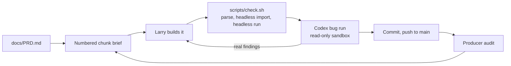

<p align="center">
  
</p>

<p align="center">
  <a href="https://godotengine.org/"></a>
  
  
  
  
  
</p>

A native linux FPS for Omarchy. You are the nixfred `>_` hexagon, deep inside your own machine, hunting rogue daemons, zombie processes and runaway apps. Tron light-grid arenas, Matrix code rain, fast arena gunplay, and your OWN local AI riding along as your guide. Play solo against daemons or jump into a match with a friend across the internet in seconds.

## The vibe

<table>
  <tr>
    <td align="center" width="50%">
      <br>
      <em>Concept art, not in-game footage.</em>
    </td>
    <td align="center" width="50%">
      <br>
      <em>Concept art, not in-game footage.</em>
    </td>
  </tr>
</table>

## Features

<table>
  <tr>
    <td align="center" width="33%">🟦<br><b>Tron arena</b><br>Black void, glowing light grid, neon edges on every surface.</td>
    <td align="center" width="33%">📡<br><b>Signal weapons</b><br>SIGTERM shotgun, SIGHUP confusion grenade, the SIGKILL railgun.</td>
    <td align="center" width="33%">🧠<br><b>Your REAL local AI</b><br>The model already running on your machine rides along as your guide.</td>
  </tr>
  <tr>
    <td align="center">🌐<br><b>One-click multiplayer</b><br>Internet matches by room code. No port forwarding.</td>
    <td align="center">🟢<br><b>Code-rain vision</b><br>See daemons through walls as Matrix glyphs.</td>
    <td align="center">🐧<br><b>Native linux binary</b><br>Godot 4 on Vulkan. One program, built for Omarchy and Hyprland.</td>
  </tr>
</table>

Everything above is on the roadmap below. Today's build is the greybox arena with the Tron look and the terminal cannon.

## Install and play

Runs from source today. Packaged builds (AppImage, AUR) are planned and not available yet.

**Requirements**

- Godot 4.x from pacman (the project is built against 4.7)
- A Vulkan-capable GPU and driver
- git
- Optional, coming in M2: Ollama or LM Studio for the AI guide

**Quickstart (Omarchy / Arch)**

```bash
sudo pacman -S --needed godot git
git clone https://github.com/nixfred/sigkill.git   # private for now, ask for access
cd sigkill
godot --path .
```

Click into the window to grab the mouse. Esc gives it back, and so does switching away from the window.

**Controls**

Bindings are registered in code in `scripts/controls.gd`, with mouse look and the click-to-engage rule in `scripts/player.gd`. There are no Ctrl, Alt or Super chords.

| Input | Action |
|---|---|
| W / A / S / D, or the arrow keys | Move |
| Mouse | Look |
| Space | Jump |
| C | Slide, when running fast on the ground. Jump during a slide to keep its speed |
| Left click | Fire the terminal cannon (the first click only grabs the mouse) |
| R | Respawn all targets |
| Esc | Release the mouse |

**Run the checks**

```bash
scripts/check.sh
```

The game never modifies, deletes, executes, signals or kills anything on your system. The full contract is in `docs/DESIGN.md`.

## How it's built

One small numbered chunk at a time, from the PRD. Every chunk goes through the same gate before it lands.



- `docs/PRD.md`: what we are building and the hard safety rules
- `docs/ENGINE.md`: why Godot 4
- `docs/DESIGN.md`: design notes and the safety contract

## Roadmap

| Milestone | What lands | Status |
|---|---|---|
| M0 Foundations | Godot installed, headless quality gate, private repo | ✅ Done |
| M1 Look and feel | Tron environment (done), movement feel, cannon feel, derezz deaths, code-rain walls | 🔧 In progress |
| M2 Your AI | Local model detection, boot sequence, in-game guide, round coaching | ⬜ Planned |
| M3 Multiplayer | LAN and tailnet play, synced combat, room codes and invite links | ⬜ Planned |
| M4 Arsenal and modes | SIGTERM, SIGKILL railgun, SIGSTOP bullet time, fork bomb, light trails, code-rain vision, root vs user, spectate as top | ⬜ Planned |
| M5 Your machine is the world | Filesystem maps, process enemies, theme levels | ⬜ Planned |

## Screenshots

Real in-game captures land once the renderer chunks are verified.

<p align="center">
  <br>
  <sub>a nixfred joint</sub>
</p>
