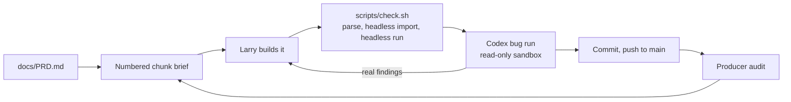

<p align="center">
  
</p>

<p align="center">
  <a href="https://godotengine.org/"></a>
  
  
  
  
  
</p>

<p align="center"><b>A native Linux first-person shooter for Omarchy. You are the nixfred <code>&gt;_</code> hexagon, hunting rogue daemons inside your own machine, with your own AI at your side.</b></p>

<h3 align="center"><i>your AI has been watching you code for months.<br>what happens when you hand it a gun?</i></h3>

## Key art

<table>
  <tr>
    <td align="center" width="50%">
      <br>
      <em>Concept art, not in-game footage.</em>
    </td>
    <td align="center" width="50%">
      <br>
      <em>Concept art, not in-game footage.</em>
    </td>
  </tr>
</table>

## What SIGKILL is

SIGKILL is a first-person shooter that runs natively on Omarchy, the Arch and Hyprland desktop. It is not a web game and not a port: it is a Godot 4 project, built and checked against Godot 4.7.2 from the Arch `extra` repository, rendered with Vulkan through Godot's Forward+ renderer.

You play the nixfred `>_` hexagon, deep inside your own machine, hunting rogue daemons, zombie processes and runaway apps. The world has three visual registers that share one space:

- **Tron** where the system is healthy: a pure black void, glowing light grids, neon edges on every surface. Teal and mint are yours; red and amber are hostile.
- **Matrix** where reality is thin: green code rain that bleeds through walls when daemons are near.
- **Cyberpunk** in the deep directories: neon megacorp ruins, rain and signage.

Corruption pushes the clean Tron grid toward Matrix rain and cyberpunk decay. The core loop is fast arena deathmatch against other players plus a solo or co-op daemon hunt, in the same arenas with the same weapons, wrapped in a story campaign.

### Why a big studio can't ship this

A studio game has to be the same on every machine. SIGKILL is different on every machine, on purpose:

- **It is built from your machine.** Later milestones turn your real folder tree into rooms and your running processes into enemies, using only names, sizes and counts. Nothing is ever read beyond that, and every kill is cosmetic.
- **It plays alongside your AI.** Your guide is the coding agent you already chose in Omarchy, talking to you live, on your own subscription or your own hardware. A studio cannot ship your AI in the box.
- **It is made for one desktop.** Omarchy themes, Hyprland and the terminal culture around them are the setting, not an afterthought.

<table>
  <tr>
    <td align="center" width="33%">🟦<br><b>Tron arena</b><br>Black void, glowing light grid, neon edges on every surface.</td>
    <td align="center" width="33%">📡<br><b>Signal weapons</b><br>SIGTERM shotgun, SIGHUP confusion grenade, the SIGKILL railgun.</td>
    <td align="center" width="33%">🧠<br><b>Your REAL AI</b><br>The coding agent you already picked in Omarchy rides along as your guide.</td>
  </tr>
  <tr>
    <td align="center">🌐<br><b>One-click multiplayer</b><br>Internet matches by room code. No port forwarding.</td>
    <td align="center">🟢<br><b>Code-rain vision</b><br>See daemons through walls as Matrix glyphs.</td>
    <td align="center">🐧<br><b>Native linux binary</b><br>Godot 4 on Vulkan. One program, built for Omarchy and Hyprland.</td>
  </tr>
</table>

Built today: the greybox arena with the Tron look, tight movement and the terminal cannon. Everything else on this page is labeled with its real status, and the roadmap below tracks it chunk by chunk.

## Story

**You're a sysadmin jacked into your own machine, because something is spawning processes you never started.** Your AI is the only one you trust, until the trail leads to a question nobody wants answered: who wrote the daemons?

The campaign is told in short missions between arenas, through terminal logs you pick up, your AI's lines and the places themselves. There are no long cutscenes. The story is fiction from top to bottom: nothing in it reads or reveals real system data.

### The opener

> It doesn't start with a menu. It starts the way your late nights usually end: a terminal, a cursor, your own machine.
>
> Something in there knows your machine better than it should.
>
> Two minutes later you will understand exactly why you are holding a rifle.

The opener runs live in the engine, never pre-rendered, and is skippable after the first viewing. It is built from your real machine only if you say yes on first launch, using read-only names, sizes and counts; say no and you get the same opener on fake data. Esc and the window's close button always work. Status: Planned (C38 to C42, after the boot sequence and the derezz effect exist).

## The arsenal

Every weapon is a Unix signal or shell command made physical, and each one will get its own Tron light skin, mods and unlocks earned by playing. They are fiction: no weapon runs, signals or touches anything real on your machine.

| Weapon | What it does | Status |
|---|---|---|
| Terminal cannon | The default hitscan rifle. Neon muzzle flash with a light, camera recoil with smooth recovery, a hit marker on confirmed hits, sparks off the surface you hit, synthesised zap and hit sounds | ✅ Built (C6) |
| SIGTERM | Polite shotgun | ⬜ Planned (C16) |
| SIGKILL / `kill -9` | Uncatchable rail rifle that one-shots and derezzes. The ult, with a "kill -9" headshot callout | ⬜ Planned (C17) |
| Fork bomb | Grenade that splits 1, 2, 4, 8 | ⬜ Planned (C19) |
| `sudo` | Power-up that overcharges the current weapon, tied into Root vs user | ⬜ Planned (C22) |
| `fork()` | Shotgun whose pellets split in two mid-flight | ⬜ Planned (C24) |
| `grep` | Seeker smart gun that locks onto a marked target | ⬜ Planned (C25) |
| `rm -rf` | Slow, devastating cannon with friendly-fire risk | ⬜ Planned (C26) |
| `cron` | Timed mines | ⬜ Planned (C27) |
| `ping` | Sonar pulse that reveals hidden daemons | ⬜ Planned (C28) |
| `chmod 000` | Freeze ray | ⬜ Planned (C29) |
| `pipe \|` | Chain beam that arcs between enemies | ⬜ Planned (C30) |
| `/dev/null` | Black-hole grenade | ⬜ Planned (C31) |
| SIGHUP | Confusion grenade: enemies "reload" and wander | ⬜ Planned (C32) |

Nothing in the arsenal is in progress right now: the cannon is finished and the rest waits for the weapon framework.

**Abilities and modes**

| Ability or mode | What it does | Status |
|---|---|---|
| Derezz deaths | Players and daemons shatter into glowing voxels. Kill feed: "SIGKILL &lt;pid&gt; sent by &lt;player&gt;" | ⬜ Planned (C7) |
| SIGSTOP bullet time | Short meter of Matrix slow-mo; SIGCONT resumes | ⬜ Planned (C18) |
| Light-trail mode | Your path leaves a solid neon wall, for Tron deathmatch | ⬜ Planned (C20) |
| Code-rain vision | See enemies through walls as glyphs; drains fast | ⬜ Planned (C21) |
| Root vs user | Spawn as user, earn sudo for a power spike | ⬜ Planned (C22) |
| Spectate as top | Dead players watch a live process-table style view of the match | ⬜ Planned (C23) |

**How weapons are built.** Today the cannon's every number lives in one resource, `resources/terminal_cannon.tres`, read through `scripts/weapon_tuning.gd`. The weapon framework (C16) generalises that into data-driven weapon resources with a swap wheel, ammo, and slots for mods and skins; unlocks, mods and light skins follow in C33.

## The vibe

<table>
  <tr>
    <td align="center" width="50%">
      <br>
      <em>Concept art, not in-game footage.</em>
    </td>
    <td align="center" width="50%">
      <br>
      <em>Concept art, not in-game footage.</em>
    </td>
  </tr>
</table>

## Install and play

Runs from source today. Packaged builds (AppImage, AUR) are planned and not available yet.

**Requirements**

- Godot 4.x from pacman (the project is built against 4.7)
- A Vulkan-capable GPU and driver
- git
- Optional, coming in M2: the AI guide uses your Omarchy default agent (Claude Code and Codex first), with a local model server such as Ollama or LM Studio as the fallback

**Quickstart (Omarchy / Arch)**

```bash
sudo pacman -S --needed godot git
git clone https://github.com/nixfred/sigkill.git   # private for now, ask for access
cd sigkill
godot --path .
```

Click into the window to grab the mouse. Esc gives it back, and so does switching away from the window.

**Controls**

Bindings are registered in code in `scripts/controls.gd`, with mouse look and the click-to-engage rule in `scripts/player.gd`. There are no Ctrl, Alt or Super chords.

| Input | Action |
|---|---|
| W / A / S / D, or the arrow keys | Move |
| Mouse | Look |
| Space | Jump |
| C | Slide, when running fast on the ground. Jump during a slide to keep its speed |
| Left click | Fire the terminal cannon (the first click only grabs the mouse) |
| R | Respawn all targets |
| Esc | Release the mouse |

**Run the checks**

```bash
scripts/check.sh
```

The game never modifies, deletes, executes, signals or kills anything on your system. The full contract is in `docs/DESIGN.md`.

## How it's built

One small numbered chunk at a time, from the PRD. Every chunk goes through the same gate before it lands.



- `docs/PRD.md`: what we are building and the hard safety rules
- `docs/ENGINE.md`: why Godot 4
- `docs/DESIGN.md`: design notes and the safety contract

## Roadmap

| Milestone | What lands | Status |
|---|---|---|
| M0 Foundations | Godot installed, headless quality gate, private repo | ✅ Done |
| M1 Look and feel | Tron environment (done), movement feel, cannon feel, derezz deaths, code-rain walls | 🔧 In progress |
| M2 Your AI | Local model detection, boot sequence, in-game guide, round coaching | ⬜ Planned |
| M3 Multiplayer | LAN and tailnet play, synced combat, room codes and invite links | ⬜ Planned |
| M4 Arsenal and modes | SIGTERM, SIGKILL railgun, SIGSTOP bullet time, fork bomb, light trails, code-rain vision, root vs user, spectate as top | ⬜ Planned |
| M5 Your machine is the world | Filesystem maps, process enemies, theme levels | ⬜ Planned |

## Screenshots

Real in-game captures land once the renderer chunks are verified.

<p align="center">
  <br>
  <sub>a nixfred joint</sub>
</p>
