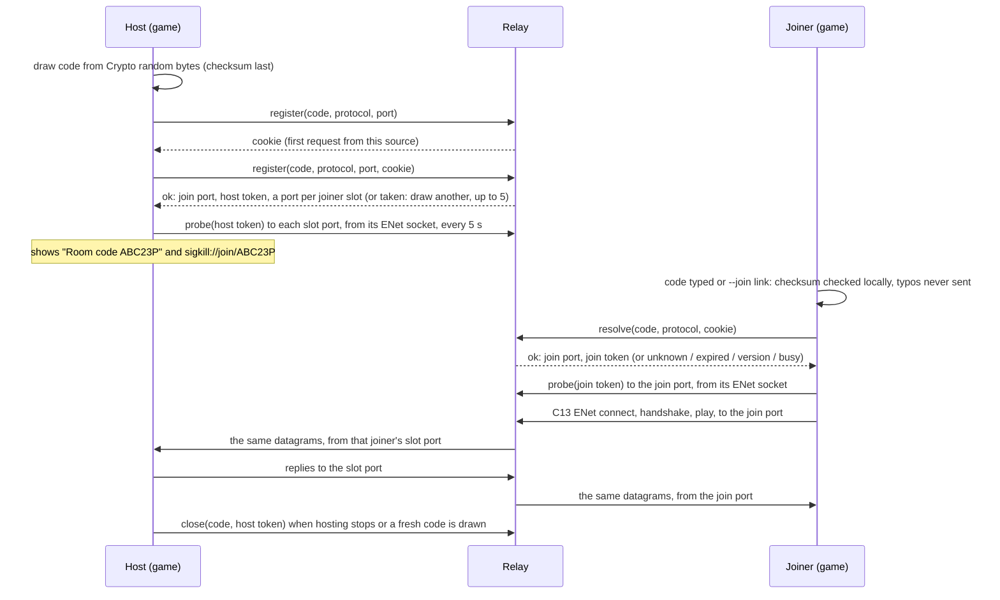

# SIGKILL relay design

Room codes and invite links (PRD 5.1, chunk C15): a tiny rendezvous that turns a 6-character
code into a host's address, NAT punch-through so most players connect directly, and a
fallback relay for the rest.

**Status: built and tested on 127.0.0.1 only (C16c). Nothing is deployed.** The relay
(`relay/relay_server.gd`, run by `relay/relay_main.gd`) is the rendezvous and the fallback
relay in one small UDP service, and the game has a real client for it
(`scripts/net/udp_rendezvous.gd`). The game uses it only when a player sets a relay URL in
Settings, Multiplayer; the default is empty, and with it the game's rendezvous is
`NullRendezvous`, which is never live and sends nothing. No server runs it, no account has
been made, nothing has been paid for: hosting waits for Fred.

**The choice: every match through the relay.** C15 planned a rendezvous that hands a joiner
the host's address, then punch-through, with the relay as a fallback. C16c builds the
rendezvous and the relay, and sends every room-code match through the relay:

- it works behind any NAT, where a direct connection between two homes mostly would not;
- neither player ever learns the other's address (no reply carries one);
- punch-through cannot be proven on one machine's 127.0.0.1, and docs/RELAY.md always said
  it had to be proven on two real networks first. It stays a later option that would cut
  relay traffic, not a requirement.

LAN and tailnet join by address are unchanged and never touch the relay.

**WebSocket mode: built and tested on 127.0.0.1 only (C16d). Nothing is deployed.** For a
machine with no public address and no inbound UDP, reached only through an HTTPS proxy on one
port (Fred's pick is an exe.dev VM), the same relay also runs on one TCP port as a WebSocket
service (`relay/relay_ws.gd`, `--ws-port`). The game picks the transport from the relay URL's
scheme: `udp://` the UDP relay above, `ws://` and `wss://` the WebSocket one, anything else no
relay at all. See [WebSocket mode](#websocket-mode-built-c16d) and
[On exe.dev](#on-exedev-websocket-mode). The UDP relay stays the alternative for a plain
server with a public address.

## The three parts

| Part | Job | Traffic |
|---|---|---|
| Rendezvous | Holds `code -> host address and game port` for a few minutes | A handful of tiny datagrams per match |
| Punch-through | Tells each side the other's public address so both can open a path through their NATs at the same moment | A few probe datagrams per match |
| Fallback relay | Forwards the game's own ENet datagrams between two players who cannot reach each other directly | The whole match, for those players only |

The rendezvous and the relay are built (C16c), in one process; punch-through is not. The
session talks to the rendezvous only through the `RendezvousClient` interface
(`scripts/net/rendezvous_client.gd`), and to the relay only with the game's own ENet socket.

## What crosses the wire

To the rendezvous, ever:

- the room code (6 characters),
- the game's protocol version,
- from a host, its game port,
- the cookie the relay handed this source (spoofing defence, below),
- to close a code, the room's host token.

Then, to the room's own relay ports, from the game's ENet socket: a 12-byte probe holding the
room's token for that side, and the game's own ENet datagrams. The relay forwards those
untouched and never decodes them. Never a user or host name, a path, anything about the AI
guide, player names (the display name in Settings is a label on the player's own screen and
never leaves it), or anything about the machine. The session calls only
`register(code, protocol, port)`, `resolve(code, protocol)` and `close(code, protocol, port)`,
and the relay test reads every request the game makes.

From the relay to a host: the room's join port, its host token and one host-facing port per
joiner slot. To a joiner: the join port, the join token and the seconds the code has left. Or
an error word (`unknown`, `expired`, `version`, `taken`, `busy`). No reply ever holds an
address: the joiner connects to the relay itself with the C13 path (ENet, the C13 handshake,
the C14 combat).

A room code leads only to the relay the player set: the game connects to that relay's own
address and never to an address a reply names. Without a relay, the C15 rule stands: a room
code only to this machine, a private LAN or a tailnet (`local_address()` in
`scripts/net/net_session.gd`).

### Wire format, version 2 (`scripts/net/relay_wire.gd`, shared by the game and the relay)

Request, exactly 64 bytes: `"SR"`, wire version `2`, op (`1` register, `2` resolve, `3` close),
the code in ASCII (6 bytes), the protocol version (u16), the game port (u16), the cookie
(8 bytes, zero until the relay hands one out), the host token (8 bytes, close only), then
zeros.

Reply, 27 to 57 bytes: `"SR"`, `2`, status (`0` ok, `1` unknown, `2` expired, `3` version,
`4` taken, `5` busy, `6` cookie), the code (echoed, so a late reply is never taken for
another), the host's protocol (u16), the room's join port (u16), seconds left (u32), a token
(8 bytes: the cookie, the host token or the join token), then the host-facing ports (u8
count, u16 each, up to 15).

Probe, 12 bytes, to a room's relay port from the game's ENet socket: `"SP"`, `2`, kind (`1`
host, `2` join), the token for that side.

Over WebSocket (C16d) the requests, replies and probes are the same bytes, one WebSocket
message each, and a register reply's host-facing list names the room's joiner slots (1 to
N-1) where the UDP relay names ports; its join port is 0. A datagram is a data message:
`"SD"`, `2`, a slot (from the host: the joiner it is for; to the host: the joiner it came from;
`0` between the relay and a joiner), then the game's ENet datagram, untouched.

The two changes C15 required before a real service are in: a request (64 bytes) is never
shorter than the longest reply (57), so the relay never sends more bytes than it received;
and a source's first request is answered only with a cookie, an HMAC of its address, port and
a 30-second window under a secret drawn at start, which it must send back before the relay
acts on anything it asks. Wire version 1 is the C15 test fake's and is unchanged.

## Message flow



### Punch-through (not built)

Godot 4.7's `ENetConnection.socket_send(destination_address, destination_port, packet)` sends
a raw datagram from the very socket ENet listens on, which opens the NAT mapping the other
player's packets need. The plan:

1. The host and the joiner each send one small probe to the rendezvous from their ENet
   socket (`socket_send`), carrying the code. The rendezvous records the public address
   and port it saw for each.
2. The rendezvous tells each side the other's public address and port over the control
   channel.
3. Both sides `socket_send` a few probes at each other for a second or two, then the joiner
   connects with ENet to the host's public address and port.
4. If no connection is up after a timeout, the pair falls back to the relay.

This has to be proven on two real networks before anything is built on it; symmetric NATs
and some carrier NATs defeat it, which is what the relay is for. With every match through
the relay (C16c), punch-through would only save relay traffic.

### The relay (built, C16c)

Each room gets a join port, which every joiner's ENet connects to, and one host-facing port
per joiner slot, which the host's ENet sees as that joiner. A side is let in only by a probe
with its own token, sent from the game's own ENet socket (Godot 4.7's
`ENetConnection.socket_send`), which also opens that player's NAT for the relay's replies. The
relay forwards ENet datagrams between a slot's joiner and the host and nobody else, and never
decodes them. ENet's packets stay end to end; DTLS (`dtls_server_setup` and
`dtls_client_setup` are in Godot 4.7's `ENetConnection`) can encrypt them past the relay
later.

## WebSocket mode (built, C16d)

**Why.** An exe.dev VM has no public IP and no raw inbound TCP or UDP: the only way in is
exe.dev's HTTPS proxy, to one port of the VM. The UDP relay cannot live there. The WebSocket
relay can: one TCP port, plain `ws://` on the VM, `wss://` from the players to the proxy.

**The scheme picks the transport.** `scripts/net/relay_wire.gd`'s `transport_of()`: `udp://`
takes the C16c path (`UdpRendezvous`), `ws://` and `wss://` the WebSocket one (`WsRendezvous`,
`scripts/net/ws_rendezvous.gd`). Any other scheme (`http://`, `https://`, `tcp://`, a capital
`WS://`) is not a relay URL: the settings refuse it and say which three work, the room tuning
refuses it, and the game makes no connection of any kind for it. `ws://` means port 80 and
`wss://` 443 when no port is named; no path.

**One port, rooms by token.** The relay listens on one TCP port (`--ws-port`). Every room
shares it, with no data ports: a connection that registers a code is that room's host link; a
connection that probes with a room's join token takes one of its joiner slots; rooms are told
apart by their tokens. The relay forwards a joiner's datagrams to its host tagged with the
joiner's slot, and the host's to the slot each names. A host link that registers again (the
game draws a fresh code when its code runs out) keeps its room and joiners under the new code
and fresh tokens, and the old code answers `expired`.

**The game's side: a tunnel, the match unchanged.** The match still runs on the game's own
ENet, with the C13 handshake and the C14 combat. `WsRendezvous` answers the session with
loopback sockets of its own on 127.0.0.1: a joiner's "mouth", which its ENet connects to, and
one socket per joiner slot for a host, which its ENet probes, exactly as it would the UDP
relay's ports. Every datagram arriving there goes to the relay as a data message, the
session's probes as the relay's probes, and every data message from the relay comes out of
the matching loopback socket to ENet. A loopback socket takes datagrams from 127.0.0.1 only,
and only from the first source it sees, the game's own ENet socket. Neither player ever sees
the other's address, or the relay's: each ENet sees only 127.0.0.1.

**Closing.** Godot's WebSocket sends a close ahead of queued messages and gives up whatever
arrives with one. So both sides close a link only once what it holds is sent and 300 ms have
passed, and the game puts ENet's goodbye through the tunnel before it closes it: a joiner who
leaves is let go by the host in milliseconds (6 ms in the test), and a host who leaves is
heard as "host left" at once (7 ms), not at ENet's timeout.

**Limits.** The UDP relay's own (the WebSocket relay extends it and keeps its control path
whole): the cookie round trip (on the connection's address and port), registrations and
resolutions a minute and live rooms per address, rooms in all, players per room, a code's
life and its time as `expired`, the payload cap and packets a second per room. On top:
connections at once (`--sources`), the WebSocket handshake done within 5 s, a connection silent
for the idle time closed, a room ending when its host link closes (its joiners' links closed
with it), a slot freed when its joiner's link closes, one room per joiner link, and a message
a link's outbound buffer cannot take dropped and counted, never queued without end.

**Behind a proxy.** Every connection reaches the relay from the proxy's own address. The
relay never learns a player's address at all, and the per-address limits count every player
together: set them for the whole relay (`relay/sigkill-relay-ws.service` does).

**TLS.** `wss://` is TLS between the player and the proxy, and the proxy terminates it; the
relay itself speaks plain `ws://` on the VM. The game checks the proxy's certificate with the
engine's built-in certificate list. The tests cannot stand in for that proxy: they prove that
a `wss://` URL takes the WebSocket path with TLS and reaches its host and port over TCP, and
nothing past that. `wss://` end to end is untested.

**TCP, not UDP.** Over WebSocket every datagram rides one TCP stream, so a lost segment holds
up everything behind it until it is resent: on a lossy network the match hitches where the
UDP relay would only lose a packet (ENet already resends what matters on its own). The UDP
relay stays the better transport wherever a public address and inbound UDP exist.

## Code lifecycle and expiry

- **Drawn by the host,** from the engine's cryptographic random bytes, never from a name, an
  address or the time (`scripts/net/room_code.gd`). 6 characters from 2-9 and A-Z without I,
  L and O; the last is a checksum, so a typo or a swapped pair is caught on the player's
  machine and never sent. 31^5, about 28.6 million, codes.
- **Registered** with the game port. A code already held by a live room is answered `taken`
  and the host draws another, up to `RoomTuning.register_attempts` (5). A registration the
  host stops waiting for (it leaves first, or the answer never comes) is released all the
  same, and an answer that gives a code no time is refused and released.
- **Lives** for the rendezvous's TTL, 10 minutes by default, capped on the game side by
  `RoomTuning.code_ttl_s` (600 s). The host shows the time left, then releases the code and
  draws a fresh one, so an old invite stops working.
- **Single room.** One code points to one room, and a room has one live code at a time. A
  code is released when the host stops hosting or draws a fresh one; only the room's host
  token, which only the registering host got, releases it. A match already running through
  the room's ports goes on after its code is released, until it goes idle.
- **Expired codes** answer `expired` (not `unknown`) for a short while so a late joiner learns
  to ask for a new one, then they are forgotten.

## Rate limits and abuse (built, C16c)

Every limit is a setting (below), proven to trip by `tests/relay_test.gd`:

- **Per source address, once believed:** 6 registrations and 30 resolutions a minute, and 2
  live rooms at once. Over the limit: `busy`, never an error with details. At most 4096
  sources are tracked at once; past that, new ones get `busy`. A source is tracked only after
  its cookie round trip: the cookie is stateless, so a flood of first requests from spoofed
  addresses leaves no state and can't fill that table. Cookie replies are capped at 3000 a
  minute in all, which bounds what such a flood can make the relay send.
- **Rooms:** 64 at once, of 4 players each (3 joiner slots); a code lives 10 minutes, then
  answers `expired` for 2 minutes and is forgotten; a room whose code is gone and whose ports
  carried nothing for 60 seconds is closed, and so is any idle joiner slot.
- **Payloads:** a control request is exactly 64 bytes or it is dropped; a relayed datagram is
  at most 1400 bytes; a room forwards at most 400 datagrams a second.
- **Bad packets:** a wrong size, magic, wire version, op or code, a code with a bad checksum
  (the game never sends one), a datagram from a source that never probed, a probe with the
  wrong token or kind, a joiner past the room's slots: each dropped and counted.
- **Guessing codes:** with about 28.6 million codes, a few live rooms and 30 resolutions a
  minute per address, a guesser finds a room rarely; a room's join token comes only with a
  resolution.
- **Spoofed sources (UDP):** replies go only to the source of the request; nothing is acted on
  before the cookie round trip; a reply is never longer than its request. A close has no
  reply at all, and needs the host token.

## What is logged

Nothing personal. The relay prints a start line (its control port and limits) and, every
`stats_s` seconds and when it stops, one line of aggregate counters: rooms, requests,
registrations, resolutions, closes, cookies, peak rooms, relayed packets and bytes, and each
kind of drop and refusal. Never an address, a room code or a token: the relay test checks its
whole output for anything shaped like an IP address. Addresses live in memory only: a
joiner's while its path carries traffic (60 s idle), a host's while its room holds its ports,
a registering host's while its code lives (the per-address room cap), a source's for its
one-minute rate window. Nothing is written to disk: Godot's own log file holds only that same
output, and the systemd example keeps it in a tmpfs wiped at stop. No user or host names exist
anywhere in the service, because the game never sends any. The WebSocket relay (C16d) prints the same lines and keeps a
connection's address only while it is open; behind a proxy it only ever sees the proxy's.

## Privacy

- Through the relay neither player learns the other's address: each sees only the relay's.
  (LAN join by address is unchanged: the joiner typed the host's address.)
- An address is personal data in some places. The relay keeps it in memory only, for at most
  the code's life (10 minutes) or the match it relays, and never logs it.
- No accounts and no analytics: the relay has no notion of a player beyond an address and a
  token, for as long as a match needs them.
- Nothing about the AI guide, the player's machine or their files ever goes near any of this.

## Failure modes

| What fails | What the player sees | What still works |
|---|---|---|
| No relay set (the default) | "Online rooms aren't live yet. Use LAN join (address)." | LAN and tailnet join by address |
| Rendezvous down or unreachable | "couldn't reach the room service" after the request timeout (4 s) | LAN and tailnet join |
| Rendezvous over its limits | "the room service is busy: try again in a moment" | The same |
| Code mistyped | "room code K7R2MZ has a typo: check each character", nothing sent | Typing it again |
| Code unknown | "no open room with code K7R2MX" | Asking the host again |
| Code expired | "room code ... has expired: ask the host for a new one" | The host's fresh code |
| Host on another version | "version mismatch: host X, you Y", before any connection | Updating |
| Host stops hosting | Its code is released; joiners in the room see "host left" (C13) | Hosting again |
| Every code drawn is taken | The host keeps hosting; "no room code (every code drawn was taken): LAN join by address still works" | LAN join |
| Relay full (rooms or ports) | "the room service is busy: try again in a moment" | LAN join |
| A room's slots all taken | The extra joiner's connect times out: "couldn't reach host" | The host's next code |
| Relay down mid-match | ENet's peer timeout: "host left" (C13) | LAN join |
| A relay URL with another scheme (`http://`, `tcp://`) | Settings: "A relay is udp://host, ws://host or wss://host (each with an optional :port), or empty for none."; nothing connects | Any of the three |
| WebSocket relay or its proxy down | "couldn't reach the room service" | LAN join, a `udp://` relay |
| A host's link to a WebSocket relay drops | Its room ends; joiners see "host left"; the host's next code makes a new room | Hosting again |
| Reply lost (UDP) | The request timeout; nothing is left in flight | Trying again |

## Running it

The relay is a few GDScript files run by a headless Godot 4.7: the same engine and the same
wire-format file as the game, so the two always agree. It needs a Godot 4.7 binary and a copy
of this project, nothing else (no packages, no database, no disk).

### Locally, for a test

```bash
relay/run_relay.sh                       # 127.0.0.1:9010 only, until stopped
relay/run_relay.sh --port 9100 --stats-s 30
```

Then in the game: Esc, Settings, Multiplayer, relay `udp://127.0.0.1:9010`. Host with M then
H: the panel shows the room code and the `sigkill://join/` link; a second copy of the game
with the same relay set joins with M then K. `tests/relay_test.gd` does exactly this headless.

WebSocket mode, the same way, on one TCP port:

```bash
relay/run_relay.sh --ws-port 8000        # ws://127.0.0.1:8000 only, until stopped
```

and the relay `ws://127.0.0.1:8000` in the game. `tests/relay_ws_test.gd` does this headless.

### On a plain Linux server

1. Copy the SIGKILL project to the server (the relay loads only `relay/` and
   `scripts/net/relay_wire.gd` and `scripts/net/room_code.gd`), and a Godot 4.7 Linux binary.
2. Open UDP in the firewall: the control port (9010) and the data port range
   (40000-40999 in the example: it must hold rooms x room players ports).
3. Copy `relay/sigkill-relay.service` to `/etc/systemd/system/`, change its two placeholder
   paths, then `systemctl enable --now sigkill-relay`. The unit runs as a throwaway dynamic
   user with no home, a read-only system and Godot's folders in a tmpfs.
4. Players set the relay in Settings, Multiplayer: `udp://<the server's name or address>:9010`.

The unit and the script are examples: neither has been run on a real server, and nothing in
the project installs or enables them.

### On exe.dev (WebSocket mode)

Not done, not tried: nothing here has been run on exe.dev, no VM has been made and no account
used. What it would take, from what C16d built:

1. On the VM, a copy of the SIGKILL project and a Godot 4.7 Linux binary, as for a plain
   server. The relay needs no package and no disk.
2. One HTTP port, such as `8000`, shared through exe.dev's HTTPS proxy: the proxy takes
   `https://<vm-name>.exe.xyz` (and so `wss://`) and forwards to that port on the VM. How to
   share a port is in exe.dev's own documentation, not repeated here. The proxy has to pass
   WebSocket upgrades through, and how long it lets a quiet connection live is its own; both
   are unchecked here. The game's links are never quiet for long: a host's probes go every 5 s,
   and a match sends many times a second.
3. Copy `relay/sigkill-relay-ws.service` to `/etc/systemd/system/`, change its two placeholder
   paths, then `systemctl enable --now sigkill-relay-ws`. It binds `0.0.0.0` (every interface
   of the VM) on port `8000`, and sets the per-address limits for the whole relay, since every
   connection comes from the proxy.
4. Players set the relay in Settings, Multiplayer: `wss://<vm-name>.exe.xyz` (a placeholder:
   the VM's real name goes there).

TLS is the proxy's: the relay on the VM speaks plain `ws://` and holds no certificate.

### Settings

Every setting is an environment variable or a flag (a flag wins); a bad value stops the relay
with exit 2 and the reason.

| Variable | Flag | Default | What |
|---|---|---|---|
| `SIGKILL_RELAY_BIND` | `--bind` | `127.0.0.1` | Address to listen on; a server sets `*` (every interface) |
| `SIGKILL_RELAY_PORT` | `--port` | 9010 | The UDP control port |
| `SIGKILL_RELAY_DATA_PORTS` | `--data-ports` | `0` (the system picks) | The UDP range for rooms' ports, e.g. `40000-40999` |
| `SIGKILL_RELAY_ROOMS` | `--rooms` | 64 | Rooms holding ports at once |
| `SIGKILL_RELAY_ROOM_PLAYERS` | `--room-players` | 4 | Players per room, the host included |
| `SIGKILL_RELAY_ROOMS_PER_IP` | `--rooms-per-ip` | 2 | Live rooms one address may register |
| `SIGKILL_RELAY_ROOM_TTL_S` | `--room-ttl-s` | 600 | Life of a room code |
| `SIGKILL_RELAY_EXPIRED_S` | `--expired-s` | 120 | How long an old code answers `expired` |
| `SIGKILL_RELAY_IDLE_S` | `--idle-s` | 60 | An idle path or room is closed after this |
| `SIGKILL_RELAY_REGISTER_PER_MIN` | `--register-per-min` | 6 | Registrations a minute per address |
| `SIGKILL_RELAY_RESOLVE_PER_MIN` | `--resolve-per-min` | 30 | Resolutions a minute per address |
| `SIGKILL_RELAY_HELLO_PER_MIN` | `--hello-per-min` | 3000 | Cookie replies a minute, in all |
| `SIGKILL_RELAY_SOURCES` | `--sources` | 4096 | Source addresses tracked at once |
| `SIGKILL_RELAY_PAYLOAD_CAP` | `--payload-cap` | 1400 | Largest relayed datagram, bytes |
| `SIGKILL_RELAY_ROOM_PPS` | `--room-pps` | 400 | Datagrams a second one room may relay |
| `SIGKILL_RELAY_TICK_HZ` | `--tick-hz` | 500 | Polls a second (2 ms of added latency at most) |
| `SIGKILL_RELAY_STATS_S` | `--stats-s` | 300 | Seconds between counter lines; 0 for none |
| `SIGKILL_RELAY_WS_PORT` | `--ws-port` | 0 (the UDP relay) | WebSocket mode on this one TCP port (C16d); `--sources` is then the connections at once |
| | `--stop-file` | none | Stop cleanly (exit 0) once this file exists: for tests |

`SIGKILL_GODOT` names the Godot binary for `relay/run_relay.sh` and `SIGKILL_RELAY_LOG` where
Godot puts its log file (default: the runtime directory).

Stopping: the service manager's SIGTERM ends the process at once, which loses nothing, since
every bit of state is in memory by design.

## Hosting cost

### Fred's pick: exe.dev, WebSocket mode (C16d)

The relay would run inside Fred's existing flat exe.dev plan, so no new machine is paid for.
Egress (the relay's outbound traffic, which is the whole of every room-code match) comes out of
the plan's included monthly allowance and is then billed per GiB, at the rates on
https://exe.dev/pricing (linked only: no figure is quoted here, and the page was not read for
this chunk). Per-match traffic is still unmeasured, so no monthly figure is given: unpriced,
Fred decides. Over WebSocket a match is TCP, which hitches on packet loss where UDP would not
(see [WebSocket mode](#websocket-mode-built-c16d)).

**The UDP relay, on a plain server with a public address: three options.** Every price below is quoted from the provider's public pricing page, read on
2026-10-26, as written there, and not re-read since. Relay traffic per match has still not
been measured on a real network: the relay test's short match on 127.0.0.1 relayed a few
dozen datagrams, which says nothing about a real one, so no monthly figure is given. With
every room-code match through the relay (C16c), the relay's traffic is the whole of every
such match, which makes the measurement matter more, not less. The relay runs as one plain
process, so Option 1 or Option 2 can host all of it.

### Option 1: one small cloud server (Hetzner Cloud)

Runs all three parts, UDP included, on one machine.

- Cheapest shared-vCPU plan on the cost-optimized page, CX23 (2 vCPU, 4 GB RAM, 40 GB NVMe),
  for the Germany and Finland locations: from "€ 5.99 per month, excl. VAT", or
  "€ 0.0096 per hour, excl. VAT".
- Traffic: "Cloud servers located in the EU include at least 20 TB of included traffic."
  US servers: "include at least 1 TB of included traffic." The price of each additional
  terabyte is drawn on the page by a script; the page's static text for it reads
  "€ 1.00 per hour, excl. VAT", which cannot be a per-terabyte price, so extra traffic is
  unpriced here: Fred decides.
- The plan cards say "Price incl. IPv4".
- On the day it was read, every plan card on the page said "This product is currently
  unavailable. Please check back later."
- Source: https://www.hetzner.com/cloud/cost-optimized/ (read 2026-10-26).

### Option 2: a small machine on Fly.io

Runs all three parts; UDP needs a dedicated IPv4 address.

- "Started Machine, shared-cpu-1x with 256MB RAM", "$2.19/month", "Billed by the second while
  running"; "Monthly Machine prices assume 30 days of continuous runtime." Machine prices
  vary by region; that figure is for their lowest-priced regions.
- Outbound data: "$0.02/GB in North America and Europe" ("Inbound data is free").
- "Dedicated IPv4 addresses are $2/mo." The UDP page says "You need a dedicated IPv4
  address." and that a shared IPv4 address or an IPv6 address cannot be used for UDP.
- The pricing page's answer to "Is there a free tier?" is "No."
- Sources: https://docs.fly.io/about/pricing and https://docs.fly.io/networking/udp-and-tcp
  (both read 2026-10-26).

### Option 3: the rendezvous alone on Cloudflare Workers (does not fit what was built)

Holds the code table over HTTPS (Workers and Durable Objects). Workers cannot relay raw UDP,
so punch-through probes and the relay would need one of the options above; this option only
covers the rendezvous, and the rendezvous built in C16c speaks UDP, so it would need a
rewrite to use this.

- Workers Paid: "a minimum charge of $5 USD per month for an account"; requests "10 million
  included per month", "+$0.30 per additional million". Free plan: "100,000 per day"
  requests. "There are no additional charges for data transfer (egress) or throughput
  (bandwidth)."
- Durable Objects on the Paid plan: requests "1 million / month, + $0.15/million".
- Sources: https://developers.cloudflare.com/workers/platform/pricing/ and
  https://developers.cloudflare.com/durable-objects/platform/pricing/ (both read
  2026-10-26).

### Not priced

The relay's monthly traffic, and so its cost on any option: unpriced, Fred decides (after a
measured match). Taxes: the Hetzner prices exclude VAT; the Fly.io and Cloudflare pages read
did not state tax terms. Anything else: unpriced, Fred decides.

Nothing is deployed. Hosting waits for Fred's decision (WebSocket mode on exe.dev is his pick;
nothing has been set up there).
