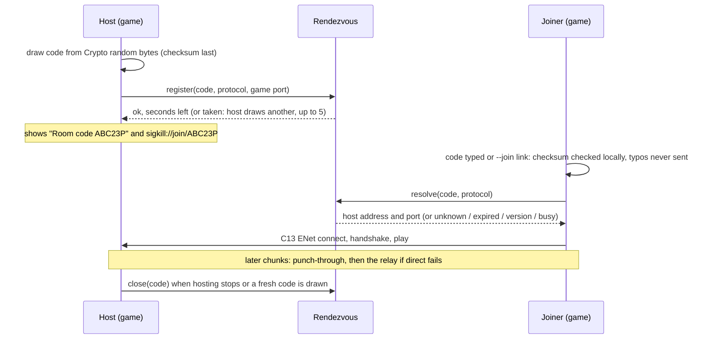

# SIGKILL relay design

Room codes and invite links (PRD 5.1, chunk C15): a tiny rendezvous that turns a 6-character
code into a host's address, NAT punch-through so most players connect directly, and a
fallback relay for the rest.

**Status: design only.** The game's client side is built (C15) and tested against an
in-process fake on 127.0.0.1. The game's only real rendezvous is `NullRendezvous`, which is
never live and sends nothing. No service exists, no account has been made, nothing has been
paid for.

## The three parts

| Part | Job | Traffic |
|---|---|---|
| Rendezvous | Holds `code -> host address and game port` for a few minutes | A handful of tiny datagrams per match |
| Punch-through | Tells each side the other's public address so both can open a path through their NATs at the same moment | A few probe datagrams per match |
| Fallback relay | Forwards the game's own ENet datagrams between two players who cannot reach each other directly | The whole match, for those players only |

The rendezvous is the only part the client side talks to today, and only through the
`RendezvousClient` interface (`scripts/net/rendezvous_client.gd`). Punch-through and the relay
are later chunks, after hosting is decided.

## What crosses the wire

To the rendezvous, ever:

- the room code (6 characters),
- the game's protocol version,
- from a host, its game port.

The host's address is the one the rendezvous sees the request come from; the game never
sends one. Never a user or host name, a path, anything about the AI guide, player names,
positions or any other player data. The session enforces this by calling only
`register(code, protocol, port)`, `resolve(code, protocol)` and `close(code, protocol, port)`,
and the room test checks every request the fake receives.

From the rendezvous, to a joiner: the address and game port it holds for the code, the
seconds the code has left, or an error word (`unknown`, `expired`, `version`, `taken`,
`busy`). The joiner then connects with the C13 path (ENet, the C13 handshake, the C14
combat), exactly as if the address had been typed.

Until hosting is decided, the game follows a room code only to this machine, a private LAN
or a tailnet (`local_address()` in `scripts/net/net_session.gd`: IPv4 loopback, 10/8,
172.16/12, 192.168/16, the 100.64/10 shared range, link-local; IPv6 loopback, fc00::/7,
fe80::/10). A rendezvous that names any other address gets "that room is outside your LAN or
tailnet; online rooms aren't live yet" and no connection is made. Internet play means lifting
that rule on purpose, together with the hosting decision.

### Wire format (as the test fake speaks it)

Request, 14 bytes, fixed: `"SR"`, wire version `1`, op (`1` register, `2` resolve, `3` close),
the code in ASCII (6 bytes), the protocol version (u16), the game port (u16, `0` when
resolving). There is no room in it for anything else.

Reply: `"SR"`, `1`, status (`0` ok, `1` unknown, `2` expired, `3` version, `4` taken, `5` busy),
the code (echoed, so a late reply is never mistaken for another), the host's protocol
(u16), the port (u16), seconds left (u32), then the address as the rendezvous saw it
(u8 length, ASCII).

Before a real service exists, two changes are required: requests are padded to at least
the size of the largest reply, so a spoofed request can never make the service send more
bytes than it received (no amplification); and the service adds a cookie round trip (as
below) before it believes a source address.

## Message flow

### Punch-through (later chunk)

Godot 4.7's `ENetConnection.socket_send(destination_address, destination_port, packet)` sends
a raw datagram from the very socket ENet listens on, which opens the NAT mapping the other
player's packets need. The plan:

1. The host and the joiner each send one small probe to the rendezvous from their ENet
   socket (`socket_send`), carrying the code. The rendezvous records the public address
   and port it saw for each.
2. The rendezvous tells each side the other's public address and port over the control
   channel.
3. Both sides `socket_send` a few probes at each other for a second or two, then the joiner
   connects with ENet to the host's public address and port.
4. If no connection is up after a timeout, the pair falls back to the relay.

This has to be proven on two real networks before anything is built on it; symmetric NATs
and some carrier NATs defeat it, which is what the relay is for.

### Fallback relay (later chunk)

The relay gives each player of a room a port of its own and forwards ENet datagrams between
the two registered players of that room and nobody else. It never decodes them. ENet's
packets stay end-to-end; DTLS (`dtls_server_setup` and `dtls_client_setup` are in Godot 4.7's
`ENetConnection`) can encrypt them past the relay later.

## Code lifecycle and expiry

- **Drawn by the host,** from the engine's cryptographic random bytes, never from a name, an
  address or the time (`scripts/net/room_code.gd`). 6 characters from 2-9 and A-Z without I,
  L and O; the last is a checksum, so a typo or a swapped pair is caught on the player's
  machine and never sent. 31^5, about 28.6 million, codes.
- **Registered** with the game port. A code already held by a live room is answered `taken`
  and the host draws another, up to `RoomTuning.register_attempts` (5). A registration the
  host stops waiting for (it leaves first, or the answer never comes) is released all the
  same, and an answer that gives a code no time is refused and released.
- **Lives** for the rendezvous's TTL, 10 minutes by default, capped on the game side by
  `RoomTuning.code_ttl_s` (600 s). The host shows the time left, then releases the code and
  draws a fresh one, so an old invite stops working.
- **Single room.** One code points to one room, and a room has one live code at a time. A
  code is released when the host stops hosting or draws a fresh one; only the address and
  port that registered it may release it.
- **Expired codes** answer `expired` (not `unknown`) for a short while so a late joiner learns
  to ask for a new one, then they are forgotten.

## Rate limits and abuse

Proposed limits, to be tuned from measurements once a service exists:

- **Per source address:** a few registrations a minute, a few dozen resolutions a minute, and
  a ceiling on live rooms. Over the limit: `busy`, never an error with details.
- **Guessing codes:** with about 28.6 million codes, a small number of live rooms and the
  resolution limit, a guesser finds a room rarely. Codes with a bad checksum are counted
  as abuse signals, since the game never sends one.
- **Spoofed sources (UDP):** replies go only to the source address of the request; a cookie
  round trip (the service answers a first request with a short-lived token the client must
  echo) before a source counts as real; requests padded so the service never amplifies.
- **The relay** forwards only between the two registered players of a room, caps bandwidth
  per room, drops rooms idle for a minute, and never carries anything to any other address.

## What is logged

Nothing personal. Aggregate counters only: requests per minute, live rooms, relayed bytes,
limits hit. Source addresses and the code-to-address table live in memory only, for the
code's life and the rate-limit window, and are never written to disk or a log. No user or
host names exist anywhere in the service, because the game never sends any.

## Privacy

- A joiner learns the host's public address, exactly as with LAN join by address today. The
  relay, once it exists, can hide each player's address from the other.
- An address is personal data in some places. The service keeps it in memory only, for at
  most the code's life (10 minutes) or the match it relays.
- Nothing about the AI guide, the player's machine or their files ever goes near any of this.

## Failure modes

| What fails | What the player sees | What still works |
|---|---|---|
| No rendezvous configured (today) | "Online rooms aren't live yet. Use LAN join (address)." | LAN and tailnet join by address |
| Rendezvous down or unreachable | "couldn't reach the room service" after the request timeout (4 s) | LAN and tailnet join |
| Rendezvous over its limits | "the room service is busy: try again in a moment" | The same |
| Code mistyped | "room code K7R2MZ has a typo: check each character", nothing sent | Typing it again |
| Code unknown | "no open room with code K7R2MX" | Asking the host again |
| Code expired | "room code ... has expired: ask the host for a new one" | The host's fresh code |
| Host on another version | "version mismatch: host X, you Y", before any connection | Updating |
| Host stops hosting | Its code is released; joiners in the room see "host left" (C13) | Hosting again |
| Every code drawn is taken | The host keeps hosting; "no room code (every code drawn was taken): LAN join by address still works" | LAN join |
| Punch-through fails | (later) the relay takes over | |
| Relay down | (later) "couldn't reach host" (C13) | LAN join |
| Reply lost (UDP) | The request timeout; nothing is left in flight | Trying again |

## Hosting cost

Three options. Every price below is quoted from the provider's public pricing page, read on
2026-10-26, as written there. Relay traffic per match has not been measured yet: it has to be
measured on a real two-machine match before any monthly figure can be estimated, so none is
given here.

### Option 1: one small cloud server (Hetzner Cloud)

Runs all three parts, UDP included, on one machine.

- Cheapest shared-vCPU plan on the cost-optimized page, CX23 (2 vCPU, 4 GB RAM, 40 GB NVMe),
  for the Germany and Finland locations: from "€ 5.99 per month, excl. VAT", or
  "€ 0.0096 per hour, excl. VAT".
- Traffic: "Cloud servers located in the EU include at least 20 TB of included traffic."
  US servers: "include at least 1 TB of included traffic." The price of each additional
  terabyte is drawn on the page by a script; the page's static text for it reads
  "€ 1.00 per hour, excl. VAT", which cannot be a per-terabyte price, so extra traffic is
  unpriced here: Fred decides.
- The plan cards say "Price incl. IPv4".
- On the day it was read, every plan card on the page said "This product is currently
  unavailable. Please check back later."
- Source: https://www.hetzner.com/cloud/cost-optimized/ (read 2026-10-26).

### Option 2: a small machine on Fly.io

Runs all three parts; UDP needs a dedicated IPv4 address.

- "Started Machine, shared-cpu-1x with 256MB RAM", "$2.19/month", "Billed by the second while
  running"; "Monthly Machine prices assume 30 days of continuous runtime." Machine prices
  vary by region; that figure is for their lowest-priced regions.
- Outbound data: "$0.02/GB in North America and Europe" ("Inbound data is free").
- "Dedicated IPv4 addresses are $2/mo." The UDP page says "You need a dedicated IPv4
  address." and that a shared IPv4 address or an IPv6 address cannot be used for UDP.
- The pricing page's answer to "Is there a free tier?" is "No."
- Sources: https://docs.fly.io/about/pricing and https://docs.fly.io/networking/udp-and-tcp
  (both read 2026-10-26).

### Option 3: the rendezvous alone on Cloudflare Workers

Holds the code table over HTTPS (Workers and Durable Objects). Workers cannot relay raw UDP,
so punch-through probes and the relay would need one of the options above; this option only
covers the rendezvous.

- Workers Paid: "a minimum charge of $5 USD per month for an account"; requests "10 million
  included per month", "+$0.30 per additional million". Free plan: "100,000 per day"
  requests. "There are no additional charges for data transfer (egress) or throughput
  (bandwidth)."
- Durable Objects on the Paid plan: requests "1 million / month, + $0.15/million".
- Sources: https://developers.cloudflare.com/workers/platform/pricing/ and
  https://developers.cloudflare.com/durable-objects/platform/pricing/ (both read
  2026-10-26).

### Not priced

The relay's monthly traffic, and so its cost on any option: unpriced, Fred decides (after a
measured match). Taxes: the Hetzner prices exclude VAT; the Fly.io and Cloudflare pages read
did not state tax terms. Anything else: unpriced, Fred decides.

Nothing is deployed. Hosting waits for Fred's decision.
